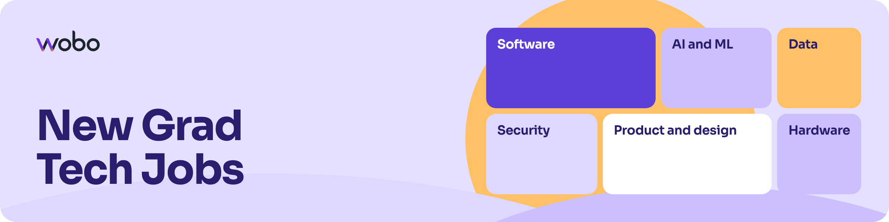

# <a href="#entry-level-software-jobs"><picture><source media="(prefers-color-scheme: dark)" srcset="assets/banner-dark.png"></picture></a>

**676 open new grad and entry-level tech jobs in the US for 2026 and 2027 graduates**, kept by Wobo. Read from employers' own career sites; the list is rebuilt every hour (last update Nov 22, 2026, 2:46 pm ET). Entry level here means a first job: no internships, no senior titles. Each role opens on wobo.ai, where you can read the job and apply.

> [!TIP]
> **Tired of applying one by one?** [Let Wobo apply for you](https://www.wobo.ai/?utm_source=github&utm_medium=list&utm_campaign=new-grad&utm_content=tip), with a resume tailored to each job. Free to start.

**Sections:** [Software](#entry-level-software-jobs) (245) · [AI and ML](#entry-level-ai-and-ml-jobs) (47) · [Data](#entry-level-data-jobs) (50) · [Security](#entry-level-security-jobs) (35) · [Product and design](#entry-level-product-and-design-jobs) (13) · [Hardware](#entry-level-hardware-jobs) (286) · [About this list](#about-this-list)

🎓 Graduate degree required · <kbd>clearance</kbd> US security clearance required

## Entry-level software jobs

| Company | Role | Location | Pay | Posted |
| :-- | :-- | :-- | :-- | :-- |
| **Monarch Investment and Management Group** | [Junior Applications Developer](https://www.wobo.ai/job/junior-applications-developer-at-monarch-investment-and-management-group-sgl7fpxdy/?utm_source=github&utm_medium=list&utm_campaign=new-grad) | Franktown, CO | \$70K to \$90K/yr | Nov&nbsp;21 |
| **Katmai** | [Information Management Specialist (Sharepoint Developer Jr.)](https://www.wobo.ai/job/information-management-specialist-sharepoint-developer-jr-at-katmai-sdc5oq199/?utm_source=github&utm_medium=list&utm_campaign=new-grad) <kbd>clearance</kbd> | Quantico, VA | \$90K to \$99K/yr | Nov&nbsp;21 |
| **Dsn** | [(1121223) Embedded Software Engineer- Entry Level role](https://www.wobo.ai/job/1121223-embedded-software-engineer-entry-level-role-at-dsn-sdc5jyqrp/?utm_source=github&utm_medium=list&utm_campaign=new-grad) | Mossville, IL | \$75K to \$80K/yr | Nov&nbsp;21 |
| **MiniMed** | [Software Test Engineer I](https://www.wobo.ai/job/software-test-engineer-i-at-minimed-shgewkppk/?utm_source=github&utm_medium=list&utm_campaign=new-grad) | Northridge, CA | \$63K to \$107K/yr | Nov&nbsp;20 |
| **Cisco** | [Software Engineer – India ComSec (NCCS) Hybrid](https://www.wobo.ai/job/software-engineer-india-comsec-nccs-hybrid-at-cisco-selw8w1kx/?utm_source=github&utm_medium=list&utm_campaign=new-grad) | NC (hybrid) | \$103K to \$147K/yr | Nov&nbsp;20 |
| **Morgan & Morgan, P.A.** | [Case Developer](https://www.wobo.ai/job/case-developer-at-morgan-morgan-pa-scuf3de1p/?utm_source=github&utm_medium=list&utm_campaign=new-grad) | Longwood, FL | \$18/hr | Nov&nbsp;20 |
| **Oracle** | [Spring 2027 Start - Undergrad Software Engineer - Oracle Cloud Infrastructure (OCI) - Nashville, TN](https://www.wobo.ai/job/spring-2027-start-undergrad-software-engineer-oracle-cloud-infrastructure-oci-nashville-sbq4yi72a/?utm_source=github&utm_medium=list&utm_campaign=new-grad) | Nashville, TN |  | Nov&nbsp;20 |
| **Anduril Industries** | [Radar Systems Engineer, Early Career](https://www.wobo.ai/job/radar-systems-engineer-early-career-at-anduril-industries-sd0fwoz7v/?utm_source=github&utm_medium=list&utm_campaign=new-grad) <kbd>clearance</kbd> | Costa Mesa, CA | \$117K to \$150K/yr | Nov&nbsp;20 |
| ↳ | [RF Integration Systems Engineer, Early Career](https://www.wobo.ai/job/rf-integration-systems-engineer-early-career-at-anduril-industries-sd0fxd3wi/?utm_source=github&utm_medium=list&utm_campaign=new-grad) <kbd>clearance</kbd> | Costa Mesa, CA | \$117K to \$150K/yr | Nov&nbsp;20 |
| ↳ | [Mission Systems Engineer, Early Career](https://www.wobo.ai/job/mission-systems-engineer-early-career-at-anduril-industries-sd0fk1a32/?utm_source=github&utm_medium=list&utm_campaign=new-grad) <kbd>clearance</kbd> | Costa Mesa, CA | \$117K to \$150K/yr | Nov&nbsp;20 |
| **MetaPhase Consulting** | [Junior Forward Deployed Engineer](https://www.wobo.ai/job/junior-forward-deployed-engineer-at-metaphase-consulting-sb6vpohhm/?utm_source=github&utm_medium=list&utm_campaign=new-grad) | Reston, VA | \$85K to \$115K/yr | Nov&nbsp;20 |
| ↳ | [Junior Application Developer (Power Platform) for TBM](https://www.wobo.ai/job/junior-application-developer-power-platform-for-tbm-at-metaphase-consulting-sb6vmj8mh/?utm_source=github&utm_medium=list&utm_campaign=new-grad) | Washington, DC | \$80K to \$100K/yr | Nov&nbsp;20 |
| **Journal Technologies** | [Junior Data Integration Developer](https://www.wobo.ai/job/junior-data-integration-developer-at-journal-technologies-sah3txbvm/?utm_source=github&utm_medium=list&utm_campaign=new-grad) | Los Angeles, CA +1 |  | Nov&nbsp;20 |
| **Aerospace** | [Systems Engineer I - Next Generation Integrated Avionics](https://www.wobo.ai/job/systems-engineer-i-next-generation-integrated-avionics-at-aerospace-saguyhp10/?utm_source=github&utm_medium=list&utm_campaign=new-grad) | Phoenix, AZ (hybrid) |  | Nov&nbsp;20 |
| **University of Maryland** | [IT Platform Engineer Junior, Collaboration / eMail](https://www.wobo.ai/job/it-platform-engineer-junior-collaborationemail-at-university-of-maryland-selxec8tw/?utm_source=github&utm_medium=list&utm_campaign=new-grad) | MD | \$92K to \$110K/yr | Nov&nbsp;19 |
| **Technology Service Corporation** | [Software Engineer I](https://www.wobo.ai/job/software-engineer-i-at-technology-service-corporation-scrx1g3uz/?utm_source=github&utm_medium=list&utm_campaign=new-grad) <kbd>clearance</kbd> | Huntsville, AL +1 |  | Nov&nbsp;19 |
| **Parsons** | [Associate Software Engineer](https://www.wobo.ai/job/associate-software-engineer-at-parsons-sexpxlxif/?utm_source=github&utm_medium=list&utm_campaign=new-grad) | Remote (US) | \$64K to \$111K/yr | Nov&nbsp;19 |
| **Medtronic** | [Software Engineer I - CRM](https://www.wobo.ai/job/software-engineer-i-crm-at-medtronic-ses2g8ixn/?utm_source=github&utm_medium=list&utm_campaign=new-grad) | Mounds View, MN | \$74K to \$112K/yr | Nov&nbsp;19 |
| **L-Acoustics** | [L-ISA Studio Junior Application Engineer - Rock Lititz](https://www.wobo.ai/job/l-isa-studio-junior-application-engineer-rock-lititz-at-l-acoustics-scsvfcxsl/?utm_source=github&utm_medium=list&utm_campaign=new-grad) | Lititz, PA |  | Nov&nbsp;19 |
| **Insperity** | [Associate Software Implementation Analyst](https://www.wobo.ai/job/associate-software-implementation-analyst-at-insperity-scse4iffj/?utm_source=github&utm_medium=list&utm_campaign=new-grad) | Kingwood, TX (hybrid) |  | Nov&nbsp;19 |
| **GDIT** | [Junior Scala Back-End Developer](https://www.wobo.ai/job/junior-scala-back-end-developer-at-gdit-s9wu1ac2p/?utm_source=github&utm_medium=list&utm_campaign=new-grad) | Any Location (remote) | \$89K to \$121K/yr | Nov&nbsp;19 |
| **Amentum** | [Junior Systems Engineer/Analyst](https://www.wobo.ai/job/junior-systems-engineeranalyst-at-amentum-sciv7edrb/?utm_source=github&utm_medium=list&utm_campaign=new-grad) <kbd>clearance</kbd> | Dahlgren, VA | \$70K to \$120K/yr | Nov&nbsp;19 |
| **Arva Intelligence** | [Junior DevOps Engineer](https://www.wobo.ai/job/junior-devops-engineer-at-arva-intelligence-s5vznxnut/?utm_source=github&utm_medium=list&utm_campaign=new-grad) | Houston, TX (hybrid) | \$85K to \$100K/yr | Nov&nbsp;19 |
| **Redwood Credit Union** | [DevOps Engineer I](https://www.wobo.ai/job/devops-engineer-i-at-redwood-credit-union-sdwzpotg8/?utm_source=github&utm_medium=list&utm_campaign=new-grad) | Napa, CA | \$101K to \$118K/yr | Nov&nbsp;19 |
| **Sopra Steria** | [Embedded Software Verification Engineer (Entry Level)](https://www.wobo.ai/job/embedded-software-verification-engineer-entry-level-at-sopra-steria-sci7yu8vk/?utm_source=github&utm_medium=list&utm_campaign=new-grad) | Platteville, WI (remote) |  | Nov&nbsp;19 |
| **Formlabs** | [Embedded Software Engineer - Entry Level](https://www.wobo.ai/job/embedded-software-engineer-entry-level-at-formlabs-s65qbwekk/?utm_source=github&utm_medium=list&utm_campaign=new-grad) | Boston, MA | \$110K to \$140K/yr | Nov&nbsp;19 |
| **York Space Systems** | [Ground Software Engineer Junior](https://www.wobo.ai/job/ground-software-engineer-junior-at-york-space-systems-s10ovu46g/?utm_source=github&utm_medium=list&utm_campaign=new-grad) | Denver, CO (hybrid) |  | Nov&nbsp;19 |
| **The Home Depot** | [Systems Engineer (Remote)](https://www.wobo.ai/job/systems-engineer-remote-at-the-home-depot-sbx1yzpx3/?utm_source=github&utm_medium=list&utm_campaign=new-grad) | Remote (US) | \$50K to \$130K/yr | Nov&nbsp;18 |
| **Technology Service Corporation** | [Systems Engineer I](https://www.wobo.ai/job/systems-engineer-i-at-technology-service-corporation-s3xhytd7l/?utm_source=github&utm_medium=list&utm_campaign=new-grad) | Silver Spring, MD +1 | \$83K to \$108K/yr | Nov&nbsp;18 |
| **Southern New Hampshire University** | [ServiceNow Software Developer I](https://www.wobo.ai/job/servicenow-software-developer-i-at-southern-new-hampshire-university-s42a3po6u/?utm_source=github&utm_medium=list&utm_campaign=new-grad) | Remote (US) | \$88K to \$141K/yr | Nov&nbsp;18 |
| **Nordstrom** | [Associate Product Developer - Women's Active and Specialized, Hybrid (Seattle, WA)](https://www.wobo.ai/job/associate-product-developer-womens-active-and-specialized-hybrid-seattle-wa-at-nordstrom-sciyzu716/?utm_source=github&utm_medium=list&utm_campaign=new-grad) | Seattle, WA (hybrid) | \$69K to \$111K/yr | Nov&nbsp;18 |
| **Hewlett Packard Enterprise** | [Systems / Software Engineer I Graduate](https://www.wobo.ai/job/systems-software-engineer-i-graduate-at-hewlett-packard-enterprise-s7u1yao40/?utm_source=github&utm_medium=list&utm_campaign=new-grad) | Sunnyvale, CA | \$84K to \$170K/yr | Nov&nbsp;18 |
| ↳ | [Customer Systems Engineer Graduate](https://www.wobo.ai/job/customer-systems-engineer-graduate-at-hewlett-packard-enterprise-s7u1p76l2/?utm_source=github&utm_medium=list&utm_campaign=new-grad) | Roseville, CA (hybrid) | \$34 to \$52/hr | Nov&nbsp;18 |
| **GE Vernova** | [GE Vernova Embedded Software Engineer](https://www.wobo.ai/job/ge-vernova-embedded-software-engineer-at-ge-vernova-s8fp8kc59/?utm_source=github&utm_medium=list&utm_campaign=new-grad) | VA | \$72K to \$108K/yr | Nov&nbsp;18 |
| **Frost Bank** | [Engineer I - DevOps](https://www.wobo.ai/job/engineer-i-devops-at-frost-bank-s3ezsrx8y/?utm_source=github&utm_medium=list&utm_campaign=new-grad) | San Antonio, TX |  | Nov&nbsp;18 |
| **Chewy** | [Software Engineer I](https://www.wobo.ai/job/software-engineer-i-at-chewy-s60193s90/?utm_source=github&utm_medium=list&utm_campaign=new-grad) | Bellevue, WA +1 | \$93K to \$160K/yr | Nov&nbsp;18 |
| **Bracco** | [Software Engineer I - Bracco Medical Technologies](https://www.wobo.ai/job/software-engineer-i-bracco-medical-technologies-at-bracco-s42wk7u76/?utm_source=github&utm_medium=list&utm_campaign=new-grad) | United States | \$90K to \$105K/yr | Nov&nbsp;18 |
| **Bexar County** | [Applications Developer I](https://www.wobo.ai/job/applications-developer-i-at-bexar-county-s3mkwpbho/?utm_source=github&utm_medium=list&utm_campaign=new-grad) | TX (hybrid) | \$72K to \$86K/yr | Nov&nbsp;18 |
| **Abbott** | [Software Development Quality Engineer I](https://www.wobo.ai/job/software-development-quality-engineer-i-at-abbott-s8vsnfpkc/?utm_source=github&utm_medium=list&utm_campaign=new-grad) | Sylmar, CA | \$74K to \$116K/yr | Nov&nbsp;18 |
| **Cummins** | [EATON - Electronic Systems Engineer - Software](https://www.wobo.ai/job/eaton-electronic-systems-engineer-software-at-cummins-rxtozg7jf/?utm_source=github&utm_medium=list&utm_campaign=new-grad) | Galesburg, MI |  | Nov&nbsp;18 |
| **Thorlabs** | [Photonics Systems Engineer I](https://www.wobo.ai/job/photonics-systems-engineer-i-at-thorlabs-rwsafivy1/?utm_source=github&utm_medium=list&utm_campaign=new-grad) 🎓 | Newton, NJ | \$99K to \$105K/yr | Nov&nbsp;18 |
| **Bask Health** | [Associate Solutions Engineer, New Grad](https://www.wobo.ai/job/associate-solutions-engineer-new-grad-at-bask-health-rwr1au8c8/?utm_source=github&utm_medium=list&utm_campaign=new-grad) | Remote (US) |  | Nov&nbsp;18 |
| **MetaPhase Consulting** | [Junior ServiceNow Developer](https://www.wobo.ai/job/junior-servicenow-developer-at-metaphase-consulting-rwe2stk3g/?utm_source=github&utm_medium=list&utm_campaign=new-grad) | Remote (US) |  | Nov&nbsp;18 |
| **SAIC** | [MACH-TB Junior Mission Systems Engineer](https://www.wobo.ai/job/mach-tb-junior-mission-systems-engineer-at-saic-rvnw4o9mu/?utm_source=github&utm_medium=list&utm_campaign=new-grad) | Crane, IN |  | Nov&nbsp;18 |
| **Twitch** | [Software Engineer I, Commerce](https://www.wobo.ai/job/software-engineer-i-commerce-at-twitch-rxesfgysl/?utm_source=github&utm_medium=list&utm_campaign=new-grad) | Seattle, WA +1 | \$111K to \$160K/yr | Nov&nbsp;17 |
| **Sierra Nevada Corporation** | [Software Engineer I](https://www.wobo.ai/job/software-engineer-i-at-sierra-nevada-corporation-rylnkusbh/?utm_source=github&utm_medium=list&utm_campaign=new-grad) <kbd>clearance</kbd> | Lone Tree, CO (hybrid) | \$86K to \$118K/yr | Nov&nbsp;17 |
| **RTX** | [Software Engineer I (Onsite)](https://www.wobo.ai/job/software-engineer-i-onsite-at-rtx-rxu5q666k/?utm_source=github&utm_medium=list&utm_campaign=new-grad) <kbd>clearance</kbd> | St. Petersburg, FL +2 | \$69K to \$131K/yr | Nov&nbsp;17 |
| **Rocket Companies** | [Software Engineer I](https://www.wobo.ai/job/software-engineer-i-at-rocket-companies-ry5ueomy8/?utm_source=github&utm_medium=list&utm_campaign=new-grad) | Detroit, MI |  | Nov&nbsp;17 |
| **Roche** | [Software Engineer I](https://www.wobo.ai/job/software-engineer-i-at-roche-rzjxz546m/?utm_source=github&utm_medium=list&utm_campaign=new-grad) | Boston, MA (hybrid) | \$90K to \$166K/yr | Nov&nbsp;17 |
| **Northwestern Mutual** | [Software Engineer I](https://www.wobo.ai/job/software-engineer-i-at-northwestern-mutual-rzcil3tdx/?utm_source=github&utm_medium=list&utm_campaign=new-grad) | Milwaukee, WI (hybrid) | \$76K to \$113K/yr | Nov&nbsp;17 |
| **Jet Propulsion Laboratory** | [Engineering Applications Software Engineer Level 1](https://www.wobo.ai/job/engineering-applications-software-engineer-level-1-at-jet-propulsion-laboratory-s7833jyqc/?utm_source=github&utm_medium=list&utm_campaign=new-grad) | Pasadena, CA | \$93K to \$112K/yr | Nov&nbsp;17 |
| **Relativity Space** | [Software Engineer I (Factory Platform)](https://www.wobo.ai/job/software-engineer-i-factory-platform-at-relativity-space-rxfnytewy/?utm_source=github&utm_medium=list&utm_campaign=new-grad) | Long Beach, CA | \$115K to \$173K/yr | Nov&nbsp;17 |
| **Mirantis** | [Software Engineer, Backend (Go)](https://www.wobo.ai/job/software-engineer-backend-go-at-mirantis-rx3k6xmsh/?utm_source=github&utm_medium=list&utm_campaign=new-grad) | Raleigh, NC |  | Nov&nbsp;17 |
| **Kiva Confections** | [Junior Developer](https://www.wobo.ai/job/junior-developer-at-kiva-confections-rxh0iqjat/?utm_source=github&utm_medium=list&utm_campaign=new-grad) | New York City, NY (remote) |  | Nov&nbsp;17 |
| **GRVTY** | [Cloud Engineer Jr](https://www.wobo.ai/job/cloud-engineer-jr-at-grvty-s3911z9yi/?utm_source=github&utm_medium=list&utm_campaign=new-grad) <kbd>clearance</kbd> | Springfield, VA | \$135K to \$148K/yr | Nov&nbsp;17 |
| **Benchling** | [Software Engineer, CDC](https://www.wobo.ai/job/software-engineer-cdc-at-benchling-rwg44ecr6/?utm_source=github&utm_medium=list&utm_campaign=new-grad) | San Francisco, CA (hybrid) |  | Nov&nbsp;17 |
| **Cummins Apprenticeship** | [Combustion and Emissions Systems Engineer](https://www.wobo.ai/job/combustion-and-emissions-systems-engineer-at-cummins-apprenticeship-rtyoxw4wz/?utm_source=github&utm_medium=list&utm_campaign=new-grad) | Columbus, IN |  | Nov&nbsp;17 |
| **Fortinet** | [Early Careers: Software Developer Engineer](https://www.wobo.ai/job/early-careers-software-developer-engineer-at-fortinet-rtwgev3h8/?utm_source=github&utm_medium=list&utm_campaign=new-grad) | Sunnyvale, CA (hybrid) | \$79K to \$97K/yr | Nov&nbsp;17 |
| **SharkNinja** | [Associate Product Developer - Robots](https://www.wobo.ai/job/associate-product-developer-robots-at-sharkninja-rwzf3f006/?utm_source=github&utm_medium=list&utm_campaign=new-grad) | Needham, MA | \$56K to \$82K/yr | Nov&nbsp;17 |
| **Cla-Val** | [Junior Software Developer](https://www.wobo.ai/job/junior-software-developer-at-cla-val-rsumy8u7i/?utm_source=github&utm_medium=list&utm_campaign=new-grad) | Costa Mesa, CA |  | Nov&nbsp;17 |
| **Fantom Corporation** | [Software Engineer Level 1](https://www.wobo.ai/job/software-engineer-level-1-at-fantom-corporation-rsdrxo5t9/?utm_source=github&utm_medium=list&utm_campaign=new-grad) <kbd>clearance</kbd> | Hanover, MD |  | Nov&nbsp;17 |
| ↳ | [RF Software Engineer Level 1](https://www.wobo.ai/job/rf-software-engineer-level-1-at-fantom-corporation-rsdroqae1/?utm_source=github&utm_medium=list&utm_campaign=new-grad) | Hanover, MD |  | Nov&nbsp;17 |
| **Fantom Corporation** | [Software Engineer Level 0](https://www.wobo.ai/job/software-engineer-level-0-at-fantom-corporation-rsdrw85fa/?utm_source=github&utm_medium=list&utm_campaign=new-grad) <kbd>clearance</kbd> | Hanover, MD |  | Nov&nbsp;16 |
| **Torch Technologies** | [Entry-Level Modeling & Simulation Software Engineer](https://www.wobo.ai/job/entry-level-modeling-simulation-software-engineer-at-torch-technologies-s3affgdnu/?utm_source=github&utm_medium=list&utm_campaign=new-grad) | Huntsville, AL |  | Nov&nbsp;16 |
| ↳ | [Junior-Level Modeling & Simulation Software Engineer](https://www.wobo.ai/job/junior-level-modeling-simulation-software-engineer-at-torch-technologies-s3afebye1/?utm_source=github&utm_medium=list&utm_campaign=new-grad) <kbd>clearance</kbd> | Huntsville, AL |  | Nov&nbsp;16 |
| **Tandem Diabetes Care** | [Embedded Software Engineer I](https://www.wobo.ai/job/embedded-software-engineer-i-at-tandem-diabetes-care-rvb53tj9o/?utm_source=github&utm_medium=list&utm_campaign=new-grad) | CA (remote) | \$39 to \$49/hr | Nov&nbsp;16 |
| **Shift4** | [QA Engineer I](https://www.wobo.ai/job/qa-engineer-i-at-shift4-s65hy0f3j/?utm_source=github&utm_medium=list&utm_campaign=new-grad) | Atlanta, GA (hybrid) |  | Nov&nbsp;16 |
| **Leidos** | [High-Speed Systems Engineer](https://www.wobo.ai/job/high-speed-systems-engineer-at-leidos-ruuame3b5/?utm_source=github&utm_medium=list&utm_campaign=new-grad) <kbd>clearance</kbd> | King of Prussia, PA | \$58K to \$105K/yr | Nov&nbsp;16 |
| **Boeing** | [Associate Software Engineer - Developer](https://www.wobo.ai/job/associate-software-engineer-developer-at-boeing-rxv0pvxk0/?utm_source=github&utm_medium=list&utm_campaign=new-grad) <kbd>clearance</kbd> | Tukwila, WA | \$106K to \$144K/yr | Nov&nbsp;16 |
| **SBT Global, Inc** | [Junior Full Stack Developer - Bilingual in Korean](https://www.wobo.ai/job/junior-full-stack-developer-bilingual-in-korean-at-sbt-global-inc-rt5bin5zs/?utm_source=github&utm_medium=list&utm_campaign=new-grad) | Plano, TX | \$77K/yr | Nov&nbsp;16 |
| **CrossCountry Consulting** | [Jr. Forward Deployed Software Engineer - (VA)](https://www.wobo.ai/job/jr-forward-deployed-software-engineer-va-at-crosscountry-consulting-rse1shssg/?utm_source=github&utm_medium=list&utm_campaign=new-grad) | McLean, VA (hybrid) | \$90K to \$125K/yr | Nov&nbsp;16 |
| ↳ | [Jr. Forward Deployed Software Engineer - (GA)](https://www.wobo.ai/job/jr-forward-deployed-software-engineer-ga-at-crosscountry-consulting-rse1qkrln/?utm_source=github&utm_medium=list&utm_campaign=new-grad) | GA (hybrid) | \$90K to \$125K/yr | Nov&nbsp;16 |
| **PDW** | [Associate Software Engineer](https://www.wobo.ai/job/associate-software-engineer-at-pdw-rq3fph0u3/?utm_source=github&utm_medium=list&utm_campaign=new-grad) | Burlington, MA |  | Nov&nbsp;16 |
| **Fortinet** | [Early Careers: Embedded Software Engineer](https://www.wobo.ai/job/early-careers-embedded-software-engineer-at-fortinet-rpwrav9zh/?utm_source=github&utm_medium=list&utm_campaign=new-grad) | Sunnyvale, CA (hybrid) | \$97K to \$118K/yr | Nov&nbsp;16 |
| **The New School** | [Front End Developer & UI/UX Designer - Student Assistant Specialist](https://www.wobo.ai/job/front-end-developer-uiux-designer-student-assistant-specialist-at-the-new-school-rupzf2svs/?utm_source=github&utm_medium=list&utm_campaign=new-grad) | New York City, NY | \$16 to \$21/hr | Nov&nbsp;15 |
| **SOLV Energy** | [SCADA Systems Engineer I](https://www.wobo.ai/job/scada-systems-engineer-i-at-solv-energy-rujbs5fue/?utm_source=github&utm_medium=list&utm_campaign=new-grad) | Bend, OR | \$74K to \$92K/yr | Nov&nbsp;15 |
| **Pima County** | [ITSD - Software Engineer I](https://www.wobo.ai/job/itsd-software-engineer-i-at-pima-county-rqa9w6y54/?utm_source=github&utm_medium=list&utm_campaign=new-grad) | SUPERIOR COURT (remote) | \$65K to \$72K/yr | Nov&nbsp;15 |
| **Boeing** | [Optical Systems Engineer (Entry Level) - Millennium Space Systems](https://www.wobo.ai/job/optical-systems-engineer-entry-level-millennium-space-systems-at-boeing-rtvfq332u/?utm_source=github&utm_medium=list&utm_campaign=new-grad) <kbd>clearance</kbd> | El Segundo, CA | \$71K to \$104K/yr | Nov&nbsp;15 |
| **Aretum** | [Junior Web Developer/Engineer - Contingent](https://www.wobo.ai/job/junior-web-developerengineer-contingent-at-aretum-rijstjxra/?utm_source=github&utm_medium=list&utm_campaign=new-grad) | McLean, VA (remote) | \$75K to \$100K/yr | Nov&nbsp;14 |
| **Twitch** | [Software Engineer I, Payments](https://www.wobo.ai/job/software-engineer-i-payments-at-twitch-rj9zxvtge/?utm_source=github&utm_medium=list&utm_campaign=new-grad) | San Francisco, CA | \$127K to \$185K/yr | Nov&nbsp;13 |
| **CrossCountry Consulting** | [Jr. Forward Deployed Software Engineer - (PA)](https://www.wobo.ai/job/jr-forward-deployed-software-engineer-pa-at-crosscountry-consulting-rse1rwdkd/?utm_source=github&utm_medium=list&utm_campaign=new-grad) | Philadelphia, PA (hybrid) | \$90K to \$125K/yr | Nov&nbsp;13 |
| **Zoox** | [Contract Student Worker - Software Engineer (40hrs/wk)](https://www.wobo.ai/job/contract-student-worker-software-engineer-40hrswk-at-zoox-s1htsft16/?utm_source=github&utm_medium=list&utm_campaign=new-grad) | Foster City, CA | \$30/hr | Nov&nbsp;13 |
| **CMTelematics** | [Software Engineer I, Cloud](https://www.wobo.ai/job/software-engineer-i-cloud-at-cmtelematics-rjb5yc2iz/?utm_source=github&utm_medium=list&utm_campaign=new-grad) | Cambridge, MA (hybrid) | \$93K to \$116K/yr | Nov&nbsp;13 |
| **K Group Companies** | [Systems Engineer 1](https://www.wobo.ai/job/systems-engineer-1-at-k-group-companies-rj977k09e/?utm_source=github&utm_medium=list&utm_campaign=new-grad) | Grand Rapids, MI |  | Nov&nbsp;13 |
| **Oracle** | [Site Reliability Engineer - OCI (Start Date: Feb 2027)](https://www.wobo.ai/job/site-reliability-engineer-oci-start-date-feb-2027-at-oracle-rex0qbodg/?utm_source=github&utm_medium=list&utm_campaign=new-grad) | Nashville, TN | \$59K to \$118K/yr | Nov&nbsp;13 |
| **Shield** | [Engineer I, Software - New Grad - 6531](https://www.wobo.ai/job/engineer-i-software-new-grad-6531-at-shield-rnh3prgq0/?utm_source=github&utm_medium=list&utm_campaign=new-grad) <kbd>clearance</kbd> | Arlington, VA |  | Nov&nbsp;13 |
| **Raymond James** | [Financial Planning Software Support Analyst I](https://www.wobo.ai/job/financial-planning-software-support-analyst-i-at-raymond-james-rk94qivr8/?utm_source=github&utm_medium=list&utm_campaign=new-grad) | St. Petersburg, FL (hybrid) |  | Nov&nbsp;12 |
| **O’Reilly Auto Parts** | [Platform Engineer I (Mobile Device Management) (Onsite Role)](https://www.wobo.ai/job/platform-engineer-i-mobile-device-management-onsite-role-at-oreilly-auto-parts-rji4hcyq6/?utm_source=github&utm_medium=list&utm_campaign=new-grad) | Springfield, MO |  | Nov&nbsp;12 |
| **Nightwing** | [Junior Software Engineer (SWE0)](https://www.wobo.ai/job/junior-software-engineer-swe0-at-nightwing-s2ydvpc9f/?utm_source=github&utm_medium=list&utm_campaign=new-grad) <kbd>clearance</kbd> | Annapolis Junction, MD | \$55K to \$106K/yr | Nov&nbsp;12 |
| **Cone Health** | [Analytic Developer](https://www.wobo.ai/job/analytic-developer-at-cone-health-s60yod1gb/?utm_source=github&utm_medium=list&utm_campaign=new-grad) | Market Street - 4411 (remote) |  | Nov&nbsp;12 |
| **Shield** | [Software Development Engineer - New Graduate](https://www.wobo.ai/job/software-development-engineer-new-graduate-at-shield-rnhcovmu2/?utm_source=github&utm_medium=list&utm_campaign=new-grad) | San Diego, CA |  | Nov&nbsp;12 |
| **mthree** | [Java Developer](https://www.wobo.ai/job/java-developer-at-mthree-rfui7796y/?utm_source=github&utm_medium=list&utm_campaign=new-grad) | Boston, MA | \$66K/yr | Nov&nbsp;12 |
| **SpaceX** | [New Graduate Engineer, Aerospace Software (Starfall)](https://www.wobo.ai/job/new-graduate-engineer-aerospace-software-starfall-at-spacex-rfvjfssjp/?utm_source=github&utm_medium=list&utm_campaign=new-grad) | Hawthorne, CA | \$125K to \$160K/yr | Nov&nbsp;12 |
| **Raydar** | [Junior Frontend Engineer](https://www.wobo.ai/job/junior-frontend-engineer-at-raydar-rc7egjons/?utm_source=github&utm_medium=list&utm_campaign=new-grad) | San Francisco, CA (hybrid) | \$140K to \$205K/yr | Nov&nbsp;12 |
| **Bask Health** | [Software Engineer, Early Career](https://www.wobo.ai/job/software-engineer-early-career-at-bask-health-rb9jig48z/?utm_source=github&utm_medium=list&utm_campaign=new-grad) | Remote (US) |  | Nov&nbsp;12 |
| ↳ | [Junior Full Stack Engineer, Merchant Tools](https://www.wobo.ai/job/junior-full-stack-engineer-merchant-tools-at-bask-health-rb9iyuz23/?utm_source=github&utm_medium=list&utm_campaign=new-grad) | Remote (US) |  | Nov&nbsp;12 |
| ↳ | [Junior Full Stack Engineer](https://www.wobo.ai/job/junior-full-stack-engineer-at-bask-health-rb9ixesig/?utm_source=github&utm_medium=list&utm_campaign=new-grad) | Remote (US) |  | Nov&nbsp;12 |
| ↳ | [Junior Forward Deployed Engineer](https://www.wobo.ai/job/junior-forward-deployed-engineer-at-bask-health-rb9iw8zs8/?utm_source=github&utm_medium=list&utm_campaign=new-grad) | Remote (US) |  | Nov&nbsp;12 |
| ↳ | [Junior Backend Engineer, Platform](https://www.wobo.ai/job/junior-backend-engineer-platform-at-bask-health-rb9iuqm5t/?utm_source=github&utm_medium=list&utm_campaign=new-grad) | United States |  | Nov&nbsp;12 |
| ↳ | [Junior Backend Engineer](https://www.wobo.ai/job/junior-backend-engineer-at-bask-health-rb9it9kmm/?utm_source=github&utm_medium=list&utm_campaign=new-grad) | United States |  | Nov&nbsp;12 |
| ↳ | [Frontend Engineer, New Grad](https://www.wobo.ai/job/frontend-engineer-new-grad-at-bask-health-rb9inyffk/?utm_source=github&utm_medium=list&utm_campaign=new-grad) | Remote (US) |  | Nov&nbsp;12 |
| ↳ | [Backend Engineer, New Grad](https://www.wobo.ai/job/backend-engineer-new-grad-at-bask-health-rb9iav8wg/?utm_source=github&utm_medium=list&utm_campaign=new-grad) | United States |  | Nov&nbsp;12 |
| **Leidos** | [Jr Software Engineer](https://www.wobo.ai/job/jr-software-engineer-at-leidos-rg9gbmorv/?utm_source=github&utm_medium=list&utm_campaign=new-grad) | Gaithersburg, MD (hybrid) | \$70K to \$126K/yr | Nov&nbsp;11 |
| **Hewlett Packard Enterprise** | [Systems/Software Engineer I](https://www.wobo.ai/job/systemssoftware-engineer-i-at-hewlett-packard-enterprise-rek36jzc1/?utm_source=github&utm_medium=list&utm_campaign=new-grad) | Sunnyvale, CA | \$84K to \$171K/yr | Nov&nbsp;11 |
| **Deckers Brands** | [Associate Materials Developer - UGG Apparel & Accessories](https://www.wobo.ai/job/associate-materials-developer-ugg-apparel-accessories-at-deckers-brands-rcy6lj0ht/?utm_source=github&utm_medium=list&utm_campaign=new-grad) | Goleta, CA (hybrid) | \$31 to \$39/hr | Nov&nbsp;11 |
| **Shield** | [Engineer II, Software - Ground Control Station - Full Stack - New Grad - 6140](https://www.wobo.ai/job/engineer-ii-software-ground-control-station-full-stack-new-grad-6140-at-shield-rnh3d1wrx/?utm_source=github&utm_medium=list&utm_campaign=new-grad) <kbd>clearance</kbd> | Arlington, VA |  | Nov&nbsp;11 |
| ↳ | [Engineer II, Software - Autonomous Pilot Integration - New Grad - 6127](https://www.wobo.ai/job/engineer-ii-software-autonomous-pilot-integration-new-grad-6127-at-shield-rnh3b27ek/?utm_source=github&utm_medium=list&utm_campaign=new-grad) <kbd>clearance</kbd> | Arlington, VA |  | Nov&nbsp;11 |
| ↳ | [Engineer I, Software - Autonomous Pilot Integration - New Grad - 6125](https://www.wobo.ai/job/engineer-i-software-autonomous-pilot-integration-new-grad-6125-at-shield-rnh3nsp20/?utm_source=github&utm_medium=list&utm_campaign=new-grad) | Arlington, VA |  | Nov&nbsp;11 |
| **Rubrik** | [Software Engineer - Virtual Platform](https://www.wobo.ai/job/software-engineer-virtual-platform-at-rubrik-rc2mn4skz/?utm_source=github&utm_medium=list&utm_campaign=new-grad) | Palo Alto, CA | \$131K to \$197K/yr | Nov&nbsp;11 |
| **Zoox** | [Contract Student Worker - Software Engineer (20/hrs week)](https://www.wobo.ai/job/contract-student-worker-software-engineer-20hrs-week-at-zoox-rfqtxwf3b/?utm_source=github&utm_medium=list&utm_campaign=new-grad) | Foster City, CA | \$30/hr | Nov&nbsp;11 |
| **Edmentum** | [Software Engineer I](https://www.wobo.ai/job/software-engineer-i-at-edmentum-rc074gi5n/?utm_source=github&utm_medium=list&utm_campaign=new-grad) | Bloomington, MN (remote) | \$80K to \$100K/yr | Nov&nbsp;11 |
| **Self Financial** | [Associate Software Engineer](https://www.wobo.ai/job/associate-software-engineer-at-self-financial-rc2gtapn8/?utm_source=github&utm_medium=list&utm_campaign=new-grad) | Austin, TX (hybrid) |  | Nov&nbsp;11 |
| **Karman Space & Defense** | [Systems Engineer I](https://www.wobo.ai/job/systems-engineer-i-at-karman-space-defense-shc2desdq/?utm_source=github&utm_medium=list&utm_campaign=new-grad) | Seattle, WA | \$85K to \$110K/yr | Nov&nbsp;11 |
| **SharkNinja** | [Forward Deployed Engineer - Entry Level](https://www.wobo.ai/job/forward-deployed-engineer-entry-level-at-sharkninja-rbk9952wx/?utm_source=github&utm_medium=list&utm_campaign=new-grad) | Needham, MA | \$95K to \$125K/yr | Nov&nbsp;11 |
| **BNY** | [2027 BNY Analyst Program - Engineering (Developer) - New York, NY](https://www.wobo.ai/job/2027-bny-analyst-program-engineering-developer-new-york-ny-at-bny-r74y1sodt/?utm_source=github&utm_medium=list&utm_campaign=new-grad) | New York City, NY (hybrid) | \$52K to \$110K/yr | Nov&nbsp;11 |
| **Fortinet** | [Jr. Software QA Engineer](https://www.wobo.ai/job/jr-software-qa-engineer-at-fortinet-r6u60w25t/?utm_source=github&utm_medium=list&utm_campaign=new-grad) | Union City, CA | \$88K to \$125K/yr | Nov&nbsp;11 |
| ↳ | [Early Careers: Software Development Engineer](https://www.wobo.ai/job/early-careers-software-development-engineer-at-fortinet-r6tl83pj2/?utm_source=github&utm_medium=list&utm_campaign=new-grad) | Sunnyvale, CA | \$134K to \$220K/yr | Nov&nbsp;11 |
| ↳ | [Early Careers: Software Engineer – Cloud Platform (FortiSIEM)](https://www.wobo.ai/job/early-careers-software-engineer-cloud-platform-fortisiem-at-fortinet-r6t9eoskw/?utm_source=github&utm_medium=list&utm_campaign=new-grad) | Santa Clara, CA (hybrid) | \$110K to \$180K/yr | Nov&nbsp;11 |
| ↳ | [Software Development Engineer](https://www.wobo.ai/job/software-development-engineer-at-fortinet-r6t85zj4e/?utm_source=github&utm_medium=list&utm_campaign=new-grad) | Santa Clara, CA (hybrid) | \$123K to \$151K/yr | Nov&nbsp;11 |
| ↳ | [Early Careers: Embedded Software Developer](https://www.wobo.ai/job/early-careers-embedded-software-developer-at-fortinet-r6sxr7jz3/?utm_source=github&utm_medium=list&utm_campaign=new-grad) | Sunnyvale, CA | \$110K to \$180K/yr | Nov&nbsp;11 |
| ↳ | [Software Dev QA Engineer (Early Career/NPI)](https://www.wobo.ai/job/software-dev-qa-engineer-early-careernpi-at-fortinet-r6sxqmfle/?utm_source=github&utm_medium=list&utm_campaign=new-grad) | Sunnyvale, CA | \$75K to \$120K/yr | Nov&nbsp;11 |
| **Chubb** | [Associate Developer](https://www.wobo.ai/job/associate-developer-at-chubb-r6ql2cfmf/?utm_source=github&utm_medium=list&utm_campaign=new-grad) | Stamford, CT | \$80K to \$115K/yr | Nov&nbsp;11 |
| **Photon** | [Junior Backend Engineer - Dallas, TX](https://www.wobo.ai/job/junior-backend-engineer-dallas-tx-at-photon-r6m30b021/?utm_source=github&utm_medium=list&utm_campaign=new-grad) | Dallas, TX | \$37K to \$132K/yr | Nov&nbsp;11 |
| ↳ | [Jr. QA Engineer - Dallas, TX](https://www.wobo.ai/job/jr-qa-engineer-dallas-tx-at-photon-r6m2rol7u/?utm_source=github&utm_medium=list&utm_campaign=new-grad) | TX | \$31K to \$109K/yr | Nov&nbsp;11 |
| **NOV** | [Associate Software Engineer - Pathway (June 2027 & January 2027)](https://www.wobo.ai/job/associate-software-engineer-pathway-june-2027-january-2027-at-nov-r6ic4h6d8/?utm_source=github&utm_medium=list&utm_campaign=new-grad) | Houston, TX (hybrid) |  | Nov&nbsp;11 |
| ↳ | [Drilling Solutions Engineer - Diamond Program](https://www.wobo.ai/job/drilling-solutions-engineer-diamond-program-at-nov-r6ia0wayb/?utm_source=github&utm_medium=list&utm_campaign=new-grad) | Houston, TX |  | Nov&nbsp;11 |
| **Koniag Government Services** | [Junior Cloud Engineer](https://www.wobo.ai/job/junior-cloud-engineer-at-koniag-government-services-r57myj5tv/?utm_source=github&utm_medium=list&utm_campaign=new-grad) <kbd>clearance</kbd> | Washington, DC |  | Nov&nbsp;11 |
| ↳ | [Junior Software Engineer](https://www.wobo.ai/job/junior-software-engineer-at-koniag-government-services-r57llfs5k/?utm_source=github&utm_medium=list&utm_campaign=new-grad) <kbd>clearance</kbd> | Washington, DC (hybrid) |  | Nov&nbsp;11 |
| **ASRC Federal** | [Associate Software Engineer](https://www.wobo.ai/job/associate-software-engineer-at-asrc-federal-r4xf1rx6q/?utm_source=github&utm_medium=list&utm_campaign=new-grad) <kbd>clearance</kbd> | Moorestown, NJ +1 |  | Nov&nbsp;11 |
| ↳ | [Associate Software Integration & Test Engineer](https://www.wobo.ai/job/associate-software-integration-test-engineer-at-asrc-federal-r4xd0os1d/?utm_source=github&utm_medium=list&utm_campaign=new-grad) <kbd>clearance</kbd> | Moorestown, NJ |  | Nov&nbsp;11 |
| ↳ | [Junior Software Developer](https://www.wobo.ai/job/junior-software-developer-at-asrc-federal-r4x96bgk9/?utm_source=github&utm_medium=list&utm_campaign=new-grad) <kbd>clearance</kbd> | Suffolk, VA (hybrid) |  | Nov&nbsp;11 |
| **Vitu** | [Software Engineer I](https://www.wobo.ai/job/software-engineer-i-at-vitu-r4kmsfrkw/?utm_source=github&utm_medium=list&utm_campaign=new-grad) | Remote (US) | \$64K to \$74K/yr | Nov&nbsp;11 |
| **Twenty-Six Defense** | [Software Engineer I](https://www.wobo.ai/job/software-engineer-i-at-twenty-six-defense-r4jsvovx4/?utm_source=github&utm_medium=list&utm_campaign=new-grad) | Roanoke, VA |  | Nov&nbsp;11 |
| ↳ | [Software Automation Engineer I](https://www.wobo.ai/job/software-automation-engineer-i-at-twenty-six-defense-r4jsnb969/?utm_source=github&utm_medium=list&utm_campaign=new-grad) | Roanoke, VA |  | Nov&nbsp;11 |
| **York Space Systems** | [Junior Software Test Automation Engineer](https://www.wobo.ai/job/junior-software-test-automation-engineer-at-york-space-systems-r47urrpat/?utm_source=github&utm_medium=list&utm_campaign=new-grad) <kbd>clearance</kbd> | Greenwood Village, CO |  | Nov&nbsp;11 |
| ↳ | [Embedded Flight Software Engineer (Early Career)](https://www.wobo.ai/job/embedded-flight-software-engineer-early-career-at-york-space-systems-r47uojuzl/?utm_source=github&utm_medium=list&utm_campaign=new-grad) <kbd>clearance</kbd> | Greenwood Village, CO |  | Nov&nbsp;11 |
| **The Citco Group Limited** | [Junior Application Engineer](https://www.wobo.ai/job/junior-application-engineer-at-the-citco-group-limited-r41j5khv5/?utm_source=github&utm_medium=list&utm_campaign=new-grad) | Charlotte, NC |  | Nov&nbsp;11 |
| **Evergreen Goodwill** | [Systems Engineer I](https://www.wobo.ai/job/systems-engineer-i-at-evergreen-goodwill-r3n82pyn9/?utm_source=github&utm_medium=list&utm_campaign=new-grad) | Seattle, WA (hybrid) | \$85K to \$90K/yr | Nov&nbsp;11 |
| **American Bureau of Shipping** | [Engineer I, DevOps](https://www.wobo.ai/job/engineer-i-devops-at-american-bureau-of-shipping-r36n439xb/?utm_source=github&utm_medium=list&utm_campaign=new-grad) | Houston, TX (hybrid) |  | Nov&nbsp;11 |
| **Sinclair Broadcast Group** | [Contract Associate Engineer, Software Development](https://www.wobo.ai/job/contract-associate-engineer-software-development-at-sinclair-broadcast-group-r32xqiaas/?utm_source=github&utm_medium=list&utm_campaign=new-grad) | Seattle, WA | \$83K/yr | Nov&nbsp;11 |
| **DTCC** | [Application Developer Analyst \[2027 EDGE Program\]](https://www.wobo.ai/job/application-developer-analyst-2027-edge-program-at-dtcc-r2rzwkne9/?utm_source=github&utm_medium=list&utm_campaign=new-grad) | Jersey City, NJ (hybrid) |  | Nov&nbsp;11 |
| **Shelby County** | [Programmer Analyst I (Planning & Development)](https://www.wobo.ai/job/programmer-analyst-i-planning-development-at-shelby-county-r2p5c2ha1/?utm_source=github&utm_medium=list&utm_campaign=new-grad) | Memphis, TN |  | Nov&nbsp;11 |
| **Oracle** | [February 2027 - Undergrad Software Engineer - Oracle Cloud Infrastructure (OCI) - Nashville, TN](https://www.wobo.ai/job/february-2027-undergrad-software-engineer-oracle-cloud-infrastructure-oci-nashville-tn-at-r2i6m6ssr/?utm_source=github&utm_medium=list&utm_campaign=new-grad) | Nashville, TN | \$74K to \$148K/yr | Nov&nbsp;11 |
| **Emergent Holdings** | [Infrastructure Engineer I](https://www.wobo.ai/job/infrastructure-engineer-i-at-emergent-holdings-r2ggf0s57/?utm_source=github&utm_medium=list&utm_campaign=new-grad) | Lansing, MI (remote) | \$57K to \$115K/yr | Nov&nbsp;11 |
| **Verisk** | [DevOps Engineer I](https://www.wobo.ai/job/devops-engineer-i-at-verisk-r2djdifv5/?utm_source=github&utm_medium=list&utm_campaign=new-grad) | Holmdel, NJ (hybrid) |  | Nov&nbsp;11 |
| **Mars** | [Junior Java Developer](https://www.wobo.ai/job/junior-java-developer-at-mars-r1x6tbjtb/?utm_source=github&utm_medium=list&utm_campaign=new-grad) | Seattle, WA |  | Nov&nbsp;11 |
| **EXL** | [Junior Developer](https://www.wobo.ai/job/junior-developer-at-exl-r1n3aziuh/?utm_source=github&utm_medium=list&utm_campaign=new-grad) | Remote (US) | \$45K to \$55K/yr | Nov&nbsp;11 |
| **AST SpaceMobile** | [RF Systems Engineer (Antenna and Ground Stations)](https://www.wobo.ai/job/rf-systems-engineer-antenna-and-ground-stations-at-ast-spacemobile-s35hblwbc/?utm_source=github&utm_medium=list&utm_campaign=new-grad) | Dallas, TX | \$90K to \$97K/yr | Nov&nbsp;10 |
| **ZT Systems** | [Test Software Developer](https://www.wobo.ai/job/test-software-developer-at-zt-systems-r90h5t7lq/?utm_source=github&utm_medium=list&utm_campaign=new-grad) | Secaucus, NJ | \$82K to \$110K/yr | Nov&nbsp;10 |
| **Vinik Sports Group** | [Software Engineer I](https://www.wobo.ai/job/software-engineer-i-at-vinik-sports-group-r9g6soe48/?utm_source=github&utm_medium=list&utm_campaign=new-grad) | Tampa, FL (hybrid) |  | Nov&nbsp;10 |
| **Tandem Diabetes Care** | [Software Test Engineer I (Systems Test)](https://www.wobo.ai/job/software-test-engineer-i-systems-test-at-tandem-diabetes-care-r9r8fbcx1/?utm_source=github&utm_medium=list&utm_campaign=new-grad) | Del Mar, CA (hybrid) | \$39 to \$49/hr | Nov&nbsp;10 |
| **Salesforce** | [Software Engineering AMTS (College Grad)](https://www.wobo.ai/job/software-engineering-amts-college-grad-at-salesforce-rbk43o6qo/?utm_source=github&utm_medium=list&utm_campaign=new-grad) | San Francisco, CA (hybrid) | \$114K to \$153K/yr | Nov&nbsp;10 |
| **CDK Global** | [Associate Software Engineer](https://www.wobo.ai/job/associate-software-engineer-at-cdk-global-rd9zvlz6u/?utm_source=github&utm_medium=list&utm_campaign=new-grad) | Austin, TX (hybrid) | \$85K to \$95K/yr | Nov&nbsp;10 |
| **Penumbra, Inc.** | [Calibration and Equipment Systems Engineer I](https://www.wobo.ai/job/calibration-and-equipment-systems-engineer-i-at-penumbra-inc-r6nilzogd/?utm_source=github&utm_medium=list&utm_campaign=new-grad) | Alameda, CA | \$70K to \$90K/yr | Nov&nbsp;10 |
| **Chalk** | [Forward Deployed Engineer - New Grad](https://www.wobo.ai/job/forward-deployed-engineer-new-grad-at-chalk-s6461epxr/?utm_source=github&utm_medium=list&utm_campaign=new-grad) | San Francisco, CA |  | Nov&nbsp;10 |
| **Western Digital** | [Software Engineer](https://www.wobo.ai/job/software-engineer-at-western-digital-r5vmk5tkf/?utm_source=github&utm_medium=list&utm_campaign=new-grad) | San Jose, CA |  | Nov&nbsp;10 |
| **Spring Venture Group** | [DevOps Engineer I](https://www.wobo.ai/job/devops-engineer-i-at-spring-venture-group-s539y5sxw/?utm_source=github&utm_medium=list&utm_campaign=new-grad) | Kansas City, MO |  | Nov&nbsp;10 |
| **Credence** | [Junior SAP ABAP Developer](https://www.wobo.ai/job/junior-sap-abap-developer-at-credence-queqehfvj/?utm_source=github&utm_medium=list&utm_campaign=new-grad) <kbd>clearance</kbd> | McLean, VA | \$100K to \$130K/yr | Nov&nbsp;10 |
| **UPS** | [Buildings and Systems Engineering Specialist](https://www.wobo.ai/job/buildings-and-systems-engineering-specialist-at-ups-r8pm4t09v/?utm_source=github&utm_medium=list&utm_campaign=new-grad) | TX |  | Nov&nbsp;9 |
| **State Street** | [Junior Platform Engineer, Officer](https://www.wobo.ai/job/junior-platform-engineer-officer-at-state-street-r2vvntjz1/?utm_source=github&utm_medium=list&utm_campaign=new-grad) | Quincy, MA | \$70K to \$119K/yr | Nov&nbsp;9 |
| **RTX** | [Flight Controls Systems Engineer I (Onsite)](https://www.wobo.ai/job/flight-controls-systems-engineer-i-onsite-at-rtx-r90dmevtl/?utm_source=github&utm_medium=list&utm_campaign=new-grad) | Cedar Rapids, IA | \$57K to \$109K/yr | Nov&nbsp;9 |
| **CSI** | [Software Engineer I – C#/.NET \| Hybrid – Paducah, KY](https://www.wobo.ai/job/software-engineer-i-cnet-hybrid-paducah-ky-at-csi-s4jpqhlp0/?utm_source=github&utm_medium=list&utm_campaign=new-grad) | Paducah, KY (hybrid) |  | Nov&nbsp;9 |
| **AnaVation** | [Junior Mobile Device RE and Software Engineer – HYBRID!](https://www.wobo.ai/job/junior-mobile-device-re-and-software-engineer-hybrid-at-anavation-qwhm427c9/?utm_source=github&utm_medium=list&utm_campaign=new-grad) <kbd>clearance</kbd> | Lorton, VA (hybrid) |  | Nov&nbsp;9 |
| **Hardin Design & Development** | [Web Developer - Entry Level](https://www.wobo.ai/job/web-developer-entry-level-at-hardin-design-development-s5xveb80z/?utm_source=github&utm_medium=list&utm_campaign=new-grad) | Madison, WI | \$55K to \$70K/yr | Nov&nbsp;9 |
| **SBA Communications** | [Cloud Engineer I](https://www.wobo.ai/job/cloud-engineer-i-at-sba-communications-qy5qq28xr/?utm_source=github&utm_medium=list&utm_campaign=new-grad) | Boca Raton, FL |  | Nov&nbsp;8 |
| **Old Republic Title** | [Associate Developer - C#/.NET](https://www.wobo.ai/job/associate-developer-cnet-at-old-republic-title-qtc0ga87w/?utm_source=github&utm_medium=list&utm_campaign=new-grad) | Orlando, FL (hybrid) |  | Nov&nbsp;8 |
| **Northrop Grumman** | [Associate Software Configuration Analyst/Software Configuration Analyst](https://www.wobo.ai/job/associate-software-configuration-analystsoftware-configuration-analyst-at-northrop-grumman-qqpr4sk5l/?utm_source=github&utm_medium=list&utm_campaign=new-grad) | Melbourne, FL | \$60K to \$90K/yr | Nov&nbsp;8 |
| **Qu Pos, Inc** | [DevOps Engineer 1](https://www.wobo.ai/job/devops-engineer-1-at-qu-pos-inc-q2gaeeetz/?utm_source=github&utm_medium=list&utm_campaign=new-grad) | Remote (US) |  | Nov&nbsp;7 |
| **Shield** | [Software Engineer I - Internal Tools (New Grad) - R6052](https://www.wobo.ai/job/software-engineer-i-internal-tools-new-grad-r6052-at-shield-rnhcr1yp4/?utm_source=github&utm_medium=list&utm_campaign=new-grad) | Seattle, WA |  | Nov&nbsp;6 |
| **Prosync** | [System OR Software Engineer I](https://www.wobo.ai/job/system-or-software-engineer-i-at-prosync-q27ibanv4/?utm_source=github&utm_medium=list&utm_campaign=new-grad) <kbd>clearance</kbd> | Annapolis Junction, MD |  | Nov&nbsp;6 |
| **Torch Technologies** | [Systems Engineer, Junior](https://www.wobo.ai/job/systems-engineer-junior-at-torch-technologies-s3agaj6wk/?utm_source=github&utm_medium=list&utm_campaign=new-grad) <kbd>clearance</kbd> | Hanscom AFB, MA | \$95K to \$105K/yr | Nov&nbsp;5 |
| **Nightwing** | [Software Developer I (System Security)](https://www.wobo.ai/job/software-developer-i-system-security-at-nightwing-s2yeispfg/?utm_source=github&utm_medium=list&utm_campaign=new-grad) <kbd>clearance</kbd> | Huntsville, AL (hybrid) |  | Nov&nbsp;5 |
| **LivaNova** | [Software Test Engineer I](https://www.wobo.ai/job/software-test-engineer-i-at-livanova-q0pv7heqp/?utm_source=github&utm_medium=list&utm_campaign=new-grad) | Houston, TX | \$85K to \$100K/yr | Nov&nbsp;5 |
| **Chewy** | [Software Engineer I, Full Stack, Promotions](https://www.wobo.ai/job/software-engineer-i-full-stack-promotions-at-chewy-s6034kgqr/?utm_source=github&utm_medium=list&utm_campaign=new-grad) | Boston, MA | \$98K to \$160K/yr | Nov&nbsp;5 |
| **Abbott** | [Software Quality Engineer I](https://www.wobo.ai/job/software-quality-engineer-i-at-abbott-q37yaehdp/?utm_source=github&utm_medium=list&utm_campaign=new-grad) | Sylmar, CA | \$74K to \$116K/yr | Nov&nbsp;5 |
| **StubHub** | [Software Engineer I (New Grad) - Consumer Experience](https://www.wobo.ai/job/software-engineer-i-new-grad-consumer-experience-at-stubhub-pz89m1u1f/?utm_source=github&utm_medium=list&utm_campaign=new-grad) | New York City, NY (hybrid) | \$120K to \$150K/yr | Nov&nbsp;5 |
| **Skydio** | [Solutions Engineer – State, Local, Educational (SLED) Campus Security](https://www.wobo.ai/job/solutions-engineer-state-local-educational-sled-campus-security-at-skydio-pt8y469cs/?utm_source=github&utm_medium=list&utm_campaign=new-grad) | San Mateo, CA (remote) | \$150K to \$200K/yr | Nov&nbsp;5 |
| **Raytheon Australia** | [Systems Engineer I - Open Systems Solutions (Onsite)](https://www.wobo.ai/job/systems-engineer-i-open-systems-solutions-onsite-at-raytheon-australia-q0qo5ij3t/?utm_source=github&utm_medium=list&utm_campaign=new-grad) <kbd>clearance</kbd> | Cedar Rapids, IA | \$57K to \$109K/yr | Nov&nbsp;4 |
| **Priceline** | [Associate Software Engineer](https://www.wobo.ai/job/associate-software-engineer-at-priceline-pt1kxhm79/?utm_source=github&utm_medium=list&utm_campaign=new-grad) | New York City, NY (hybrid) | \$100K to \$125K/yr | Nov&nbsp;4 |
| **Mastercard** | [Site Reliability Engineer I](https://www.wobo.ai/job/site-reliability-engineer-i-at-mastercard-ptrtemx4v/?utm_source=github&utm_medium=list&utm_campaign=new-grad) | O'Fallon, MO | \$61K to \$102K/yr | Nov&nbsp;4 |
| **Jet Propulsion Laboratory** | [Power Systems Engineer I (345A)](https://www.wobo.ai/job/power-systems-engineer-i-345a-at-jet-propulsion-laboratory-q1zi55roe/?utm_source=github&utm_medium=list&utm_campaign=new-grad) | Pasadena, CA | \$99K to \$119K/yr | Nov&nbsp;4 |
| **Jain Global** | [Junior Developer, Compliance](https://www.wobo.ai/job/junior-developer-compliance-at-jain-global-s4p1azwro/?utm_source=github&utm_medium=list&utm_campaign=new-grad) | New York City, NY | \$120K to \$150K/yr | Nov&nbsp;4 |
| **GDIT** | [Jr. Net, C#, SQL Developer - Active Top Secret required](https://www.wobo.ai/job/jr-net-c-sql-developer-active-top-secret-required-at-gdit-pukpelj9i/?utm_source=github&utm_medium=list&utm_campaign=new-grad) <kbd>clearance</kbd> | Washington, DC | \$81K to \$92K/yr | Nov&nbsp;4 |
| **Cisive** | [Associate Software Developer](https://www.wobo.ai/job/associate-software-developer-at-cisive-s4li3ztnl/?utm_source=github&utm_medium=list&utm_campaign=new-grad) | MD (remote) |  | Nov&nbsp;4 |
| **Twitch** | [Software Dev Engineer I - Security Platform](https://www.wobo.ai/job/software-dev-engineer-i-security-platform-at-twitch-pqiknbr4m/?utm_source=github&utm_medium=list&utm_campaign=new-grad) | Irvine, CA +2 | \$123K to \$160K/yr | Nov&nbsp;4 |
| **Captivation Software** | [Systems Engineer 1 - Linux / Bash / Python / STE / STN / Cisco / Docker](https://www.wobo.ai/job/systems-engineer-1-linuxbashpythonstestnciscodocker-at-captivation-software-pqigi0a85/?utm_source=github&utm_medium=list&utm_campaign=new-grad) <kbd>clearance</kbd> | Annapolis Junction, MD | \$130K to \$270K/yr | Nov&nbsp;4 |
| ↳ | [Software Engineer 1 - Python/PySpark/AWS](https://www.wobo.ai/job/software-engineer-1-pythonpysparkaws-at-captivation-software-pqifssm4p/?utm_source=github&utm_medium=list&utm_campaign=new-grad) <kbd>clearance</kbd> | Annapolis Junction, MD | \$130K to \$270K/yr | Nov&nbsp;4 |
| ↳ | [Software Engineer 1 - Python / Kotlin / Java / Terraform / Elasticsearch / Opensearch / AWS](https://www.wobo.ai/job/software-engineer-1-pythonkotlinjavaterraformelasticsearchopensearchaws-at-captivation-pqifrah69/?utm_source=github&utm_medium=list&utm_campaign=new-grad) <kbd>clearance</kbd> | Annapolis Junction, MD | \$130K to \$270K/yr | Nov&nbsp;4 |
| ↳ | [Software Engineer 1 - Java / Confluence / Jira / AWS / Maven / MapReduce](https://www.wobo.ai/job/software-engineer-1-javaconfluencejiraawsmavenmapreduce-at-captivation-software-pqifqqc4g/?utm_source=github&utm_medium=list&utm_campaign=new-grad) <kbd>clearance</kbd> | Annapolis Junction, MD | \$130K to \$270K/yr | Nov&nbsp;4 |
| **Empower Pharmacy** | [Associate Software Engineer – Full Stack](https://www.wobo.ai/job/associate-software-engineer-full-stack-at-empower-pharmacy-s46sxgd5e/?utm_source=github&utm_medium=list&utm_campaign=new-grad) | Houston, TX |  | Nov&nbsp;4 |
| **Credigy** | [Junior.Net Developer](https://www.wobo.ai/job/juniornet-developer-at-credigy-s5sppar4x/?utm_source=github&utm_medium=list&utm_campaign=new-grad) | Norcross, GA |  | Nov&nbsp;4 |
| **Endeavor AI** | [Forward Deployed Engineer, 2027 Graduate](https://www.wobo.ai/job/forward-deployed-engineer-2027-graduate-at-endeavor-ai-s64pzttim/?utm_source=github&utm_medium=list&utm_campaign=new-grad) | Chicago, IL |  | Nov&nbsp;3 |
| **RTX** | [Systems Engineer 1](https://www.wobo.ai/job/systems-engineer-1-at-rtx-prn2y2py1/?utm_source=github&utm_medium=list&utm_campaign=new-grad) <kbd>clearance</kbd> | Tucson, AZ | \$57K to \$109K/yr | Nov&nbsp;3 |
| **Genuine Parts Company** | [DevOps Engineer I](https://www.wobo.ai/job/devops-engineer-i-at-genuine-parts-company-pp9ly1cik/?utm_source=github&utm_medium=list&utm_campaign=new-grad) | Birmingham, AL (hybrid) |  | Nov&nbsp;3 |
| **Booz Allen** | [Software and Documentation Support Engineer, Junior](https://www.wobo.ai/job/software-and-documentation-support-engineer-junior-at-booz-allen-pkxysgw83/?utm_source=github&utm_medium=list&utm_campaign=new-grad) <kbd>clearance</kbd> | Port Hueneme, CA | \$53K to \$108K/yr | Nov&nbsp;3 |
| **Captivation Software** | [Software Engineer 1 - MongoDB / Scala / Java / AWS](https://www.wobo.ai/job/software-engineer-1-mongodbscalajavaaws-at-captivation-software-phnh6h41d/?utm_source=github&utm_medium=list&utm_campaign=new-grad) <kbd>clearance</kbd> | Annapolis Junction, MD | \$130K to \$270K/yr | Nov&nbsp;3 |
| **Custom Computer Specialists** | [Junior Systems Engineer](https://www.wobo.ai/job/junior-systems-engineer-at-custom-computer-specialists-s4r3nx1zi/?utm_source=github&utm_medium=list&utm_campaign=new-grad) | Hauppauge, NY | \$70K to \$85K/yr | Nov&nbsp;3 |
| **SageCor Solutions** | [Systems Engineer 1 (IDN - 199)](https://www.wobo.ai/job/systems-engineer-1-idn-199-at-sagecor-solutions-p3nelqi95/?utm_source=github&utm_medium=list&utm_campaign=new-grad) <kbd>clearance</kbd> | Annapolis Junction, MD |  | Nov&nbsp;3 |
| **Sierra Nevada Corporation** | [Systems Engineer I](https://www.wobo.ai/job/systems-engineer-i-at-sierra-nevada-corporation-pjen63m24/?utm_source=github&utm_medium=list&utm_campaign=new-grad) <kbd>clearance</kbd> | Lone Tree, CO (hybrid) | \$86K to \$118K/yr | Nov&nbsp;2 |
| **RTX** | [Systems Engineering- (Onsite)](https://www.wobo.ai/job/systems-engineering-onsite-at-rtx-pikta0q4j/?utm_source=github&utm_medium=list&utm_campaign=new-grad) | Burnsville, MN | \$37K to \$82K/yr | Nov&nbsp;2 |
| **Parsons** | [Software Engineer I - Top Secret](https://www.wobo.ai/job/software-engineer-i-top-secret-at-parsons-pci5mkq0r/?utm_source=github&utm_medium=list&utm_campaign=new-grad) <kbd>clearance</kbd> | Remote (US) | \$88K to \$155K/yr | Nov&nbsp;2 |
| **Mariani Landscape** | [Associate Business Developer - Outside Sales & Territory Canvassing](https://www.wobo.ai/job/associate-business-developer-outside-sales-territory-canvassing-at-mariani-landscape-s3kk8ql82/?utm_source=github&utm_medium=list&utm_campaign=new-grad) | Venice, FL |  | Nov&nbsp;2 |
| **LexisNexis Risk Solutions** | [Tech Accelerate Graduate Program - Software Engineer I](https://www.wobo.ai/job/tech-accelerate-graduate-program-software-engineer-i-at-lexisnexis-risk-solutions-pihk5wung/?utm_source=github&utm_medium=list&utm_campaign=new-grad) | Alpharetta, GA | \$59K to \$99K/yr | Nov&nbsp;2 |
| **Amentum** | [Software Tools Developer, Entry Level](https://www.wobo.ai/job/software-tools-developer-entry-level-at-amentum-pbyyt7bxj/?utm_source=github&utm_medium=list&utm_campaign=new-grad) | Huntsville, AL |  | Nov&nbsp;2 |
| **Smartsheet** | [Software Engineer I (Remote Eligible)](https://www.wobo.ai/job/software-engineer-i-remote-eligible-at-smartsheet-p964l5d6v/?utm_source=github&utm_medium=list&utm_campaign=new-grad) | Remote (US) | \$108K to \$148K/yr | Nov&nbsp;2 |
| **University of Miami** | [BI Report Developer 1](https://www.wobo.ai/job/bi-report-developer-1-at-university-of-miami-pbc2ul3su/?utm_source=github&utm_medium=list&utm_campaign=new-grad) | Coral Gables, FL |  | Nov&nbsp;1 |
| **RTX** | [Systems Engineer I - Business & Regional Programs (Onsite)](https://www.wobo.ai/job/systems-engineer-i-business-regional-programs-onsite-at-rtx-p0tp74m32/?utm_source=github&utm_medium=list&utm_campaign=new-grad) | Cedar Rapids, IA | \$57K to \$109K/yr | Oct&nbsp;31 |
| **Brown & Brown** | [Junior HubSpot Developer](https://www.wobo.ai/job/junior-hubspot-developer-at-brown-brown-p1mh2f20v/?utm_source=github&utm_medium=list&utm_campaign=new-grad) | Plano, TX |  | Oct&nbsp;31 |
| **Handshake** | [Software Engineer I, Promotions](https://www.wobo.ai/job/software-engineer-i-promotions-at-handshake-omsdltjsf/?utm_source=github&utm_medium=list&utm_campaign=new-grad) | San Francisco, CA |  | Oct&nbsp;30 |
| **Built Technologies** | [Innovation Software Engineer 1](https://www.wobo.ai/job/innovation-software-engineer-1-at-built-technologies-oki32yrl5/?utm_source=github&utm_medium=list&utm_campaign=new-grad) | Nashville, TN | \$80K to \$110K/yr | Oct&nbsp;30 |
| **Zurn Elkay Water Solutions** | [Application Engineer](https://www.wobo.ai/job/application-engineer-at-zurn-elkay-water-solutions-oegz3apej/?utm_source=github&utm_medium=list&utm_campaign=new-grad) | Paso Robles, CA | \$73K to \$80K/yr | Oct&nbsp;29 |
| **RTX** | [Systems Engineer I - Tac Comm - Onsite](https://www.wobo.ai/job/systems-engineer-i-tac-comm-onsite-at-rtx-oshz456mv/?utm_source=github&utm_medium=list&utm_campaign=new-grad) <kbd>clearance</kbd> | Cedar Rapids, IA | \$57K to \$109K/yr | Oct&nbsp;29 |
| **Onto Innovation** | [Systems Engineer 1](https://www.wobo.ai/job/systems-engineer-1-at-onto-innovation-oe9whe14w/?utm_source=github&utm_medium=list&utm_campaign=new-grad) | Wilmington, MA | \$60K to \$90K/yr | Oct&nbsp;29 |
| **Boeing** | [Associate Software Engineer](https://www.wobo.ai/job/associate-software-engineer-at-boeing-oewie9afd/?utm_source=github&utm_medium=list&utm_campaign=new-grad) <kbd>clearance</kbd> | Albuquerque, NM | \$99K to \$144K/yr | Oct&nbsp;29 |
| **Captivation Software** | [Radio Frequency Software Engineer 1 - C++ / Linux / Python / DSP](https://www.wobo.ai/job/radio-frequency-software-engineer-1-clinuxpythondsp-at-captivation-software-obmtbkwt5/?utm_source=github&utm_medium=list&utm_campaign=new-grad) <kbd>clearance</kbd> | Annapolis Junction, MD | \$130K to \$270K/yr | Oct&nbsp;29 |
| **Northwood Space** | [Software Engineer, Platform (Early Career)](https://www.wobo.ai/job/software-engineer-platform-early-career-at-northwood-space-o67js4ajw/?utm_source=github&utm_medium=list&utm_campaign=new-grad) | Torrance, CA |  | Oct&nbsp;29 |
| **Vuori, Inc** | [Associate Developer, Athlete Services & Special Projects](https://www.wobo.ai/job/associate-developer-athlete-services-special-projects-at-vuori-inc-oazggniom/?utm_source=github&utm_medium=list&utm_campaign=new-grad) | Carlsbad, CA | \$70K to \$89K/yr | Oct&nbsp;29 |
| **Interco** | [Junior Software Developer](https://www.wobo.ai/job/junior-software-developer-at-interco-s4udscnxa/?utm_source=github&utm_medium=list&utm_campaign=new-grad) | St. Louis, MO | \$60K to \$65K/yr | Oct&nbsp;29 |
| **NMB Technologies Corporation** | [Application Engineer Associate](https://www.wobo.ai/job/application-engineer-associate-at-nmb-technologies-corporation-nx6y4myvw/?utm_source=github&utm_medium=list&utm_campaign=new-grad) | Chatsworth, CA | \$70K to \$104K/yr | Oct&nbsp;29 |
| **Rocket Lab Corporation** | [Spacecraft Propulsion Systems Engineer I](https://www.wobo.ai/job/spacecraft-propulsion-systems-engineer-i-at-rocket-lab-corporation-o2tl30jno/?utm_source=github&utm_medium=list&utm_campaign=new-grad) <kbd>clearance</kbd> | Long Beach, CA | \$82K to \$113K/yr | Oct&nbsp;28 |
| ↳ | [Systems Engineer I](https://www.wobo.ai/job/systems-engineer-i-at-rocket-lab-corporation-o2tl4sr4l/?utm_source=github&utm_medium=list&utm_campaign=new-grad) | Long Beach, CA | \$82K to \$113K/yr | Oct&nbsp;28 |
| **Technology Service Corporation** | [Junior Software Engineer (UAS)](https://www.wobo.ai/job/junior-software-engineer-uas-at-technology-service-corporation-s3xjexbq1/?utm_source=github&utm_medium=list&utm_campaign=new-grad) <kbd>clearance</kbd> | Arlington, VA | \$81K to \$116K/yr | Oct&nbsp;28 |
| **Leidos** | [Jr Systems Engineer](https://www.wobo.ai/job/jr-systems-engineer-at-leidos-oaut23d6g/?utm_source=github&utm_medium=list&utm_campaign=new-grad) <kbd>clearance</kbd> | Newport News, VA | \$58K to \$105K/yr | Oct&nbsp;28 |
| **Cisco** | [Software QA Engineer I (Full Time) - United States](https://www.wobo.ai/job/software-qa-engineer-i-full-time-united-states-at-cisco-o5vs9ro7h/?utm_source=github&utm_medium=list&utm_campaign=new-grad) | Richardson, TX | \$95K to \$140K/yr | Oct&nbsp;28 |
| **Avnet** | [Associate Field Application Engineer - AMD](https://www.wobo.ai/job/associate-field-application-engineer-amd-at-avnet-oe65r5mo4/?utm_source=github&utm_medium=list&utm_campaign=new-grad) | Wilmington, MA (hybrid) | \$85K to \$105K/yr | Oct&nbsp;28 |
| **Argonne National Laboratory** | [Postbaccalaureate Appointee - Robotics Software Developer, Rapid Prototyping Laboratory](https://www.wobo.ai/job/postbaccalaureate-appointee-robotics-software-developer-rapid-prototyping-laboratory-at-oclkyhgaw/?utm_source=github&utm_medium=list&utm_campaign=new-grad) | Lemont, IL | \$59K to \$92K/yr | Oct&nbsp;28 |
| **Veolia** | [Junior Manufacturing Software Engineer](https://www.wobo.ai/job/junior-manufacturing-software-engineer-at-veolia-o2ssdozxj/?utm_source=github&utm_medium=list&utm_campaign=new-grad) | Boulder, CO | \$78K to \$90K/yr | Oct&nbsp;28 |
| **Discernis** | [Software Engineer](https://www.wobo.ai/job/software-engineer-at-discernis-s5ujrmi8b/?utm_source=github&utm_medium=list&utm_campaign=new-grad) | New York City, NY |  | Oct&nbsp;28 |
| **Bask Health** | [Junior Front-End Software Engineer](https://www.wobo.ai/job/junior-front-end-software-engineer-at-bask-health-nq70rvs16/?utm_source=github&utm_medium=list&utm_campaign=new-grad) | United States |  | Oct&nbsp;28 |
| ↳ | [Junior Back-End Software Engineer](https://www.wobo.ai/job/junior-back-end-software-engineer-at-bask-health-nq70p6nl6/?utm_source=github&utm_medium=list&utm_campaign=new-grad) | United States |  | Oct&nbsp;28 |
| **Guidehouse** | [Junior Developer](https://www.wobo.ai/job/junior-developer-at-guidehouse-nv98e0mh8/?utm_source=github&utm_medium=list&utm_campaign=new-grad) <kbd>clearance</kbd> | IL | \$68K to \$113K/yr | Oct&nbsp;27 |
| **ChampionX** | [Application Engineer I](https://www.wobo.ai/job/application-engineer-i-at-championx-o4hvhd0uq/?utm_source=github&utm_medium=list&utm_campaign=new-grad) | Midland, TX |  | Oct&nbsp;27 |
| **Aspen Technology** | [DevOps Engineer I](https://www.wobo.ai/job/devops-engineer-i-at-aspen-technology-nwj4wah7e/?utm_source=github&utm_medium=list&utm_campaign=new-grad) | Bedford, MA | \$86K to \$107K/yr | Oct&nbsp;27 |
| **RainFocus** | [Jr. UI Developer (Remote)](https://www.wobo.ai/job/jr-ui-developer-remote-at-rainfocus-nthfyrfgs/?utm_source=github&utm_medium=list&utm_campaign=new-grad) | Any State (remote) |  | Oct&nbsp;27 |
| **SambaNova** | [Cloud Platform Engineer - New Grad](https://www.wobo.ai/job/cloud-platform-engineer-new-grad-at-sambanova-s407l4343/?utm_source=github&utm_medium=list&utm_campaign=new-grad) | Austin, TX | \$131K to \$197K/yr | Oct&nbsp;27 |
| **Agave** | [Full-Stack Software Engineer (New Grad)](https://www.wobo.ai/job/full-stack-software-engineer-new-grad-at-agave-s4xeug7sj/?utm_source=github&utm_medium=list&utm_campaign=new-grad) | San Francisco, CA |  | Oct&nbsp;27 |
| **Esri** | [DevOps Engineer I – Azure](https://www.wobo.ai/job/devops-engineer-i-azure-at-esri-s2tjzib4q/?utm_source=github&utm_medium=list&utm_campaign=new-grad) | Redlands, CA | \$79K to \$133K/yr | Oct&nbsp;27 |
| **Twitch** | [Software Engineer I](https://www.wobo.ai/job/software-engineer-i-at-twitch-nkyq4ajme/?utm_source=github&utm_medium=list&utm_campaign=new-grad) | San Francisco, CA | \$127K to \$185K/yr | Oct&nbsp;26 |
| **RTX** | [Systems Engineer I - Onsite](https://www.wobo.ai/job/systems-engineer-i-onsite-at-rtx-nhp1tsmv8/?utm_source=github&utm_medium=list&utm_campaign=new-grad) <kbd>clearance</kbd> | Indianapolis, IN | \$57K to \$109K/yr | Oct&nbsp;25 |
| ↳ | [Systems Engineer I - Datalinks - Onsite](https://www.wobo.ai/job/systems-engineer-i-datalinks-onsite-at-rtx-nhozmpj7m/?utm_source=github&utm_medium=list&utm_campaign=new-grad) <kbd>clearance</kbd> | Cedar Rapids, IA | \$57K to \$109K/yr | Oct&nbsp;25 |
| **Northrop Grumman** | [Associate Software Engineer / Software Engineer](https://www.wobo.ai/job/associate-software-engineer-software-engineer-at-northrop-grumman-nlajbfvcs/?utm_source=github&utm_medium=list&utm_campaign=new-grad) <kbd>clearance</kbd> | Huntsville, AL | \$73K to \$109K/yr | Oct&nbsp;25 |
| **Applied Materials** | [Global Software Support Engineer I](https://www.wobo.ai/job/global-software-support-engineer-i-at-applied-materials-ni68a4xmj/?utm_source=github&utm_medium=list&utm_campaign=new-grad) | Austin, TX | \$70K to \$96K/yr | Oct&nbsp;25 |
| ↳ | [Algorithm Developer II - New College Grad (Masters - Santa Clara, CA)](https://www.wobo.ai/job/algorithm-developer-ii-new-college-grad-masters-santa-clara-ca-at-applied-materials-ni67d79py/?utm_source=github&utm_medium=list&utm_campaign=new-grad) 🎓 | Santa Clara, CA | \$131K to \$180K/yr | Oct&nbsp;25 |
| **Amentum** | [Junior Web Developer](https://www.wobo.ai/job/junior-web-developer-at-amentum-nek41q193/?utm_source=github&utm_medium=list&utm_campaign=new-grad) <kbd>clearance</kbd> | Dahlgren, VA | \$60K to \$80K/yr | Oct&nbsp;25 |
| **PDW** | [Associate Software Quality Engineer – Systems Verification](https://www.wobo.ai/job/associate-software-quality-engineer-systems-verification-at-pdw-mwpm7e6ws/?utm_source=github&utm_medium=list&utm_campaign=new-grad) <kbd>clearance</kbd> | Huntsville, AL |  | Oct&nbsp;24 |

[Back to sections](#sections)

## Entry-level AI and ML jobs

| Company | Role | Location | Pay | Posted |
| :-- | :-- | :-- | :-- | :-- |
| **Cox Automotive** | [Agentic AI & Automation Engineer I](https://www.wobo.ai/job/agentic-ai-automation-engineer-i-at-cox-automotive-sfhngw8kp/?utm_source=github&utm_medium=list&utm_campaign=new-grad) | Atlanta, GA (hybrid) | \$74K to \$111K/yr | Nov&nbsp;19 |
| **Terac** | [Software Developers: Interview on AI Assistant Integrations](https://www.wobo.ai/job/software-developers-interview-on-ai-assistant-integrations-at-terac-sa9wa5slg/?utm_source=github&utm_medium=list&utm_campaign=new-grad) | Remote (US) | \$85/hr | Nov&nbsp;19 |
| **Washington State University Tri-Cities** | [Multiple Tenure-Track Faculty Positions in Artificial Intelligence](https://www.wobo.ai/job/multiple-tenure-track-faculty-positions-in-artificial-intelligence-at-washington-state-s8rzcsj4f/?utm_source=github&utm_medium=list&utm_campaign=new-grad) 🎓 | Pullman, WA | \$100K to \$115K/yr | Nov&nbsp;18 |
| **Specialized** | [Early Career Analyst, AI Planning & Category Operations](https://www.wobo.ai/job/early-career-analyst-ai-planning-category-operations-at-specialized-s9y1acxoo/?utm_source=github&utm_medium=list&utm_campaign=new-grad) | CA | \$70K to \$90K/yr | Nov&nbsp;18 |
| **Accenture** | [Entry Level Technology Development Program - Full-Time AI Native Analyst - NAELFY27](https://www.wobo.ai/job/entry-level-technology-development-program-full-time-ai-native-analyst-naelfy27-at-s8gtn8pii/?utm_source=github&utm_medium=list&utm_campaign=new-grad) | Chicago, IL | \$21 to \$71/hr | Nov&nbsp;18 |
| **ATOMS** | [AI Researcher - New Grad (BS/MS)](https://www.wobo.ai/job/ai-researcher-new-grad-bsms-at-atoms-rxobmhpu3/?utm_source=github&utm_medium=list&utm_campaign=new-grad) | San Francisco, CA | \$170K/yr | Nov&nbsp;17 |
| ↳ | [AI Researcher - New Grad (PhD)](https://www.wobo.ai/job/ai-researcher-new-grad-phd-at-atoms-rxobnla59/?utm_source=github&utm_medium=list&utm_campaign=new-grad) 🎓 | San Francisco, CA | \$190K/yr | Nov&nbsp;17 |
| **Mission Bit** | [Spring 2027 AI Teaching Assistant - remote](https://www.wobo.ai/job/spring-2027-ai-teaching-assistant-remote-at-mission-bit-rssv5wza3/?utm_source=github&utm_medium=list&utm_campaign=new-grad) | San Francisco, CA (remote) | \$23/hr | Nov&nbsp;17 |
| **QTS** | [Enterprise AI Enablement Engineer I](https://www.wobo.ai/job/enterprise-ai-enablement-engineer-i-at-qts-rvhtfmaz5/?utm_source=github&utm_medium=list&utm_campaign=new-grad) | Ashburn, VA | \$96K to \$144K/yr | Nov&nbsp;16 |
| **Litera** | [Associate AI Platform Engineer](https://www.wobo.ai/job/associate-ai-platform-engineer-at-litera-s4nnrg7cv/?utm_source=github&utm_medium=list&utm_campaign=new-grad) | Denver, CO (hybrid) | \$105K to \$130K/yr | Nov&nbsp;16 |
| **Leidos** | [AI Full Stack Developer](https://www.wobo.ai/job/ai-full-stack-developer-at-leidos-ruualmsk4/?utm_source=github&utm_medium=list&utm_campaign=new-grad) <kbd>clearance</kbd> | Ashburn, VA (hybrid) | \$70K to \$126K/yr | Nov&nbsp;16 |
| **Silna Health** | [AI Deployment Analyst](https://www.wobo.ai/job/ai-deployment-analyst-at-silna-health-rrbin7lsz/?utm_source=github&utm_medium=list&utm_campaign=new-grad) | New York City, NY |  | Nov&nbsp;16 |
| **PAYCO The Clearing House Payments Company** | [AI Harness Junior Engineer](https://www.wobo.ai/job/ai-harness-junior-engineer-at-payco-the-clearing-house-payments-company-s5rj8br1y/?utm_source=github&utm_medium=list&utm_campaign=new-grad) | Liberty, NY (hybrid) | up to \$85K/yr | Nov&nbsp;15 |
| **NVIDIA** | [Deep Learning Framework Communications Engineer - New College Grad 2026](https://www.wobo.ai/job/deep-learning-framework-communications-engineer-new-college-grad-2026-at-nvidia-rp8nl06ni/?utm_source=github&utm_medium=list&utm_campaign=new-grad) | Santa Clara, CA | \$124K to \$196K/yr | Nov&nbsp;13 |
| **Kinetic Systems** | [Clinical AI Research Fellowship](https://www.wobo.ai/job/clinical-ai-research-fellowship-at-kinetic-systems-s4xghrhys/?utm_source=github&utm_medium=list&utm_campaign=new-grad) | Remote (US) | \$2K/wk | Nov&nbsp;13 |
| **Bask Health** | [Junior Applied AI Engineer](https://www.wobo.ai/job/junior-applied-ai-engineer-at-bask-health-rf092cklm/?utm_source=github&utm_medium=list&utm_campaign=new-grad) | United States |  | Nov&nbsp;13 |
| **Travelers** | [Software Engineer I (TypeScript, React, AWS, AI-Assisted Development)](https://www.wobo.ai/job/software-engineer-i-typescript-react-aws-ai-assisted-development-at-travelers-rk8jgt9dh/?utm_source=github&utm_medium=list&utm_campaign=new-grad) | Hartford, CT (hybrid) | \$102K to \$168K/yr | Nov&nbsp;12 |
| **ZettaSquared** | [Forward Engineer / AI Developer - College Graduate Program](https://www.wobo.ai/job/forward-engineer-ai-developer-college-graduate-program-at-zettasquared-s526jocuh/?utm_source=github&utm_medium=list&utm_campaign=new-grad) | Houston, TX (hybrid) | \$80K to \$100K/yr | Nov&nbsp;12 |
| **Empire State Realty Trust** | [Applied AI Engineer](https://www.wobo.ai/job/applied-ai-engineer-at-empire-state-realty-trust-rj913jn8s/?utm_source=github&utm_medium=list&utm_campaign=new-grad) | New York City, NY (hybrid) |  | Nov&nbsp;12 |
| **Redhorse Corporation** | [Cloud Software Engineer (Full-Stack and AI) - Junior Level](https://www.wobo.ai/job/cloud-software-engineer-full-stack-and-ai-junior-level-at-redhorse-corporation-rd3z9w7j2/?utm_source=github&utm_medium=list&utm_campaign=new-grad) <kbd>clearance</kbd> | Gainesville, VA |  | Nov&nbsp;12 |
| **Shield** | [Engineer I, Software - Perception - New Grad - 6135](https://www.wobo.ai/job/engineer-i-software-perception-new-grad-6135-at-shield-rnh3qbpqy/?utm_source=github&utm_medium=list&utm_campaign=new-grad) <kbd>clearance</kbd> | Arlington, VA |  | Nov&nbsp;11 |
| **Frontier Medicines** | [Machine Learning Scientist I - Generative & Agentic AI for Drug Discovery](https://www.wobo.ai/job/machine-learning-scientist-i-generative-agentic-ai-for-drug-discovery-at-frontier-r9uku1t9d/?utm_source=github&utm_medium=list&utm_campaign=new-grad) | South San Francisco, CA | \$100K to \$159K/yr | Nov&nbsp;11 |
| **Fortinet** | [Early Careers: AI Automation Engineer](https://www.wobo.ai/job/early-careers-ai-automation-engineer-at-fortinet-r6u6n0e7k/?utm_source=github&utm_medium=list&utm_campaign=new-grad) | Sunnyvale, CA | \$110K to \$170K/yr | Nov&nbsp;11 |
| ↳ | [AI Test Engineer](https://www.wobo.ai/job/ai-test-engineer-at-fortinet-r6szanmjo/?utm_source=github&utm_medium=list&utm_campaign=new-grad) | Santa Clara, CA | \$100K to \$140K/yr | Nov&nbsp;11 |
| **Ultimus Fund Solutions** | [Junior AI Engineer](https://www.wobo.ai/job/junior-ai-engineer-at-ultimus-fund-solutions-r4hxtb8d6/?utm_source=github&utm_medium=list&utm_campaign=new-grad) | Omaha, NE |  | Nov&nbsp;11 |
| **Tilebar11** | [Junior AI Imaging Artist](https://www.wobo.ai/job/junior-ai-imaging-artist-at-tilebar11-r3vb8nnx4/?utm_source=github&utm_medium=list&utm_campaign=new-grad) | New York City, NY (hybrid) | \$65K to \$70K/yr | Nov&nbsp;11 |
| **Ajaia** | [Junior AI Engineer](https://www.wobo.ai/job/junior-ai-engineer-at-ajaia-qudoa4w8b/?utm_source=github&utm_medium=list&utm_campaign=new-grad) | New York City, NY (remote) | \$10K/yr | Nov&nbsp;10 |
| **Salesforce** | [AI Labs Rotational Fellowship, Emerging Talent](https://www.wobo.ai/job/ai-labs-rotational-fellowship-emerging-talent-at-salesforce-r52ziq334/?utm_source=github&utm_medium=list&utm_campaign=new-grad) | San Francisco, CA | \$114K to \$136K/yr | Nov&nbsp;9 |
| **EliseAI** | [Junior Research Scientist](https://www.wobo.ai/job/junior-research-scientist-at-eliseai-r0sdzc1ml/?utm_source=github&utm_medium=list&utm_campaign=new-grad) 🎓 | San Francisco, CA | \$150K to \$230K/yr | Nov&nbsp;9 |
| **Netholabs** | [Junior AI/ML Engineer](https://www.wobo.ai/job/junior-aiml-engineer-at-netholabs-s5veyga13/?utm_source=github&utm_medium=list&utm_campaign=new-grad) | San Francisco, CA |  | Nov&nbsp;9 |
| **Repligen** | [AI Engineer I](https://www.wobo.ai/job/ai-engineer-i-at-repligen-qtdxsqhsi/?utm_source=github&utm_medium=list&utm_campaign=new-grad) | Waltham, MA | \$130K to \$160K/yr | Nov&nbsp;8 |
| **Ande** | [Software Engineer, AI (Early Career)](https://www.wobo.ai/job/software-engineer-ai-early-career-at-ande-s4tejaqqb/?utm_source=github&utm_medium=list&utm_campaign=new-grad) | New York City, NY |  | Nov&nbsp;7 |
| **Rokt** | [AI Operations - Rokt Residency](https://www.wobo.ai/job/ai-operations-rokt-residency-at-rokt-q4i6ss340/?utm_source=github&utm_medium=list&utm_campaign=new-grad) | New York City, NY | \$40/hr | Nov&nbsp;7 |
| **NVIDIA** | [Research Scientist, AI and Systems Security - PhD New College Grad 2026](https://www.wobo.ai/job/research-scientist-ai-and-systems-security-phd-new-college-grad-2026-at-nvidia-q2rb7lu7z/?utm_source=github&utm_medium=list&utm_campaign=new-grad) 🎓 | Westford, MA | \$168K to \$265K/yr | Nov&nbsp;5 |
| **Emerson** | [Embedded Software Engineer – AI and Web](https://www.wobo.ai/job/embedded-software-engineer-ai-and-web-at-emerson-pmoku6ikc/?utm_source=github&utm_medium=list&utm_campaign=new-grad) | Marshalltown, IA (hybrid) |  | Nov&nbsp;5 |
| **Captivation Software** | [Artificial Intelligence Machine Learning Engineer 1 - C++ / Marian / Java / AWS / PyTorch / Python](https://www.wobo.ai/job/artificial-intelligence-machine-learning-engineer-1-cmarianjavaawspytorchpython-at-pqiflm18b/?utm_source=github&utm_medium=list&utm_campaign=new-grad) <kbd>clearance</kbd> | Annapolis Junction, MD | \$130K to \$270K/yr | Nov&nbsp;4 |
| **SambaNova** | [Machine Learning Engineer - New Grad](https://www.wobo.ai/job/machine-learning-engineer-new-grad-at-sambanova-s40840ozp/?utm_source=github&utm_medium=list&utm_campaign=new-grad) | Austin, TX | \$131K to \$197K/yr | Nov&nbsp;3 |
| **Lead For America** | [Program Innovation & AI Literacy Specialist (IMPACTdmv)](https://www.wobo.ai/job/program-innovation-ai-literacy-specialist-impactdmv-at-lead-for-america-p5i2xqj0d/?utm_source=github&utm_medium=list&utm_campaign=new-grad) | Lanham, MD | \$23K/yr | Nov&nbsp;3 |
| **Augsburg University** | [Student: AI Fellowship](https://www.wobo.ai/job/student-ai-fellowship-at-augsburg-university-s45j5zec5/?utm_source=github&utm_medium=list&utm_campaign=new-grad) | Minneapolis, MN | \$16/hr | Nov&nbsp;2 |
| **Bottomline** | [AI Enablement Analyst](https://www.wobo.ai/job/ai-enablement-analyst-at-bottomline-p7zr7dj8r/?utm_source=github&utm_medium=list&utm_campaign=new-grad) | Portsmouth, NH |  | Nov&nbsp;2 |
| **Bristol Myers Squibb** | [Associate Engineer, Analytical AI Engineering](https://www.wobo.ai/job/associate-engineer-analytical-ai-engineering-at-bristol-myers-squibb-olhokp7wp/?utm_source=github&utm_medium=list&utm_campaign=new-grad) | Princeton, NJ | \$81K to \$98K/yr | Oct&nbsp;30 |
| **Exelixis** | [Associate Engineer- AI and Agentics](https://www.wobo.ai/job/associate-engineer-ai-and-agentics-at-exelixis-oe4u5tcmn/?utm_source=github&utm_medium=list&utm_campaign=new-grad) | Alameda, CA | \$115K to \$145K/yr | Oct&nbsp;28 |
| **Oxbridge Health** | [AI Engineer](https://www.wobo.ai/job/ai-engineer-at-oxbridge-health-nwqie38uw/?utm_source=github&utm_medium=list&utm_campaign=new-grad) | Norwalk, CT |  | Oct&nbsp;28 |
| **SambaNova** | [ML Infrastructure Engineer - New Grad](https://www.wobo.ai/job/ml-infrastructure-engineer-new-grad-at-sambanova-s4085f7gf/?utm_source=github&utm_medium=list&utm_campaign=new-grad) | Austin, TX | \$131K to \$197K/yr | Oct&nbsp;27 |
| **Hearst** | [2027 Hearst AI Newsroom Developer Fellowship Program](https://www.wobo.ai/job/2027-hearst-ai-newsroom-developer-fellowship-program-at-hearst-nl6fnrj7o/?utm_source=github&utm_medium=list&utm_campaign=new-grad) | Albany, NY (hybrid) |  | Oct&nbsp;26 |
| **WebMD** | [Associate AI Research & Operations Analyst](https://www.wobo.ai/job/associate-ai-research-operations-analyst-at-webmd-n7fjt3wdf/?utm_source=github&utm_medium=list&utm_campaign=new-grad) | El Segundo, CA | \$60K/yr | Oct&nbsp;26 |
| **Fuel Cycle** | [Associate AI Engineer](https://www.wobo.ai/job/associate-ai-engineer-at-fuel-cycle-mycc74xl4/?utm_source=github&utm_medium=list&utm_campaign=new-grad) | Los Angeles, CA | \$90K to \$110K/yr | Oct&nbsp;23 |

[Back to sections](#sections)

## Entry-level data jobs

| Company | Role | Location | Pay | Posted |
| :-- | :-- | :-- | :-- | :-- |
| **HealthCheck360** | [Data Engineer I](https://www.wobo.ai/job/data-engineer-i-at-healthcheck360-scuc8h6i7/?utm_source=github&utm_medium=list&utm_campaign=new-grad) | Dubuque, IA |  | Nov&nbsp;20 |
| **Jerry.ai** | [Associate Data Scientist](https://www.wobo.ai/job/associate-data-scientist-at-jerryai-sfcm8fucf/?utm_source=github&utm_medium=list&utm_campaign=new-grad) | New York City, NY (remote) |  | Nov&nbsp;20 |
| **City of New York** | [Junior Data Analytics & Automation Specialist](https://www.wobo.ai/job/junior-data-analytics-automation-specialist-at-city-of-new-york-sc8ol22wx/?utm_source=github&utm_medium=list&utm_campaign=new-grad) | New York City, NY |  | Nov&nbsp;20 |
| **Guidehouse** | [Data Analyst (Dashboard Developer)](https://www.wobo.ai/job/data-analyst-dashboard-developer-at-guidehouse-seozto0z0/?utm_source=github&utm_medium=list&utm_campaign=new-grad) | Remote (US) | \$68K to \$113K/yr | Nov&nbsp;19 |
| **Blue Cross Blue Shield of Michigan** | [Data Science Analyst I](https://www.wobo.ai/job/data-science-analyst-i-at-blue-cross-blue-shield-of-michigan-s0on84qs3/?utm_source=github&utm_medium=list&utm_campaign=new-grad) | Detroit, MI (hybrid) |  | Nov&nbsp;19 |
| **Specialized** | [Early Career Data Engineer](https://www.wobo.ai/job/early-career-data-engineer-at-specialized-s9y1cl0ma/?utm_source=github&utm_medium=list&utm_campaign=new-grad) | CA | \$76K to \$104K/yr | Nov&nbsp;18 |
| **Simmons Bank** | [Data Analyst I](https://www.wobo.ai/job/data-analyst-i-at-simmons-bank-sa6yv4x04/?utm_source=github&utm_medium=list&utm_campaign=new-grad) | Little Rock, AR |  | Nov&nbsp;18 |
| **Moffitt Cancer Center** | [DATA ENGINEER I](https://www.wobo.ai/job/data-engineer-i-at-moffitt-cancer-center-s2auwsjgj/?utm_source=github&utm_medium=list&utm_campaign=new-grad) | FL | \$94K to \$143K/yr | Nov&nbsp;18 |
| **Mass General Brigham** | [Data Analyst](https://www.wobo.ai/job/data-analyst-at-mass-general-brigham-s8l3w6h5k/?utm_source=github&utm_medium=list&utm_campaign=new-grad) | Boston, MA | \$42K to \$60K/yr | Nov&nbsp;18 |
| **Abercrombie & Fitch Co.** | [Assistant Analyst, Brand & Customer Analytics - A&F Co.](https://www.wobo.ai/job/assistant-analyst-brand-customer-analytics-af-co-at-abercrombie-fitch-co-s9wy78iqi/?utm_source=github&utm_medium=list&utm_campaign=new-grad) | Columbus, OH (remote) | \$65K to \$75K/yr | Nov&nbsp;18 |
| **Zoox** | [Contract Student Worker - Data Scientist (20 hrs wk)](https://www.wobo.ai/job/contract-student-worker-data-scientist-20-hrs-wk-at-zoox-s1htrsut0/?utm_source=github&utm_medium=list&utm_campaign=new-grad) | Foster City, CA | \$30/hr | Nov&nbsp;18 |
| **Crest Industries** | [Data Engineer I](https://www.wobo.ai/job/data-engineer-i-at-crest-industries-rz0b76ctl/?utm_source=github&utm_medium=list&utm_campaign=new-grad) | Ruston, LA |  | Nov&nbsp;18 |
| **Schumacher Homes** | [Business Data Analyst I](https://www.wobo.ai/job/business-data-analyst-i-at-schumacher-homes-s4gwn0nrd/?utm_source=github&utm_medium=list&utm_campaign=new-grad) | Dallas, TX (hybrid) | \$51K to \$73K/yr | Nov&nbsp;17 |
| **LabCorp** | [RCM Data Analyst I - Hybrid](https://www.wobo.ai/job/rcm-data-analyst-i-hybrid-at-labcorp-ryzs6o0p6/?utm_source=github&utm_medium=list&utm_campaign=new-grad) | Burlington, NC (hybrid) |  | Nov&nbsp;17 |
| **WM** | [Analyst I, Business Intelligence](https://www.wobo.ai/job/analyst-i-business-intelligence-at-wm-ruhpszlas/?utm_source=github&utm_medium=list&utm_campaign=new-grad) | Windsor, CT | \$69K to \$95K/yr | Nov&nbsp;17 |
| **SBT Global, Inc** | [Jr. Data Analyst (BI Developer) - Korean Bilingual](https://www.wobo.ai/job/jr-data-analyst-bi-developer-korean-bilingual-at-sbt-global-inc-rx4nbj1vg/?utm_source=github&utm_medium=list&utm_campaign=new-grad) | Plano, TX |  | Nov&nbsp;17 |
| **Woongjin, Inc** | [Data Analyst (BI Developer)\_ Bilingual (Korean/ English)](https://www.wobo.ai/job/data-analyst-bi-developer_-bilingual-korean-english-at-woongjin-inc-rx4p5qt6r/?utm_source=github&utm_medium=list&utm_campaign=new-grad) | Plano, TX |  | Nov&nbsp;17 |
| **TeleSolv Consulting** | [Junior Business Intelligence Analyst](https://www.wobo.ai/job/junior-business-intelligence-analyst-at-telesolv-consulting-rte3r8xsb/?utm_source=github&utm_medium=list&utm_campaign=new-grad) | Philadelphia, PA |  | Nov&nbsp;17 |
| **The Home Depot** | [Associate Data Scientist - Delivery Data Science](https://www.wobo.ai/job/associate-data-scientist-delivery-data-science-at-the-home-depot-sbx3pufpq/?utm_source=github&utm_medium=list&utm_campaign=new-grad) | GA |  | Nov&nbsp;16 |
| **Radiance Technologies** | [IT Data Analyst](https://www.wobo.ai/job/it-data-analyst-at-radiance-technologies-s3rxyz6z7/?utm_source=github&utm_medium=list&utm_campaign=new-grad) <kbd>clearance</kbd> | Dayton, OH |  | Nov&nbsp;16 |
| **Roblox** | [\[2027\] Data Scientist - PhD Early Career - Safety](https://www.wobo.ai/job/2027-data-scientist-phd-early-career-safety-at-roblox-rtgtlhx1y/?utm_source=github&utm_medium=list&utm_campaign=new-grad) 🎓 | San Mateo, CA (hybrid) | \$186K to \$221K/yr | Nov&nbsp;16 |
| **Marathon Petroleum Corporation** | [Audit Data Analyst I](https://www.wobo.ai/job/audit-data-analyst-i-at-marathon-petroleum-corporation-ruo1628jr/?utm_source=github&utm_medium=list&utm_campaign=new-grad) | San Antonio, TX |  | Nov&nbsp;15 |
| **Auto Club Enterprises** | [Data Scientist 1](https://www.wobo.ai/job/data-scientist-1-at-auto-club-enterprises-rr0ovryq7/?utm_source=github&utm_medium=list&utm_campaign=new-grad) | Coppell, TX (hybrid) |  | Nov&nbsp;15 |
| **UT Health San Antonio Staff Positions** | [Clinical Business Intelligence Analyst - Associate](https://www.wobo.ai/job/clinical-business-intelligence-analyst-associate-at-ut-health-san-antonio-staff-positions-rijn49fd2/?utm_source=github&utm_medium=list&utm_campaign=new-grad) | San Antonio, TX |  | Nov&nbsp;14 |
| **Guidehouse** | [Jr. Data Scientist](https://www.wobo.ai/job/jr-data-scientist-at-guidehouse-rd0w88u34/?utm_source=github&utm_medium=list&utm_campaign=new-grad) <kbd>clearance</kbd> | McLean, VA | \$98K to \$163K/yr | Nov&nbsp;11 |
| **Rectangle Health** | [Junior Power BI Developer](https://www.wobo.ai/job/junior-power-bi-developer-at-rectangle-health-rbzcwmgyf/?utm_source=github&utm_medium=list&utm_campaign=new-grad) | White Plains, NY | \$75K to \$100K/yr | Nov&nbsp;11 |
| **ChukMedia** | [Resident - Data Analytics](https://www.wobo.ai/job/resident-data-analytics-at-chukmedia-rc52dx4vm/?utm_source=github&utm_medium=list&utm_campaign=new-grad) | NY (hybrid) | \$20/hr | Nov&nbsp;11 |
| **Caesars Entertainment** | [Analyst I, Labor Analytics - Corporate (Las Vegas)](https://www.wobo.ai/job/analyst-i-labor-analytics-corporate-las-vegas-at-caesars-entertainment-r6ueflu15/?utm_source=github&utm_medium=list&utm_campaign=new-grad) | Las Vegas, NV (hybrid) |  | Nov&nbsp;11 |
| **Hermes** | [VIE - Data Engineer (H/F) - New York](https://www.wobo.ai/job/vie-data-engineer-hf-new-york-at-hermes-r5sfre634/?utm_source=github&utm_medium=list&utm_campaign=new-grad) | New York City, NY |  | Nov&nbsp;11 |
| **Vitu** | [Data Analyst Level I](https://www.wobo.ai/job/data-analyst-level-i-at-vitu-r4kmfa1ae/?utm_source=github&utm_medium=list&utm_campaign=new-grad) | Remote (US) | \$68K to \$72K/yr | Nov&nbsp;11 |
| **Formosa Plastics** | [DATA ANALYST I](https://www.wobo.ai/job/data-analyst-i-at-formosa-plastics-r3vch6hm5/?utm_source=github&utm_medium=list&utm_campaign=new-grad) | Livingston, NJ |  | Nov&nbsp;11 |
| **National Center for Missing & Exploited Children** | [Analyst 1, Missing Child Data Analytics](https://www.wobo.ai/job/analyst-1-missing-child-data-analytics-at-national-center-for-missing-exploited-children-r3hze6mdg/?utm_source=github&utm_medium=list&utm_campaign=new-grad) | Alexandria, VA |  | Nov&nbsp;11 |
| **EXL** | [Associate - Data Scientist](https://www.wobo.ai/job/associate-data-scientist-at-exl-r1n2bpdf5/?utm_source=github&utm_medium=list&utm_campaign=new-grad) | Hybrid |  | Nov&nbsp;11 |
| **Adobe** | [2027 University Graduate - Data Scientist](https://www.wobo.ai/job/2027-university-graduate-data-scientist-at-adobe-rcu2rc3o3/?utm_source=github&utm_medium=list&utm_campaign=new-grad) | San Jose, CA | \$90K to \$164K/yr | Nov&nbsp;10 |
| **Tidal Wave Auto Spa** | [Junior Data Analyst](https://www.wobo.ai/job/junior-data-analyst-at-tidal-wave-auto-spa-r0bm4hnpc/?utm_source=github&utm_medium=list&utm_campaign=new-grad) | Thomaston, GA | \$65K to \$75K/yr | Nov&nbsp;9 |
| **Baker Tilly** | [Associate Data Engineer](https://www.wobo.ai/job/associate-data-engineer-at-baker-tilly-r0tn26ylc/?utm_source=github&utm_medium=list&utm_campaign=new-grad) | Madison, WI | \$86K to \$163K/yr | Nov&nbsp;9 |
| **Trinity University** | [Part-Time Faculty - Business Analytics](https://www.wobo.ai/job/part-time-faculty-business-analytics-at-trinity-university-qr2k31kjy/?utm_source=github&utm_medium=list&utm_campaign=new-grad) 🎓 | San Antonio, TX |  | Nov&nbsp;8 |
| **Cardinal Health** | [Data & Analytics Early Career Development Program (Embark)](https://www.wobo.ai/job/data-analytics-early-career-development-program-embark-at-cardinal-health-pvt7fijmd/?utm_source=github&utm_medium=list&utm_campaign=new-grad) | Placentia, CA (hybrid) | \$80K/yr | Nov&nbsp;4 |
| **Regeneron** | [Process Development Engineer I, Biobank Analytics Automation](https://www.wobo.ai/job/process-development-engineer-i-biobank-analytics-automation-at-regeneron-pkpegzp5u/?utm_source=github&utm_medium=list&utm_campaign=new-grad) | Tarrytown, NY | \$80K to \$131K/yr | Nov&nbsp;3 |
| **HarbourVest** | [Junior Quantitative Investment Engineer](https://www.wobo.ai/job/junior-quantitative-investment-engineer-at-harbourvest-pjkxtc0ra/?utm_source=github&utm_medium=list&utm_campaign=new-grad) | Boston, MA (hybrid) | \$95K to \$105K/yr | Nov&nbsp;3 |
| **Sperry Rail, Inc** | [Data Analyst I](https://www.wobo.ai/job/data-analyst-i-at-sperry-rail-inc-p3lswj1v3/?utm_source=github&utm_medium=list&utm_campaign=new-grad) | Olathe, KS |  | Nov&nbsp;3 |
| **Vantor** | [Junior Data Engineer (TS/SCI)](https://www.wobo.ai/job/junior-data-engineer-tssci-at-vantor-paj0iu8sb/?utm_source=github&utm_medium=list&utm_campaign=new-grad) <kbd>clearance</kbd> | Herndon, VA | \$115K to \$155K/yr | Nov&nbsp;2 |
| **Smithfield Foods** | [Career Foundation Program (CFP) - Data Analytics - May/Spring 2027 Graduates](https://www.wobo.ai/job/career-foundation-program-cfp-data-analytics-mayspring-2027-graduates-at-smithfield-foods-pkkthkigb/?utm_source=github&utm_medium=list&utm_campaign=new-grad) | Smithfield, VA | \$22 to \$31/hr | Nov&nbsp;2 |
| **Guidehouse** | [Data Analyst I](https://www.wobo.ai/job/data-analyst-i-at-guidehouse-pamcus8y0/?utm_source=github&utm_medium=list&utm_campaign=new-grad) <kbd>clearance</kbd> | McLean, VA | \$113K to \$188K/yr | Nov&nbsp;1 |
| **Travelers** | [Data Engineer I (AWS, Databricks)](https://www.wobo.ai/job/data-engineer-i-aws-databricks-at-travelers-nm7lpz2bu/?utm_source=github&utm_medium=list&utm_campaign=new-grad) | Atlanta, GA (hybrid) | \$112K to \$185K/yr | Oct&nbsp;25 |
| **The Home Depot** | [Associate Data Scientist, Merchandise Execution Team (MET)](https://www.wobo.ai/job/associate-data-scientist-merchandise-execution-team-met-at-the-home-depot-sbxdx58a3/?utm_source=github&utm_medium=list&utm_campaign=new-grad) | GA |  | Oct&nbsp;25 |
| ↳ | [Associate Data Scientist - Generative BI](https://www.wobo.ai/job/associate-data-scientist-generative-bi-at-the-home-depot-sbxdttpmi/?utm_source=github&utm_medium=list&utm_campaign=new-grad) | GA |  | Oct&nbsp;25 |
| **Catalent** | [Analytics Scientist I](https://www.wobo.ai/job/analytics-scientist-i-at-catalent-nmgs09gb9/?utm_source=github&utm_medium=list&utm_campaign=new-grad) | Kansas City, MO |  | Oct&nbsp;25 |
| **ASU Enterprise Partners** | [Student Assistant – Data Science](https://www.wobo.ai/job/student-assistant-data-science-at-asu-enterprise-partners-nm5xy2f9e/?utm_source=github&utm_medium=list&utm_campaign=new-grad) | Scottsdale, AZ (hybrid) |  | Oct&nbsp;25 |
| **Abercrombie & Fitch Co.** | [Associate Analyst, Product Facing Insight & Analytics - A&F Co.](https://www.wobo.ai/job/associate-analyst-product-facing-insight-analytics-af-co-at-abercrombie-fitch-co-nek5bteeb/?utm_source=github&utm_medium=list&utm_campaign=new-grad) | Columbus, OH (remote) | \$70K to \$80K/yr | Oct&nbsp;25 |

[Back to sections](#sections)

## Entry-level security jobs

| Company | Role | Location | Pay | Posted |
| :-- | :-- | :-- | :-- | :-- |
| **Oak Harbor Freight Lines** | [Cyber Security Analyst I](https://www.wobo.ai/job/cyber-security-analyst-i-at-oak-harbor-freight-lines-sguysy948/?utm_source=github&utm_medium=list&utm_campaign=new-grad) | Auburn, WA |  | Nov&nbsp;21 |
| **City and County of San Francisco** | [Cyber Defense Associate Engineer (1041) - Department of Technology](https://www.wobo.ai/job/cyber-defense-associate-engineer-1041-department-of-technology-at-city-and-county-of-san-sgzacwnm8/?utm_source=github&utm_medium=list&utm_campaign=new-grad) | San Francisco, CA (hybrid) | \$130K to \$163K/yr | Nov&nbsp;20 |
| **State of Georgia** | [Cybersecurity Analyst 1 - Central Office - Decatur, GA (ADM)](https://www.wobo.ai/job/cybersecurity-analyst-1-central-office-decatur-ga-adm-at-state-of-georgia-semsb8dfb/?utm_source=github&utm_medium=list&utm_campaign=new-grad) | Decatur, GA | \$80K/yr | Nov&nbsp;19 |
| **Oregon State University** | [Student Cybersecurity Risk Assessor – CASS Software Development Group](https://www.wobo.ai/job/student-cybersecurity-risk-assessor-cass-software-development-group-at-oregon-state-sgka32bp8/?utm_source=github&utm_medium=list&utm_campaign=new-grad) | Corvallis, OR |  | Nov&nbsp;19 |
| **Truist** | [Associate Security Engineer - Threat Modeling Analysis](https://www.wobo.ai/job/associate-security-engineer-threat-modeling-analysis-at-truist-s9hkemuys/?utm_source=github&utm_medium=list&utm_campaign=new-grad) | Charlotte, NC |  | Nov&nbsp;18 |
| **GM Financial** | [Associate Cybersecurity Analyst](https://www.wobo.ai/job/associate-cybersecurity-analyst-at-gm-financial-rwkc4jd2n/?utm_source=github&utm_medium=list&utm_campaign=new-grad) | Arlington, TX (hybrid) |  | Nov&nbsp;18 |
| **Open Lending** | [Early Career Cyber Underwriter](https://www.wobo.ai/job/early-career-cyber-underwriter-at-open-lending-rw8qcl4yl/?utm_source=github&utm_medium=list&utm_campaign=new-grad) | United States |  | Nov&nbsp;18 |
| **Foundant Technologies + SmartSimple Software** | [Junior Security Engineer](https://www.wobo.ai/job/junior-security-engineer-at-foundant-technologies-smartsimple-software-rvo8g5iyf/?utm_source=github&utm_medium=list&utm_campaign=new-grad) | Remote (US) |  | Nov&nbsp;18 |
| **Motorola Solutions** | [Security Operations Center (SOC) Analyst I (Night Shift)](https://www.wobo.ai/job/security-operations-center-soc-analyst-i-night-shift-at-motorola-solutions-rxtzyzxcw/?utm_source=github&utm_medium=list&utm_campaign=new-grad) | San Antonio, TX | \$80K to \$85K/yr | Nov&nbsp;17 |
| **CSI** | [Cyber Security Analyst I](https://www.wobo.ai/job/cyber-security-analyst-i-at-csi-s4jpi3in5/?utm_source=github&utm_medium=list&utm_campaign=new-grad) | Paducah, KY (remote) |  | Nov&nbsp;17 |
| **Bloomberg Industry Group** | [Application Security Engineer 1](https://www.wobo.ai/job/application-security-engineer-1-at-bloomberg-industry-group-rz023eh39/?utm_source=github&utm_medium=list&utm_campaign=new-grad) | Arlington, VA | \$90K to \$110K/yr | Nov&nbsp;17 |
| **National Center for Missing & Exploited Children** | [Analyst 1, CyberTipline](https://www.wobo.ai/job/analyst-1-cybertipline-at-national-center-for-missing-exploited-children-rsui1rgdl/?utm_source=github&utm_medium=list&utm_campaign=new-grad) | Lake Park, FL +1 |  | Nov&nbsp;17 |
| **Northrop Grumman** | [2026 Associate Cybersecurity Analyst - Pathways Program - Beavercreek OH](https://www.wobo.ai/job/2026-associate-cybersecurity-analyst-pathways-program-beavercreek-oh-at-northrop-grumman-ruu63ml0m/?utm_source=github&utm_medium=list&utm_campaign=new-grad) <kbd>clearance</kbd> | Beavercreek, OH |  | Nov&nbsp;16 |
| **Leidos** | [Network Vulnerability Remediation Engineer – Junior Level](https://www.wobo.ai/job/network-vulnerability-remediation-engineer-junior-level-at-leidos-ruubg7f6m/?utm_source=github&utm_medium=list&utm_campaign=new-grad) <kbd>clearance</kbd> | Remote (US) | \$59K to \$107K/yr | Nov&nbsp;15 |
| **Global Partners LP** | [Junior Cybersecurity Threat Hunter & Analyst](https://www.wobo.ai/job/junior-cybersecurity-threat-hunter-analyst-at-global-partners-lp-rsyyaw797/?utm_source=github&utm_medium=list&utm_campaign=new-grad) | Newton, MA | \$81K to \$121K/yr | Nov&nbsp;15 |
| **Amentum** | [Cybersecurity Engineer Junior](https://www.wobo.ai/job/cybersecurity-engineer-junior-at-amentum-rt03rz8xg/?utm_source=github&utm_medium=list&utm_campaign=new-grad) <kbd>clearance</kbd> | FL | \$70K to \$80K/yr | Nov&nbsp;15 |
| **LevelBlue** | [Cyber Associate, IP (Litigation)](https://www.wobo.ai/job/cyber-associate-ip-litigation-at-levelblue-rio4fblaq/?utm_source=github&utm_medium=list&utm_campaign=new-grad) | Hybrid |  | Nov&nbsp;14 |
| **City and County of San Francisco** | [Workplace Security Analyst Trainee (9910) - Department of Public Health - EXEMPT](https://www.wobo.ai/job/workplace-security-analyst-trainee-9910-department-of-public-health-exempt-at-city-and-riu9jvmn6/?utm_source=github&utm_medium=list&utm_campaign=new-grad) | San Francisco, CA | \$50/hr | Nov&nbsp;13 |
| **Booz Allen** | [Cybersecurity Test Engineer, Junior](https://www.wobo.ai/job/cybersecurity-test-engineer-junior-at-booz-allen-res9urhim/?utm_source=github&utm_medium=list&utm_campaign=new-grad) <kbd>clearance</kbd> | Rome, NY (hybrid) | \$55K to \$126K/yr | Nov&nbsp;11 |
| **Zachry Group** | [Cyber Security Specialist I](https://www.wobo.ai/job/cyber-security-specialist-i-at-zachry-group-r5qiqnvmy/?utm_source=github&utm_medium=list&utm_campaign=new-grad) | Stonington, CT |  | Nov&nbsp;11 |
| **El Rio Community Health** | [IT - Information Security Analyst I - Manning - Information Systems Info Security](https://www.wobo.ai/job/it-information-security-analyst-i-manning-information-systems-info-security-at-el-rio-r3x566p4v/?utm_source=github&utm_medium=list&utm_campaign=new-grad) | Tucson, AZ |  | Nov&nbsp;11 |
| **Hightower** | [Cyber Security Associate (Contract)](https://www.wobo.ai/job/cyber-security-associate-contract-at-hightower-r3s6skgp8/?utm_source=github&utm_medium=list&utm_campaign=new-grad) | Chicago, IL (hybrid) | \$30/hr | Nov&nbsp;11 |
| **University of Tulsa - Student** | [Workstudy Cyber Studies-Pulliam](https://www.wobo.ai/job/workstudy-cyber-studies-pulliam-at-university-of-tulsa-student-r34wqqv8l/?utm_source=github&utm_medium=list&utm_campaign=new-grad) | Tulsa, OK |  | Nov&nbsp;11 |
| **Cherokee Federal** | [Junior Cyber Analyst](https://www.wobo.ai/job/junior-cyber-analyst-at-cherokee-federal-r2qrb55ae/?utm_source=github&utm_medium=list&utm_campaign=new-grad) <kbd>clearance</kbd> | Quantico, VA | \$80K to \$90K/yr | Nov&nbsp;11 |
| **Anduril Industries** | [2027 New Grad Information Security Engineer](https://www.wobo.ai/job/2027-new-grad-information-security-engineer-at-anduril-industries-r6xa6q2v8/?utm_source=github&utm_medium=list&utm_campaign=new-grad) | Costa Mesa, CA | \$88K to \$117K/yr | Nov&nbsp;10 |
| **Varonis** | [Junior Security Analyst - 2nd Shift](https://www.wobo.ai/job/junior-security-analyst-2nd-shift-at-varonis-q33xgxwwc/?utm_source=github&utm_medium=list&utm_campaign=new-grad) | Hybrid |  | Nov&nbsp;7 |
| **Mayo Clinic** | [HTM Associate Information Security Engineer](https://www.wobo.ai/job/htm-associate-information-security-engineer-at-mayo-clinic-pedsmqp2r/?utm_source=github&utm_medium=list&utm_campaign=new-grad) | Eau Claire, WI |  | Nov&nbsp;4 |
| **Leidos** | [Cyberspace Operations Planner, Junior](https://www.wobo.ai/job/cyberspace-operations-planner-junior-at-leidos-pqlulzesm/?utm_source=github&utm_medium=list&utm_campaign=new-grad) <kbd>clearance</kbd> | Fort Meade, MD | \$58K to \$105K/yr | Nov&nbsp;3 |
| **Captivation Software** | [Information Systems Security Engineer 1](https://www.wobo.ai/job/information-systems-security-engineer-1-at-captivation-software-phnh41qv4/?utm_source=github&utm_medium=list&utm_campaign=new-grad) <kbd>clearance</kbd> | Annapolis Junction, MD | \$130K to \$270K/yr | Nov&nbsp;3 |
| **Clarity Innovations** | [Junior Reverse Engineering / Vulnerability Research Engineer](https://www.wobo.ai/job/junior-reverse-engineeringvulnerability-research-engineer-at-clarity-innovations-p93jrcrar/?utm_source=github&utm_medium=list&utm_campaign=new-grad) | Columbus, OH | \$102K to \$173K/yr | Nov&nbsp;2 |
| **Bluestaq** | [Cybersecurity Engineering Residency Program](https://www.wobo.ai/job/cybersecurity-engineering-residency-program-at-bluestaq-okkql0ay1/?utm_source=github&utm_medium=list&utm_campaign=new-grad) <kbd>clearance</kbd> | Colorado Springs, CO | \$40/hr | Oct&nbsp;30 |
| **Leidos** | [Jr. Offensive Cyber Engineer](https://www.wobo.ai/job/jr-offensive-cyber-engineer-at-leidos-oauti4719/?utm_source=github&utm_medium=list&utm_campaign=new-grad) <kbd>clearance</kbd> | Lawton, OK | \$70K to \$126K/yr | Oct&nbsp;28 |
| **Booz Allen** | [Cybersecurity Analyst, Junior](https://www.wobo.ai/job/cybersecurity-analyst-junior-at-booz-allen-nwjts2bb6/?utm_source=github&utm_medium=list&utm_campaign=new-grad) <kbd>clearance</kbd> | Rome, NY (hybrid) | \$53K to \$108K/yr | Oct&nbsp;27 |
| **maxRTE** | [Network & Security Engineer I](https://www.wobo.ai/job/network-security-engineer-i-at-maxrte-nhd6rm2d9/?utm_source=github&utm_medium=list&utm_campaign=new-grad) | United States |  | Oct&nbsp;27 |
| **Sierra Nevada Corporation** | [Systems Security Engineer I](https://www.wobo.ai/job/systems-security-engineer-i-at-sierra-nevada-corporation-ndhkpjttg/?utm_source=github&utm_medium=list&utm_campaign=new-grad) <kbd>clearance</kbd> | Lone Tree, CO (hybrid) | \$86K to \$118K/yr | Oct&nbsp;25 |

[Back to sections](#sections)

## Entry-level product and design jobs

| Company | Role | Location | Pay | Posted |
| :-- | :-- | :-- | :-- | :-- |
| **Vcheck** | [Associate Product Designer](https://www.wobo.ai/job/associate-product-designer-at-vcheck-sfhr3v1k4/?utm_source=github&utm_medium=list&utm_campaign=new-grad) | New York City, NY |  | Nov&nbsp;21 |
| **Target** | [Associate Product Designer- Furniture and Lighting](https://www.wobo.ai/job/associate-product-designer-furniture-and-lighting-at-target-rxtwcwm8q/?utm_source=github&utm_medium=list&utm_campaign=new-grad) | Minneapolis, MN | \$58K to \$105K/yr | Nov&nbsp;17 |
| **Bask Health** | [Junior UX Researcher](https://www.wobo.ai/job/junior-ux-researcher-at-bask-health-rf0968c1k/?utm_source=github&utm_medium=list&utm_campaign=new-grad) | United States |  | Nov&nbsp;13 |
| ↳ | [Junior UX Designer](https://www.wobo.ai/job/junior-ux-designer-at-bask-health-rf095kmla/?utm_source=github&utm_medium=list&utm_campaign=new-grad) | United States |  | Nov&nbsp;13 |
| ↳ | [Associate Product Designer, New Grad](https://www.wobo.ai/job/associate-product-designer-new-grad-at-bask-health-rf08umcf0/?utm_source=github&utm_medium=list&utm_campaign=new-grad) | Remote (US) |  | Nov&nbsp;13 |
| **QVC Group** | [Associate Product Designer (Cinmar)](https://www.wobo.ai/job/associate-product-designer-cinmar-at-qvc-group-rjpnrcuzx/?utm_source=github&utm_medium=list&utm_campaign=new-grad) | OH |  | Nov&nbsp;12 |
| **Watlow** | [Product Design Engineer 1](https://www.wobo.ai/job/product-design-engineer-1-at-watlow-r4kibd66f/?utm_source=github&utm_medium=list&utm_campaign=new-grad) | Hannibal, MO +1 |  | Nov&nbsp;11 |
| **ZAH Group** | [Klein Leadership Program - Product Management](https://www.wobo.ai/job/klein-leadership-program-product-management-at-zah-group-r441j3434/?utm_source=github&utm_medium=list&utm_campaign=new-grad) | Mansfield, TX |  | Nov&nbsp;11 |
| **Bask Health** | [Associate Product Manager, New Grad](https://www.wobo.ai/job/associate-product-manager-new-grad-at-bask-health-r34p3ijkl/?utm_source=github&utm_medium=list&utm_campaign=new-grad) | United States |  | Nov&nbsp;11 |
| **ŌURA** | [Hardware Interaction Designer](https://www.wobo.ai/job/hardware-interaction-designer-at-oura-r7062f0tn/?utm_source=github&utm_medium=list&utm_campaign=new-grad) | San Francisco, CA (hybrid) | \$128K to \$150K/yr | Nov&nbsp;10 |
| **American Express** | [Associate - Product Design](https://www.wobo.ai/job/associate-product-design-at-american-express-q3w2adqlo/?utm_source=github&utm_medium=list&utm_campaign=new-grad) | Phoenix, AZ (hybrid) |  | Nov&nbsp;7 |
| **TESO Life** | [Product Design Associate (PT)](https://www.wobo.ai/job/product-design-associate-pt-at-teso-life-q34obcjf7/?utm_source=github&utm_medium=list&utm_campaign=new-grad) | NY | \$22 to \$25/hr | Nov&nbsp;7 |
| **Inktavo + OrderMyGear** | [Associate Product Designer](https://www.wobo.ai/job/associate-product-designer-at-inktavo-ordermygear-pkug5798c/?utm_source=github&utm_medium=list&utm_campaign=new-grad) | Dallas, TX (remote) |  | Nov&nbsp;5 |

[Back to sections](#sections)

## Entry-level hardware jobs

| Company | Role | Location | Pay | Posted |
| :-- | :-- | :-- | :-- | :-- |
| **Sierra Space** | [Mechanical Engineer I](https://www.wobo.ai/job/mechanical-engineer-i-at-sierra-space-sj7nx1kao/?utm_source=github&utm_medium=list&utm_campaign=new-grad) | Louisville, CO | \$77K to \$106K/yr | Nov&nbsp;21 |
| **Dynamic Aviation** | [Mechanical Engineer](https://www.wobo.ai/job/mechanical-engineer-at-dynamic-aviation-sguhkssy1/?utm_source=github&utm_medium=list&utm_campaign=new-grad) <kbd>clearance</kbd> | Bridgewater, VA | \$62K to \$81K/yr | Nov&nbsp;21 |
| **Thorlabs** | [Electrical Engineer I - RF/Microwave](https://www.wobo.ai/job/electrical-engineer-i-rfmicrowave-at-thorlabs-sgrsj8rhu/?utm_source=github&utm_medium=list&utm_campaign=new-grad) | Ann Arbor, MI | \$84K to \$105K/yr | Nov&nbsp;21 |
| **Tennessee Tech** | [Open Rank - Mechanical and Nuclear Engineering](https://www.wobo.ai/job/open-rank-mechanical-and-nuclear-engineering-at-tennessee-tech-sgjoa9qgr/?utm_source=github&utm_medium=list&utm_campaign=new-grad) 🎓 | Cookeville, TN |  | Nov&nbsp;21 |
| **SpaceX** | [New Graduate Engineer, Electrical (Starfall)](https://www.wobo.ai/job/new-graduate-engineer-electrical-starfall-at-spacex-shpsmkoju/?utm_source=github&utm_medium=list&utm_campaign=new-grad) | Hawthorne, CA | \$105K to \$140K/yr | Nov&nbsp;21 |
| **SpaceX** | [New Graduate Engineer, Propulsion (Raptor)](https://www.wobo.ai/job/new-graduate-engineer-propulsion-raptor-at-spacex-sd3bw9nc0/?utm_source=github&utm_medium=list&utm_campaign=new-grad) | Hawthorne, CA | \$100K to \$130K/yr | Nov&nbsp;20 |
| **Astera Labs Early Career - North America 2027** | [Post-Si Electrical Validation Engineer NCG](https://www.wobo.ai/job/post-si-electrical-validation-engineer-ncg-at-astera-labs-early-career-north-america-2027-sguvgd6z3/?utm_source=github&utm_medium=list&utm_campaign=new-grad) | San Jose, CA | \$140K to \$160K/yr | Nov&nbsp;20 |
| **UL Solutions** | [Electrical Engineer](https://www.wobo.ai/job/electrical-engineer-at-ul-solutions-sc8ifo3u2/?utm_source=github&utm_medium=list&utm_campaign=new-grad) | Melville, NY |  | Nov&nbsp;20 |
| **Zachry Group** | [Engineer I Mechanical](https://www.wobo.ai/job/engineer-i-mechanical-at-zachry-group-sc3q3hykh/?utm_source=github&utm_medium=list&utm_campaign=new-grad) | Houston, TX +3 |  | Nov&nbsp;20 |
| ↳ | [Mechanical Engineer I](https://www.wobo.ai/job/mechanical-engineer-i-at-zachry-group-sc3q15dws/?utm_source=github&utm_medium=list&utm_campaign=new-grad) | Omaha, NE (hybrid) |  | Nov&nbsp;20 |
| **Facllc** | [Electrical Designer I](https://www.wobo.ai/job/electrical-designer-i-at-facllc-sbs2s2m0u/?utm_source=github&utm_medium=list&utm_campaign=new-grad) | Denver, CO |  | Nov&nbsp;20 |
| **Rocket Lab Corporation** | [Radar RF Design Engineer I](https://www.wobo.ai/job/radar-rf-design-engineer-i-at-rocket-lab-corporation-scgvr9fum/?utm_source=github&utm_medium=list&utm_campaign=new-grad) <kbd>clearance</kbd> | Long Beach, CA | \$88K to \$132K/yr | Nov&nbsp;20 |
| **NOV** | [Associate Mechanical Engineer - Pathway Program](https://www.wobo.ai/job/associate-mechanical-engineer-pathway-program-at-nov-s8qpf0uy8/?utm_source=github&utm_medium=list&utm_campaign=new-grad) | Houston, TX |  | Nov&nbsp;20 |
| **RTX** | [Hardware Program Quality Engineer I onsite in MA](https://www.wobo.ai/job/hardware-program-quality-engineer-i-onsite-in-ma-at-rtx-sekte74en/?utm_source=github&utm_medium=list&utm_campaign=new-grad) <kbd>clearance</kbd> | Woburn, MA | \$63K to \$120K/yr | Nov&nbsp;19 |
| **NIKE** | [Engineer I, Manufacturing Engineer Process Air, Air Manufacturing Innovation](https://www.wobo.ai/job/engineer-i-manufacturing-engineer-process-air-air-manufacturing-innovation-at-nike-scr5b57fm/?utm_source=github&utm_medium=list&utm_campaign=new-grad) | St. Charles, MO |  | Nov&nbsp;19 |
| **Lattice Semiconductor** | [Junior BMC Firmware Engineer](https://www.wobo.ai/job/junior-bmc-firmware-engineer-at-lattice-semiconductor-scshh3iq5/?utm_source=github&utm_medium=list&utm_campaign=new-grad) | Duluth, GA |  | Nov&nbsp;19 |
| **ABB** | [Associate Project Engineer (Electrical)](https://www.wobo.ai/job/associate-project-engineer-electrical-at-abb-sck7f6e12/?utm_source=github&utm_medium=list&utm_campaign=new-grad) | NC |  | Nov&nbsp;19 |
| **Sopra Steria** | [FPGA Verification Engineer (Entry Level)](https://www.wobo.ai/job/fpga-verification-engineer-entry-level-at-sopra-steria-sci80q2pr/?utm_source=github&utm_medium=list&utm_campaign=new-grad) | Platteville, WI (remote) +1 |  | Nov&nbsp;19 |
| **UL Solutions** | [Entry-Level Electrical Engineer - Power](https://www.wobo.ai/job/entry-level-electrical-engineer-power-at-ul-solutions-s1amg4f8w/?utm_source=github&utm_medium=list&utm_campaign=new-grad) | Northbrook, IL (hybrid) | \$65K to \$86K/yr | Nov&nbsp;19 |
| **Door Controls USA** | [Mechanical Designer I](https://www.wobo.ai/job/mechanical-designer-i-at-door-controls-usa-rzs86v9j0/?utm_source=github&utm_medium=list&utm_campaign=new-grad) | Ben Wheeler, TX |  | Nov&nbsp;19 |
| **Tokyo Electron** | [Process Engineer](https://www.wobo.ai/job/process-engineer-at-tokyo-electron-sa230kry9/?utm_source=github&utm_medium=list&utm_campaign=new-grad) | OR |  | Nov&nbsp;18 |
| **Technology Service Corporation** | [Electrical Engineer (Radar) I](https://www.wobo.ai/job/electrical-engineer-radar-i-at-technology-service-corporation-s3xhxsjiz/?utm_source=github&utm_medium=list&utm_campaign=new-grad) | Silver Spring, MD | \$83K to \$108K/yr | Nov&nbsp;18 |
| **Specialized** | [Early Career Mechanical Design Engineer](https://www.wobo.ai/job/early-career-mechanical-design-engineer-at-specialized-s9y1fdvek/?utm_source=github&utm_medium=list&utm_campaign=new-grad) | CA | \$70K to \$90K/yr | Nov&nbsp;18 |
| **RTX** | [Manufacturing Engineer I (Onsite - Puerto Rico)](https://www.wobo.ai/job/manufacturing-engineer-i-onsite-puerto-rico-at-rtx-s7udtw9fy/?utm_source=github&utm_medium=list&utm_campaign=new-grad) | Santa Isabel |  | Nov&nbsp;18 |
| ↳ | [Manufacturing Engineer I, 2nd Shift - CLEARANCE REQUIRED](https://www.wobo.ai/job/manufacturing-engineer-i-2nd-shift-clearance-required-at-rtx-s7ucwryu1/?utm_source=github&utm_medium=list&utm_campaign=new-grad) <kbd>clearance</kbd> | Andover, MA | \$63K to \$120K/yr | Nov&nbsp;18 |
| **Motorola Solutions** | [RF Engineer - Entry Level](https://www.wobo.ai/job/rf-engineer-entry-level-at-motorola-solutions-s7t6g73dk/?utm_source=github&utm_medium=list&utm_campaign=new-grad) | Chicago, IL | \$70K to \$80K/yr | Nov&nbsp;18 |
| **Micron Technology** | [New College Grad - Semiconductor Process Engineer](https://www.wobo.ai/job/new-college-grad-semiconductor-process-engineer-at-micron-technology-s6v0boqt8/?utm_source=github&utm_medium=list&utm_campaign=new-grad) | Boise, ID |  | Nov&nbsp;18 |
| **IMEG** | [Electrical Engineering New Graduate \| Idaho Falls, ID](https://www.wobo.ai/job/electrical-engineering-new-graduate-idaho-falls-id-at-imeg-s785u73vw/?utm_source=github&utm_medium=list&utm_campaign=new-grad) | Idaho Falls, ID |  | Nov&nbsp;18 |
| **Daimler Truck Financial Services** | [Mechanical Product Validation Engineer I – Vehicle Thermodynamics & Integration (VTI)](https://www.wobo.ai/job/mechanical-product-validation-engineer-i-vehicle-thermodynamics-integration-vti-at-sa2jb1i86/?utm_source=github&utm_medium=list&utm_campaign=new-grad) | Portland, OR (hybrid) | \$71K to \$91K/yr | Nov&nbsp;18 |
| **AAON** | [Manufacturing Engineer I](https://www.wobo.ai/job/manufacturing-engineer-i-at-aaon-s3b340ae3/?utm_source=github&utm_medium=list&utm_campaign=new-grad) | Memphis, TN |  | Nov&nbsp;18 |
| **Karman Space & Defense** | [Electrical Engineer I](https://www.wobo.ai/job/electrical-engineer-i-at-karman-space-defense-shbx7gq6y/?utm_source=github&utm_medium=list&utm_campaign=new-grad) | Seattle, WA | \$105K to \$130K/yr | Nov&nbsp;18 |
| ↳ | [Manufacturing Engineer I](https://www.wobo.ai/job/manufacturing-engineer-i-at-karman-space-defense-shbym16yb/?utm_source=github&utm_medium=list&utm_campaign=new-grad) | Seattle, WA | \$93K to \$110K/yr | Nov&nbsp;18 |
| **Cummins** | [EATON - Electronic Systems Product Engineer](https://www.wobo.ai/job/eaton-electronic-systems-product-engineer-at-cummins-rxtoyn3x7/?utm_source=github&utm_medium=list&utm_campaign=new-grad) | Galesburg, MI |  | Nov&nbsp;18 |
| **Twenty-Six Defense** | [Electrical Engineer I](https://www.wobo.ai/job/electrical-engineer-i-at-twenty-six-defense-rwwusx77b/?utm_source=github&utm_medium=list&utm_campaign=new-grad) | Roanoke, VA |  | Nov&nbsp;18 |
| **Lilac** | [Associate Process Engineer, Lithium Extraction](https://www.wobo.ai/job/associate-process-engineer-lithium-extraction-at-lilac-rw793mb7i/?utm_source=github&utm_medium=list&utm_campaign=new-grad) | Berkeley, CA |  | Nov&nbsp;18 |
| **SAIC** | [Jr. Hardware Design Engineer](https://www.wobo.ai/job/jr-hardware-design-engineer-at-saic-rvnwcpmjx/?utm_source=github&utm_medium=list&utm_campaign=new-grad) <kbd>clearance</kbd> | College Park, MD |  | Nov&nbsp;18 |
| **Aerospace** | [Advanced Manufacturing Engineer I](https://www.wobo.ai/job/advanced-manufacturing-engineer-i-at-aerospace-rvl1bl0xk/?utm_source=github&utm_medium=list&utm_campaign=new-grad) | Greer, SC |  | Nov&nbsp;18 |
| **Ultradent** | [Process Engineer](https://www.wobo.ai/job/process-engineer-at-ultradent-rz5zd26iy/?utm_source=github&utm_medium=list&utm_campaign=new-grad) | Salt Lake City, UT |  | Nov&nbsp;17 |
| **Technology Service Corporation** | [Computer / Electrical Engineer I](https://www.wobo.ai/job/computerelectrical-engineer-i-at-technology-service-corporation-s3xi4v17a/?utm_source=github&utm_medium=list&utm_campaign=new-grad) <kbd>clearance</kbd> | Bloomington, IN |  | Nov&nbsp;17 |
| **Rehlko** | [Test Engineer - Switchgear](https://www.wobo.ai/job/test-engineer-switchgear-at-rehlko-s8rxe8oza/?utm_source=github&utm_medium=list&utm_campaign=new-grad) | Kohler, WI (hybrid) | \$76K to \$96K/yr | Nov&nbsp;17 |
| **Leidos** | [Electrical Engineer – Radar Systems Analysis Entry Level](https://www.wobo.ai/job/electrical-engineer-radar-systems-analysis-entry-level-at-leidos-ryu9iid47/?utm_source=github&utm_medium=list&utm_campaign=new-grad) | Huntsville, AL | \$58K to \$105K/yr | Nov&nbsp;17 |
| **KLA** | [Semiconductor Field Service Engineer - New College Grads](https://www.wobo.ai/job/semiconductor-field-service-engineer-new-college-grads-at-kla-rzf8rv9uo/?utm_source=github&utm_medium=list&utm_campaign=new-grad) | Boise, ID | \$29 to \$50/hr | Nov&nbsp;17 |
| **IMEG** | [Mechanical Engineering New Graduate \| Melbourne, FL](https://www.wobo.ai/job/mechanical-engineering-new-graduate-melbourne-fl-at-imeg-rxtuyhtyc/?utm_source=github&utm_medium=list&utm_campaign=new-grad) | Melbourne, FL |  | Nov&nbsp;17 |
| **Blue Origin** | [Instrumentation and Controls Engineer I](https://www.wobo.ai/job/instrumentation-and-controls-engineer-i-at-blue-origin-s7u1bk3ie/?utm_source=github&utm_medium=list&utm_campaign=new-grad) | Huntsville, AL |  | Nov&nbsp;17 |
| **Austal USA** | [Mechanical Engineer I](https://www.wobo.ai/job/mechanical-engineer-i-at-austal-usa-rygxmi0yy/?utm_source=github&utm_medium=list&utm_campaign=new-grad) | Mobile, AL |  | Nov&nbsp;17 |
| **Aspen Technology** | [Early Careers Electrical Engineer - Power Systems](https://www.wobo.ai/job/early-careers-electrical-engineer-power-systems-at-aspen-technology-rzkcg2d2l/?utm_source=github&utm_medium=list&utm_campaign=new-grad) | Houston, TX (hybrid) |  | Nov&nbsp;17 |
| **General Matter** | [Automation & Controls Engineer, New Grads](https://www.wobo.ai/job/automation-controls-engineer-new-grads-at-general-matter-rxhrc7ncj/?utm_source=github&utm_medium=list&utm_campaign=new-grad) | Los Angeles, CA | \$125K to \$135K/yr | Nov&nbsp;17 |
| ↳ | [Mechanical Process Engineer (New Grad)](https://www.wobo.ai/job/mechanical-process-engineer-new-grad-at-general-matter-rxhredc0k/?utm_source=github&utm_medium=list&utm_campaign=new-grad) | Los Angeles, CA | \$96K to \$106K/yr | Nov&nbsp;17 |
| **Cummins DEI** | [Electronic Systems Product Engineer](https://www.wobo.ai/job/electronic-systems-product-engineer-at-cummins-dei-rutoppat1/?utm_source=github&utm_medium=list&utm_campaign=new-grad) | Galesburg, MI |  | Nov&nbsp;17 |
| **Honeywell** | [Advanced Manufacturing Engineer I](https://www.wobo.ai/job/advanced-manufacturing-engineer-i-at-honeywell-ruj8dcj5z/?utm_source=github&utm_medium=list&utm_campaign=new-grad) | Palmetto, FL |  | Nov&nbsp;17 |
| **RE/SPEC Inc** | [Engineer in Training (Mechanical)](https://www.wobo.ai/job/engineer-in-training-mechanical-at-respec-inc-rx2j8v69w/?utm_source=github&utm_medium=list&utm_campaign=new-grad) | Juneau, AK |  | Nov&nbsp;17 |
| **TOMORROW HIRE** | [Junior Controls Engineer](https://www.wobo.ai/job/junior-controls-engineer-at-tomorrow-hire-rtvdt514o/?utm_source=github&utm_medium=list&utm_campaign=new-grad) | Remote (US) | \$70K to \$80K/yr | Nov&nbsp;17 |
| **City of New York** | [Assistant Electrical Engineer](https://www.wobo.ai/job/assistant-electrical-engineer-at-city-of-new-york-rx6tgffst/?utm_source=github&utm_medium=list&utm_campaign=new-grad) | Queens, NY |  | Nov&nbsp;17 |
| **Pond & Company** | [Electrical Engineer I](https://www.wobo.ai/job/electrical-engineer-i-at-pond-company-rsklmanqx/?utm_source=github&utm_medium=list&utm_campaign=new-grad) | Peachtree Corners, GA |  | Nov&nbsp;17 |
| **SAIC** | [Junior Electrical Engineer](https://www.wobo.ai/job/junior-electrical-engineer-at-saic-rs2bbpfoi/?utm_source=github&utm_medium=list&utm_campaign=new-grad) <kbd>clearance</kbd> | Panama City Beach, FL |  | Nov&nbsp;17 |
| **Aerospace** | [Test Engineer I (2nd Shift)](https://www.wobo.ai/job/test-engineer-i-2nd-shift-at-aerospace-rrlg19yj0/?utm_source=github&utm_medium=list&utm_campaign=new-grad) | Phoenix, AZ |  | Nov&nbsp;17 |
| **Quantum Space** | [Mechanical Engineer I](https://www.wobo.ai/job/mechanical-engineer-i-at-quantum-space-rtn9kfmva/?utm_source=github&utm_medium=list&utm_campaign=new-grad) | Rockville, MD (hybrid) | \$85K to \$110K/yr | Nov&nbsp;16 |
| **RTX** | [Electrical (Design) Engineer 1 (Onsite)](https://www.wobo.ai/job/electrical-design-engineer-1-onsite-at-rtx-rxu7u5mh3/?utm_source=github&utm_medium=list&utm_campaign=new-grad) <kbd>clearance</kbd> | Richardson, TX | \$57K to \$109K/yr | Nov&nbsp;16 |
| ↳ | [Electrical (Subsystem Design) Engineer 1 (Onsite)](https://www.wobo.ai/job/electrical-subsystem-design-engineer-1-onsite-at-rtx-rxu7tee3f/?utm_source=github&utm_medium=list&utm_campaign=new-grad) <kbd>clearance</kbd> | Richardson, TX | \$57K to \$109K/yr | Nov&nbsp;16 |
| ↳ | [Electrical Engineer 1 (Onairw)](https://www.wobo.ai/job/electrical-engineer-1-onairw-at-rtx-rxu7bci7s/?utm_source=github&utm_medium=list&utm_campaign=new-grad) <kbd>clearance</kbd> | Sterling, VA | \$63K to \$120K/yr | Nov&nbsp;16 |
| ↳ | [FPGA/ASIC Engineer 1 (Onsite)](https://www.wobo.ai/job/fpgaasic-engineer-1-onsite-at-rtx-rxu6t7f5y/?utm_source=github&utm_medium=list&utm_campaign=new-grad) | Cedar Rapids, IA | \$57K to \$109K/yr | Nov&nbsp;16 |
| **IMEG** | [Electrical Engineering New Grad \| San Francisco, CA](https://www.wobo.ai/job/electrical-engineering-new-grad-san-francisco-ca-at-imeg-rxtvefgzr/?utm_source=github&utm_medium=list&utm_campaign=new-grad) | San Francisco, CA | \$83K to \$87K/yr | Nov&nbsp;16 |
| ↳ | [Mechanical Engineering New Grad \| Las Vegas, NV](https://www.wobo.ai/job/mechanical-engineering-new-grad-las-vegas-nv-at-imeg-rxtvdjdo3/?utm_source=github&utm_medium=list&utm_campaign=new-grad) | Las Vegas, NV | \$76K to \$80K/yr | Nov&nbsp;16 |
| ↳ | [Electrical Engineering New Graduate \| Las Vegas, NV](https://www.wobo.ai/job/electrical-engineering-new-graduate-las-vegas-nv-at-imeg-rxtvcjnog/?utm_source=github&utm_medium=list&utm_campaign=new-grad) | Las Vegas, NV | \$79K to \$83K/yr | Nov&nbsp;16 |
| ↳ | [Mechanical Engineering New Grad \| New York, NY](https://www.wobo.ai/job/mechanical-engineering-new-grad-new-york-ny-at-imeg-rxtv6xmzx/?utm_source=github&utm_medium=list&utm_campaign=new-grad) | New York City, NY (hybrid) | \$82K to \$86K/yr | Nov&nbsp;16 |
| **Daimler Truck Financial Services** | [Electrical Engineer I](https://www.wobo.ai/job/electrical-engineer-i-at-daimler-truck-financial-services-rv6bjtdsb/?utm_source=github&utm_medium=list&utm_campaign=new-grad) | Gaffney, SC | \$71K to \$91K/yr | Nov&nbsp;16 |
| **Catalent** | [Manufacturing Engineer I](https://www.wobo.ai/job/manufacturing-engineer-i-at-catalent-ruq0wcl47/?utm_source=github&utm_medium=list&utm_campaign=new-grad) | San Diego, CA | \$75K to \$80K/yr | Nov&nbsp;16 |
| **Brunswick Corporation** | [Vibration Test Engineer](https://www.wobo.ai/job/vibration-test-engineer-at-brunswick-corporation-rtub49f4y/?utm_source=github&utm_medium=list&utm_campaign=new-grad) | Fond du Lac, WI | \$63K to \$101K/yr | Nov&nbsp;16 |
| **Austal USA** | [Electrical Engineer I](https://www.wobo.ai/job/electrical-engineer-i-at-austal-usa-rygxnf4r8/?utm_source=github&utm_medium=list&utm_campaign=new-grad) | Mobile, AL |  | Nov&nbsp;16 |
| **ASML** | [FLS Production Engineer - G2M & Mechanical Competency (JG06)(CWW – D2)](https://www.wobo.ai/job/fls-production-engineer-g2m-mechanical-competency-jg06cww-d2-at-asml-s2rze7ghv/?utm_source=github&utm_medium=list&utm_campaign=new-grad) | Wilton, CT | \$75K to \$138K/yr | Nov&nbsp;16 |
| **Syska Hennessy Group** | [Commissioning Agent I - Electrical / Mechanical](https://www.wobo.ai/job/commissioning-agent-i-electricalmechanical-at-syska-hennessy-group-rtnb6svno/?utm_source=github&utm_medium=list&utm_campaign=new-grad) | Charlotte, NC | \$58K to \$87K/yr | Nov&nbsp;16 |
| **Technology Service Corporation** | [Electrical Engineer I](https://www.wobo.ai/job/electrical-engineer-i-at-technology-service-corporation-s3xifywfr/?utm_source=github&utm_medium=list&utm_campaign=new-grad) <kbd>clearance</kbd> | Bloomington, IN |  | Nov&nbsp;15 |
| **Micron Technology** | [New College Grad - Shift Process Engineer](https://www.wobo.ai/job/new-college-grad-shift-process-engineer-at-micron-technology-rr06mib69/?utm_source=github&utm_medium=list&utm_campaign=new-grad) | Manassas, VA | \$85K to \$145K/yr | Nov&nbsp;15 |
| **Medtronic** | [Manufacturing Engineer I, Assembly Operations](https://www.wobo.ai/job/manufacturing-engineer-i-assembly-operations-at-medtronic-ruu37k7sx/?utm_source=github&utm_medium=list&utm_campaign=new-grad) | Danvers, MA | \$70K to \$104K/yr | Nov&nbsp;15 |
| **GlobalFoundries** | [Heterogeneous Integrated Photonics Engineer (2027 New College Graduate)](https://www.wobo.ai/job/heterogeneous-integrated-photonics-engineer-2027-new-college-graduate-at-globalfoundries-rri9vcv56/?utm_source=github&utm_medium=list&utm_campaign=new-grad) 🎓 | Malta, NY | \$85K to \$146K/yr | Nov&nbsp;15 |
| ↳ | [GaN & Compound Semiconductor Device Technology Engineer (2027 New College Graduate)](https://www.wobo.ai/job/gan-compound-semiconductor-device-technology-engineer-2027-new-college-graduate-at-rri9t388n/?utm_source=github&utm_medium=list&utm_campaign=new-grad) 🎓 | Malta, NY | \$85K to \$146K/yr | Nov&nbsp;15 |
| **Freese and Nichols** | [2027 Facilities Engineer I Jobs - Electrical + Instrumentation & Controls](https://www.wobo.ai/job/2027-facilities-engineer-i-jobs-electrical-instrumentation-controls-at-freese-and-nichols-rratua5z1/?utm_source=github&utm_medium=list&utm_campaign=new-grad) | Fort Worth, TX (hybrid) |  | Nov&nbsp;15 |
| **Quartermaster** | [Junior RF Test Engineer](https://www.wobo.ai/job/junior-rf-test-engineer-at-quartermaster-rkqy3zrni/?utm_source=github&utm_medium=list&utm_campaign=new-grad) | Columbia, MD |  | Nov&nbsp;13 |
| **City and County of San Francisco** | [Associate Engineer - Electrical - Citywide (5207) - (C00475)](https://www.wobo.ai/job/associate-engineer-electrical-citywide-5207-c00475-at-city-and-county-of-san-francisco-riua7p11r/?utm_source=github&utm_medium=list&utm_campaign=new-grad) | San Francisco, CA |  | Nov&nbsp;13 |
| ↳ | [Associate Engineer - Mechanical - Citywide (5207) - (C00477)](https://www.wobo.ai/job/associate-engineer-mechanical-citywide-5207-c00477-at-city-and-county-of-san-francisco-riua84ef3/?utm_source=github&utm_medium=list&utm_campaign=new-grad) | San Francisco, CA |  | Nov&nbsp;13 |
| **Ursa Major** | [Product Quality Engineer, In-Space Propulsion](https://www.wobo.ai/job/product-quality-engineer-in-space-propulsion-at-ursa-major-s3hz4b344/?utm_source=github&utm_medium=list&utm_campaign=new-grad) | Berthoud, CO | \$75K to \$93K/yr | Nov&nbsp;13 |
| **Formosa Plastics** | [Process Engineer I](https://www.wobo.ai/job/process-engineer-i-at-formosa-plastics-rf43ummcf/?utm_source=github&utm_medium=list&utm_campaign=new-grad) | Point Comfort, TX |  | Nov&nbsp;13 |
| **Stantec** | [Junior Mechanical Piping Technologist / Designer](https://www.wobo.ai/job/junior-mechanical-piping-technologist-designer-at-stantec-rex481pvp/?utm_source=github&utm_medium=list&utm_campaign=new-grad) | Bakersfield, CA |  | Nov&nbsp;13 |
| **Vector Atomic** | [Associate Engineer - Electrical](https://www.wobo.ai/job/associate-engineer-electrical-at-vector-atomic-re77t9qn5/?utm_source=github&utm_medium=list&utm_campaign=new-grad) | Pleasanton, CA | \$80K to \$110K/yr | Nov&nbsp;13 |
| **Shield** | [RF Engineer I - New Grad (R6108)](https://www.wobo.ai/job/rf-engineer-i-new-grad-r6108-at-shield-rnh6oc8lc/?utm_source=github&utm_medium=list&utm_campaign=new-grad) | Seattle, WA |  | Nov&nbsp;12 |
| **Tyson Foods** | [Assoc Automation Robotics Engineer (Onsite)](https://www.wobo.ai/job/assoc-automation-robotics-engineer-onsite-at-tyson-foods-rjijtqlw1/?utm_source=github&utm_medium=list&utm_campaign=new-grad) | Springdale, AR |  | Nov&nbsp;12 |
| **Torch Technologies** | [Test Engineer](https://www.wobo.ai/job/test-engineer-at-torch-technologies-s3afqfrna/?utm_source=github&utm_medium=list&utm_campaign=new-grad) <kbd>clearance</kbd> | Eglin AFB, FL |  | Nov&nbsp;12 |
| **IMEG** | [Electrical Engineering New Graduate \| Madison, WI](https://www.wobo.ai/job/electrical-engineering-new-graduate-madison-wi-at-imeg-rjhb58zq5/?utm_source=github&utm_medium=list&utm_campaign=new-grad) | Madison, WI (hybrid) | \$79K to \$82K/yr | Nov&nbsp;12 |
| **Hexcel** | [Process Engineer I](https://www.wobo.ai/job/process-engineer-i-at-hexcel-rham0tl5d/?utm_source=github&utm_medium=list&utm_campaign=new-grad) | Casa Grande, AZ |  | Nov&nbsp;12 |
| **GE Vernova** | [Graduate Field Service Engineer Electrical-5](https://www.wobo.ai/job/graduate-field-service-engineer-electrical-5-at-ge-vernova-rjs4svfdm/?utm_source=github&utm_medium=list&utm_campaign=new-grad) | Remote (US) | \$64K to \$96K/yr | Nov&nbsp;12 |
| **Cisco** | [Manufacturing Engineer I (Full Time) - United States](https://www.wobo.ai/job/manufacturing-engineer-i-full-time-united-states-at-cisco-rjira1am8/?utm_source=github&utm_medium=list&utm_campaign=new-grad) | Maynard, MA (hybrid) | \$79K to \$100K/yr | Nov&nbsp;12 |
| **ABB** | [R&D Associate Engineer - Power Electronics](https://www.wobo.ai/job/rd-associate-engineer-power-electronics-at-abb-sckot77r7/?utm_source=github&utm_medium=list&utm_campaign=new-grad) 🎓 | Richmond, VA | \$69K to \$110K/yr | Nov&nbsp;12 |
| **Farnsworth Group** | [Electrical Engineering Associate - Entry Level](https://www.wobo.ai/job/electrical-engineering-associate-entry-level-at-farnsworth-group-rfpxemw3a/?utm_source=github&utm_medium=list&utm_campaign=new-grad) | St. Louis, MO (hybrid) |  | Nov&nbsp;12 |
| **Observable Space** | [Mechanical Engineer - New Graduate 2027](https://www.wobo.ai/job/mechanical-engineer-new-graduate-2027-at-observable-space-s4febeujh/?utm_source=github&utm_medium=list&utm_campaign=new-grad) | Los Angeles, CA |  | Nov&nbsp;12 |
| **The Copper River Family of Companies** | [Jr. SolidWorks Mechanical Designer](https://www.wobo.ai/job/jr-solidworks-mechanical-designer-at-the-copper-river-family-of-companies-rfskmqkix/?utm_source=github&utm_medium=list&utm_campaign=new-grad) | Clackamas, OR |  | Nov&nbsp;12 |
| **Strategic HR Client** | [Field Service Controls Engineer](https://www.wobo.ai/job/field-service-controls-engineer-at-strategic-hr-client-rftsksnao/?utm_source=github&utm_medium=list&utm_campaign=new-grad) | Cincinnati, OH |  | Nov&nbsp;12 |
| **AECOM** | [Entry-Level Electrical Engineer](https://www.wobo.ai/job/entry-level-electrical-engineer-at-aecom-rg2zfmof5/?utm_source=github&utm_medium=list&utm_campaign=new-grad) | Atlanta, GA |  | Nov&nbsp;12 |
| **Zachry Group** | [Electrical Engineer I](https://www.wobo.ai/job/electrical-engineer-i-at-zachry-group-rbkmhawr5/?utm_source=github&utm_medium=list&utm_campaign=new-grad) | Charlotte, NC (hybrid) +4 |  | Nov&nbsp;12 |
| **Twenty-Six Defense** | [Mechanical Engineer I](https://www.wobo.ai/job/mechanical-engineer-i-at-twenty-six-defense-rbea8nt5z/?utm_source=github&utm_medium=list&utm_campaign=new-grad) | Merrimack, NH |  | Nov&nbsp;12 |
| **Thorlabs** | [Mechanical Engineer I](https://www.wobo.ai/job/mechanical-engineer-i-at-thorlabs-rbarezdxj/?utm_source=github&utm_medium=list&utm_campaign=new-grad) | Lafayette, CO +2 | \$84K to \$100K/yr | Nov&nbsp;12 |
| **Barrick Mining Corporation** | [Cortez - Electrical Engineer I](https://www.wobo.ai/job/cortez-electrical-engineer-i-at-barrick-mining-corporation-rb5lfkync/?utm_source=github&utm_medium=list&utm_campaign=new-grad) | NV |  | Nov&nbsp;12 |
| **Teledyne Technologies Incorporated** | [Junior Manufacturing Engineer](https://www.wobo.ai/job/junior-manufacturing-engineer-at-teledyne-technologies-incorporated-rgnsgwdms/?utm_source=github&utm_medium=list&utm_campaign=new-grad) | Billerica, MA | \$63K to \$84K/yr | Nov&nbsp;11 |
| **Ruger** | [Manufacturing Engineer I](https://www.wobo.ai/job/manufacturing-engineer-i-at-ruger-rg31xmtah/?utm_source=github&utm_medium=list&utm_campaign=new-grad) | Earth City, MO |  | Nov&nbsp;11 |
| **IMEG** | [Mechanical Engineering New Graduate - Designer 2](https://www.wobo.ai/job/mechanical-engineering-new-graduate-designer-2-at-imeg-re6ve3dch/?utm_source=github&utm_medium=list&utm_campaign=new-grad) | Farmington Hills, MI (hybrid) |  | Nov&nbsp;11 |
| ↳ | [Electrical Engineering New Grad \| Rogers, AR](https://www.wobo.ai/job/electrical-engineering-new-grad-rogers-ar-at-imeg-rd8rtm7t6/?utm_source=github&utm_medium=list&utm_campaign=new-grad) | Rogers, AR |  | Nov&nbsp;11 |
| **HP IQ** | [Manufacturing Engineer](https://www.wobo.ai/job/manufacturing-engineer-at-hp-iq-ren8cpsrw/?utm_source=github&utm_medium=list&utm_campaign=new-grad) | Corvallis, OR | \$59K to \$90K/yr | Nov&nbsp;11 |
| **Amentum** | [Junior Electrical Engineer](https://www.wobo.ai/job/junior-electrical-engineer-at-amentum-reqfu21uv/?utm_source=github&utm_medium=list&utm_campaign=new-grad) <kbd>clearance</kbd> | McLean, VA | \$90K to \$100K/yr | Nov&nbsp;11 |
| **ABB** | [Manufacturing Process Engineer](https://www.wobo.ai/job/manufacturing-process-engineer-at-abb-scksd8p71/?utm_source=github&utm_medium=list&utm_campaign=new-grad) | MS | \$69K to \$110K/yr | Nov&nbsp;11 |
| **Zoox** | [Contract Student Worker – Firmware Engineer (FW Core System Services)](https://www.wobo.ai/job/contract-student-worker-firmware-engineer-fw-core-system-services-at-zoox-rfqtvtvb8/?utm_source=github&utm_medium=list&utm_campaign=new-grad) | Foster City, CA (hybrid) | \$30/hr | Nov&nbsp;11 |
| **Honeywell** | [Mechanical Design Engineer I](https://www.wobo.ai/job/mechanical-design-engineer-i-at-honeywell-r8i49wl73/?utm_source=github&utm_medium=list&utm_campaign=new-grad) | Muncie, DE (hybrid) |  | Nov&nbsp;11 |
| ↳ | [Mechanical Engineering - Recent Grad/Full Time](https://www.wobo.ai/job/mechanical-engineering-recent-gradfull-time-at-honeywell-r8i02klfn/?utm_source=github&utm_medium=list&utm_campaign=new-grad) | Hybrid | \$68K to \$115K/yr | Nov&nbsp;11 |
| ↳ | [Hardware Engineer I](https://www.wobo.ai/job/hardware-engineer-i-at-honeywell-r8hxk2z8s/?utm_source=github&utm_medium=list&utm_campaign=new-grad) | Minneapolis, MN (hybrid) | \$71K to \$89K/yr | Nov&nbsp;11 |
| **Eight Sleep** | [Mechanical Engineer (New Grad 2027)](https://www.wobo.ai/job/mechanical-engineer-new-grad-2027-at-eight-sleep-rayrs054l/?utm_source=github&utm_medium=list&utm_campaign=new-grad) | San Francisco, CA |  | Nov&nbsp;11 |
| **WSP** | [Early Career Mechanical Engineer - Buildings](https://www.wobo.ai/job/early-career-mechanical-engineer-buildings-at-wsp-r8b7rg8fb/?utm_source=github&utm_medium=list&utm_campaign=new-grad) | Kansas City, MO | \$64K to \$88K/yr | Nov&nbsp;11 |
| ↳ | [Early Career Substation Electrical Engineer](https://www.wobo.ai/job/early-career-substation-electrical-engineer-at-wsp-r8b4ro8rt/?utm_source=github&utm_medium=list&utm_campaign=new-grad) | Hallowell, ME +1 | \$68K to \$83K/yr | Nov&nbsp;11 |
| ↳ | [Early Career Building Electrical Engineer](https://www.wobo.ai/job/early-career-building-electrical-engineer-at-wsp-r8azn9ew5/?utm_source=github&utm_medium=list&utm_campaign=new-grad) | Philadelphia, PA |  | Nov&nbsp;11 |
| ↳ | [Early Career Electrical Engineer](https://www.wobo.ai/job/early-career-electrical-engineer-at-wsp-r8atrr2jk/?utm_source=github&utm_medium=list&utm_campaign=new-grad) | Lakewood, CO (hybrid) | \$65K to \$82K/yr | Nov&nbsp;11 |
| ↳ | [Early Career Electrical Engineer - Renewables](https://www.wobo.ai/job/early-career-electrical-engineer-renewables-at-wsp-r8ao051tw/?utm_source=github&utm_medium=list&utm_campaign=new-grad) | Billings, MT | \$61K to \$100K/yr | Nov&nbsp;11 |
| **ALTEN Technology USA** | [Manufacturing Engineer I](https://www.wobo.ai/job/manufacturing-engineer-i-at-alten-technology-usa-rc062w8ga/?utm_source=github&utm_medium=list&utm_campaign=new-grad) | Greenville, SC | \$60K to \$70K/yr | Nov&nbsp;11 |
| **Arcadis** | [Entry-Level Electrical Engineer (Power)](https://www.wobo.ai/job/entry-level-electrical-engineer-power-at-arcadis-r81q2wwqd/?utm_source=github&utm_medium=list&utm_campaign=new-grad) | Columbus, OH (hybrid) | \$55K to \$82K/yr | Nov&nbsp;11 |
| **Mortenson** | [Electrical Engineer I](https://www.wobo.ai/job/electrical-engineer-i-at-mortenson-r76i3efuv/?utm_source=github&utm_medium=list&utm_campaign=new-grad) | Minneapolis, KS | \$81K to \$109K/yr | Nov&nbsp;11 |
| ↳ | [Electrical Engineer I - Precon/Design Phase](https://www.wobo.ai/job/electrical-engineer-i-precondesign-phase-at-mortenson-r76a98b64/?utm_source=github&utm_medium=list&utm_campaign=new-grad) | Minneapolis, MN (hybrid) | \$81K to \$109K/yr | Nov&nbsp;11 |
| **Cummins** | [Mechanical Engineering Technical Support Specialist - OCU - Technical - 2nd Shift](https://www.wobo.ai/job/mechanical-engineering-technical-support-specialist-ocu-technical-2nd-shift-at-cummins-r7405ayly/?utm_source=github&utm_medium=list&utm_campaign=new-grad) | Seymour, IN |  | Nov&nbsp;11 |
| **Decision Technologies, Inc** | [Copy of Junior Mechanical Engineer (Aerospace)](https://www.wobo.ai/job/copy-of-junior-mechanical-engineer-aerospace-at-decision-technologies-inc-r6ze88t3a/?utm_source=github&utm_medium=list&utm_campaign=new-grad) <kbd>clearance</kbd> | Arlington, VA +1 |  | Nov&nbsp;11 |
| **Fortinet** | [Early Careers: Verification Engineer](https://www.wobo.ai/job/early-careers-verification-engineer-at-fortinet-r6t9f09ub/?utm_source=github&utm_medium=list&utm_campaign=new-grad) | Sunnyvale, CA (hybrid) | \$110K to \$184K/yr | Nov&nbsp;11 |
| **Chubb** | [Junior Automated Test Engineer](https://www.wobo.ai/job/junior-automated-test-engineer-at-chubb-r6qga2whm/?utm_source=github&utm_medium=list&utm_campaign=new-grad) | Smyrna, GA |  | Nov&nbsp;11 |
| **UL Solutions** | [Engineer - Electrical Distribution (Medium Voltage)](https://www.wobo.ai/job/engineer-electrical-distribution-medium-voltage-at-ul-solutions-r6dmmxggl/?utm_source=github&utm_medium=list&utm_campaign=new-grad) | NC (hybrid) | \$75K to \$85K/yr | Nov&nbsp;11 |
| **Zachry Group** | [Engineer I Electrical](https://www.wobo.ai/job/engineer-i-electrical-at-zachry-group-r5qsitqse/?utm_source=github&utm_medium=list&utm_campaign=new-grad) | Stonington, CT |  | Nov&nbsp;11 |
| **Intertek USA** | [2026 Intertek-Electrical Career Fair Applicants - APPLY HERE!](https://www.wobo.ai/job/2026-intertek-electrical-career-fair-applicants-apply-here-at-intertek-usa-r51mh5ysj/?utm_source=github&utm_medium=list&utm_campaign=new-grad) | Cortland, OH |  | Nov&nbsp;11 |
| **Standex** | [Junior Electrical Design Engineer](https://www.wobo.ai/job/junior-electrical-design-engineer-at-standex-r4xtdtci4/?utm_source=github&utm_medium=list&utm_campaign=new-grad) | Rockledge, FL |  | Nov&nbsp;11 |
| **ASRC Federal** | [Electrical Engineer, Associate](https://www.wobo.ai/job/electrical-engineer-associate-at-asrc-federal-r4x7zczov/?utm_source=github&utm_medium=list&utm_campaign=new-grad) | Cape Canaveral, FL |  | Nov&nbsp;11 |
| **Progressive Companies** | [Electrical Engineer I - Logistics](https://www.wobo.ai/job/electrical-engineer-i-logistics-at-progressive-companies-r4vyrto4x/?utm_source=github&utm_medium=list&utm_campaign=new-grad) | Detroit, MI |  | Nov&nbsp;11 |
| **Legence** | [Mechanical Engineer I](https://www.wobo.ai/job/mechanical-engineer-i-at-legence-r4vuidsyp/?utm_source=github&utm_medium=list&utm_campaign=new-grad) | San Jose, CA | \$95K to \$110K/yr | Nov&nbsp;11 |
| ↳ | [Controls Engineer](https://www.wobo.ai/job/controls-engineer-at-legence-r4u1rrxz6/?utm_source=github&utm_medium=list&utm_campaign=new-grad) | Edina, MN | \$70K to \$75K/yr | Nov&nbsp;11 |
| ↳ | [Mechanical Engineer](https://www.wobo.ai/job/mechanical-engineer-at-legence-r42rjnitk/?utm_source=github&utm_medium=list&utm_campaign=new-grad) | Louisville, KY |  | Nov&nbsp;11 |
| ↳ | [Mechanical Engineer - CMTA Energy Solutions](https://www.wobo.ai/job/mechanical-engineer-cmta-energy-solutions-at-legence-r42qobhcy/?utm_source=github&utm_medium=list&utm_campaign=new-grad) | Oxford, MS +1 |  | Nov&nbsp;11 |
| ↳ | [Junior Mechanical Engineer](https://www.wobo.ai/job/junior-mechanical-engineer-at-legence-r42pmo6fh/?utm_source=github&utm_medium=list&utm_campaign=new-grad) | Charlottesville, VA | \$65K to \$75K/yr | Nov&nbsp;11 |
| **Muellerindustries** | [Manufacturing Engineer 1](https://www.wobo.ai/job/manufacturing-engineer-1-at-muellerindustries-r4uincecg/?utm_source=github&utm_medium=list&utm_campaign=new-grad) | New Market, VA |  | Nov&nbsp;11 |
| **Inteplast** | [6A11 - Extrusion-roll - PCE1 - PROCESS ENGINEER I](https://www.wobo.ai/job/6a11-extrusion-roll-pce1-process-engineer-i-at-inteplast-r4i56f8jt/?utm_source=github&utm_medium=list&utm_campaign=new-grad) | Lewistown, PA |  | Nov&nbsp;11 |
| **Pca** | [Plant Optimization Engineer - Mechanical (Kingsburg, CA)](https://www.wobo.ai/job/plant-optimization-engineer-mechanical-kingsburg-ca-at-pca-r4csrozgx/?utm_source=github&utm_medium=list&utm_campaign=new-grad) | Kingsburg, CA |  | Nov&nbsp;11 |
| **Delta Star** | [Electrical Test Engineer I](https://www.wobo.ai/job/electrical-test-engineer-i-at-delta-star-r4ai7zt9u/?utm_source=github&utm_medium=list&utm_campaign=new-grad) | Lynchburg, VA |  | Nov&nbsp;11 |
| **Mister Car Wash** | [Mechanical Engineer I](https://www.wobo.ai/job/mechanical-engineer-i-at-mister-car-wash-r494dgvwv/?utm_source=github&utm_medium=list&utm_campaign=new-grad) | Tucson, AZ |  | Nov&nbsp;11 |
| **Flow Control Group** | [Mechatronic Engineer](https://www.wobo.ai/job/mechatronic-engineer-at-flow-control-group-r3x9t4k7m/?utm_source=github&utm_medium=list&utm_campaign=new-grad) | Conshohocken, PA |  | Nov&nbsp;11 |
| ↳ | [Mechanical Engineer](https://www.wobo.ai/job/mechanical-engineer-at-flow-control-group-r3x9slofd/?utm_source=github&utm_medium=list&utm_campaign=new-grad) | Conshohocken, PA |  | Nov&nbsp;11 |
| **MacLean Power Systems** | [Process Engineer 1](https://www.wobo.ai/job/process-engineer-1-at-maclean-power-systems-r3vn7vm9f/?utm_source=github&utm_medium=list&utm_campaign=new-grad) | York, SC |  | Nov&nbsp;11 |
| **II-VI Aerospace & Defense** | [Process Engineer - DMG (Diamond Material Growth)](https://www.wobo.ai/job/process-engineer-dmg-diamond-material-growth-at-ii-vi-aerospace-defense-r3sn5i30m/?utm_source=github&utm_medium=list&utm_campaign=new-grad) | Saxonburg, PA |  | Nov&nbsp;11 |
| ↳ | [Product Engineer – Optical Fiber Manufacturing (Contract)](https://www.wobo.ai/job/product-engineer-optical-fiber-manufacturing-contract-at-ii-vi-aerospace-defense-r3sgussz3/?utm_source=github&utm_medium=list&utm_campaign=new-grad) | Granby, CT |  | Nov&nbsp;11 |
| **Bristol Bay Construction Holdings** | [Junior Electrical Engineer – High Voltage-Microgrid Systems](https://www.wobo.ai/job/junior-electrical-engineer-high-voltage-microgrid-systems-at-bristol-bay-construction-r3mz9pc0m/?utm_source=github&utm_medium=list&utm_campaign=new-grad) <kbd>clearance</kbd> | Bourne, MA | \$90K to \$110K/yr | Nov&nbsp;11 |
| **Hitchiner Manufacturing Co.** | [Process Engineer I, (Heat Treatment)](https://www.wobo.ai/job/process-engineer-i-heat-treatment-at-hitchiner-manufacturing-co-r3hwkixp9/?utm_source=github&utm_medium=list&utm_campaign=new-grad) | Milford, NH |  | Nov&nbsp;11 |
| **Ralliant** | [Associate Mechanical Engineer I](https://www.wobo.ai/job/associate-mechanical-engineer-i-at-ralliant-r3gjykedc/?utm_source=github&utm_medium=list&utm_campaign=new-grad) | Plainville, CT |  | Nov&nbsp;11 |
| ↳ | [Test Engineer I](https://www.wobo.ai/job/test-engineer-i-at-ralliant-r3gcafx18/?utm_source=github&utm_medium=list&utm_campaign=new-grad) | Hollister, CA |  | Nov&nbsp;11 |
| **EPTA** | [Mechanical Engineer I](https://www.wobo.ai/job/mechanical-engineer-i-at-epta-r3cpuwows/?utm_source=github&utm_medium=list&utm_campaign=new-grad) | Columbus, GA (hybrid) |  | Nov&nbsp;11 |
| **Facllc** | [Mechanical Engineer I - Energy & Utilities](https://www.wobo.ai/job/mechanical-engineer-i-energy-utilities-at-facllc-r3ag2bboo/?utm_source=github&utm_medium=list&utm_campaign=new-grad) | Chapel Hill, NC |  | Nov&nbsp;11 |
| ↳ | [Mechanical Engineer I](https://www.wobo.ai/job/mechanical-engineer-i-at-facllc-r3afwhuzs/?utm_source=github&utm_medium=list&utm_campaign=new-grad) | Nashville, TN +10 |  | Nov&nbsp;11 |
| ↳ | [Electrical Engineer I](https://www.wobo.ai/job/electrical-engineer-i-at-facllc-r3afun4zs/?utm_source=github&utm_medium=list&utm_campaign=new-grad) | Charlottesville, VA +7 |  | Nov&nbsp;11 |
| ↳ | [Electrical Engineer I-Power Systems](https://www.wobo.ai/job/electrical-engineer-i-power-systems-at-facllc-r3affd67b/?utm_source=github&utm_medium=list&utm_campaign=new-grad) | Chapel Hill, NC |  | Nov&nbsp;11 |
| ↳ | [Process Engineer I](https://www.wobo.ai/job/process-engineer-i-at-facllc-r3afds5e2/?utm_source=github&utm_medium=list&utm_campaign=new-grad) | Chapel Hill, NC |  | Nov&nbsp;11 |
| ↳ | [Instrumentation & Controls Engineer I](https://www.wobo.ai/job/instrumentation-controls-engineer-i-at-facllc-r3aeniy6r/?utm_source=github&utm_medium=list&utm_campaign=new-grad) | Madison, WI |  | Nov&nbsp;11 |
| ↳ | [Electrical Designer](https://www.wobo.ai/job/electrical-designer-at-facllc-r3abgfjoh/?utm_source=github&utm_medium=list&utm_campaign=new-grad) | Madison, WI |  | Nov&nbsp;11 |
| ↳ | [Mechanical Engineer I -E&U](https://www.wobo.ai/job/mechanical-engineer-i-eu-at-facllc-r3a7y83g7/?utm_source=github&utm_medium=list&utm_campaign=new-grad) | Chapel Hill, NC |  | Nov&nbsp;11 |
| **Resideo** | [Firmware Engineer I](https://www.wobo.ai/job/firmware-engineer-i-at-resideo-r2o2pvuz1/?utm_source=github&utm_medium=list&utm_campaign=new-grad) | Golden Valley, MN (hybrid) |  | Nov&nbsp;11 |
| **Barrick Mining Corporation** | [Turquoise Ridge - Mechanical Engineer I](https://www.wobo.ai/job/turquoise-ridge-mechanical-engineer-i-at-barrick-mining-corporation-r2enleedh/?utm_source=github&utm_medium=list&utm_campaign=new-grad) | Winnemucca, NV |  | Nov&nbsp;11 |
| **Midmark** | [Mechanical Engineer I (R+D Sustaining)](https://www.wobo.ai/job/mechanical-engineer-i-rd-sustaining-at-midmark-r2c2bqs9k/?utm_source=github&utm_medium=list&utm_campaign=new-grad) | Versailles, OH |  | Nov&nbsp;11 |
| **Mission Support and Test Services (MSTS)** | [Engineer I - Mechanical](https://www.wobo.ai/job/engineer-i-mechanical-at-mission-support-and-test-services-msts-r28uxxjw1/?utm_source=github&utm_medium=list&utm_campaign=new-grad) <kbd>clearance</kbd> | Santa Barbara, CA | \$68K to \$102K/yr | Nov&nbsp;11 |
| **Pond & Company** | [Mechanical Engineer I - PDG](https://www.wobo.ai/job/mechanical-engineer-i-pdg-at-pond-company-r28gl7zpj/?utm_source=github&utm_medium=list&utm_campaign=new-grad) | Peachtree Corners, GA (hybrid) |  | Nov&nbsp;11 |
| **Maas Energy Works** | [Process Engineer I](https://www.wobo.ai/job/process-engineer-i-at-maas-energy-works-r22i5unvl/?utm_source=github&utm_medium=list&utm_campaign=new-grad) | Redding, CA | \$80K to \$110K/yr | Nov&nbsp;11 |
| **Tremco CPG Inc** | [Process Engineer (Jr) - Manufacturing Plant](https://www.wobo.ai/job/process-engineer-jr-manufacturing-plant-at-tremco-cpg-inc-r1e16k4e3/?utm_source=github&utm_medium=list&utm_campaign=new-grad) | Cleveland, OH |  | Nov&nbsp;11 |
| ↳ | [Junior Process Engineer](https://www.wobo.ai/job/junior-process-engineer-at-tremco-cpg-inc-r1dyqx8zn/?utm_source=github&utm_medium=list&utm_campaign=new-grad) | Medina, OH |  | Nov&nbsp;11 |
| **ALTEN Technology USA** | [Aerospace Integration Engineer](https://www.wobo.ai/job/aerospace-integration-engineer-at-alten-technology-usa-r6pqzu1xq/?utm_source=github&utm_medium=list&utm_campaign=new-grad) | Everett, WA | \$95K to \$105K/yr | Nov&nbsp;10 |
| **Relativity Space** | [Vehicle Fluids Hardware Development Engineer I](https://www.wobo.ai/job/vehicle-fluids-hardware-development-engineer-i-at-relativity-space-r6v8vn3rg/?utm_source=github&utm_medium=list&utm_campaign=new-grad) | Long Beach, CA | \$90K to \$136K/yr | Nov&nbsp;10 |
| **TTM Technologies** | [Mechanical Engineer I](https://www.wobo.ai/job/mechanical-engineer-i-at-ttm-technologies-rcj4nkf1a/?utm_source=github&utm_medium=list&utm_campaign=new-grad) <kbd>clearance</kbd> | NY | \$68K to \$113K/yr | Nov&nbsp;10 |
| **Marathon Petroleum Corporation** | [Project Engineer - Instrumentation and Electrical](https://www.wobo.ai/job/project-engineer-instrumentation-and-electrical-at-marathon-petroleum-corporation-r8xryqfv4/?utm_source=github&utm_medium=list&utm_campaign=new-grad) | Salt Lake City, UT |  | Nov&nbsp;10 |
| **Intel** | [Design Verification Engineer](https://www.wobo.ai/job/design-verification-engineer-at-intel-r8wjky06y/?utm_source=github&utm_medium=list&utm_campaign=new-grad) | Santa Clara, CA | \$106K to \$149K/yr | Nov&nbsp;10 |
| **IMEG** | [Electrical Engineering New Graduate \| Scottsdale, AZ](https://www.wobo.ai/job/electrical-engineering-new-graduate-scottsdale-az-at-imeg-r9bc6cy35/?utm_source=github&utm_medium=list&utm_campaign=new-grad) | Scottsdale, AZ |  | Nov&nbsp;10 |
| **First Quality** | [Process Engineer I](https://www.wobo.ai/job/process-engineer-i-at-first-quality-r8l8o5mcl/?utm_source=github&utm_medium=list&utm_campaign=new-grad) | PA |  | Nov&nbsp;10 |
| **Catalent** | [Process Engineer I](https://www.wobo.ai/job/process-engineer-i-at-catalent-r91ck8w8g/?utm_source=github&utm_medium=list&utm_campaign=new-grad) | Greenville, NC |  | Nov&nbsp;10 |
| **LotusWorks** | [Junior Mechanical Field Engineer](https://www.wobo.ai/job/junior-mechanical-field-engineer-at-lotusworks-r6u9c6oy4/?utm_source=github&utm_medium=list&utm_campaign=new-grad) | New Albany, OH |  | Nov&nbsp;10 |
| ↳ | [Junior Electrical Field Engineer](https://www.wobo.ai/job/junior-electrical-field-engineer-at-lotusworks-r6u9bx0nw/?utm_source=github&utm_medium=list&utm_campaign=new-grad) | New Albany, OH |  | Nov&nbsp;10 |
| **Terex Corporation** | [Engineer I Mechanical](https://www.wobo.ai/job/engineer-i-mechanical-at-terex-corporation-r7r79ed1u/?utm_source=github&utm_medium=list&utm_campaign=new-grad) | Ocala, FL |  | Nov&nbsp;9 |
| **Jabil** | [Mechanical Engineer I](https://www.wobo.ai/job/mechanical-engineer-i-at-jabil-r8bgxpe1d/?utm_source=github&utm_medium=list&utm_campaign=new-grad) | Salt Lake City, UT |  | Nov&nbsp;9 |
| **Crane Company** | [Manufacturing Engineer I](https://www.wobo.ai/job/manufacturing-engineer-i-at-crane-company-r8eubrisj/?utm_source=github&utm_medium=list&utm_campaign=new-grad) | Burbank, CA | \$90K to \$105K/yr | Nov&nbsp;9 |
| **Amentum** | [Jr. Electrical Engineer](https://www.wobo.ai/job/jr-electrical-engineer-at-amentum-r1ov2mcgf/?utm_source=github&utm_medium=list&utm_campaign=new-grad) <kbd>clearance</kbd> | Hanover, MD | \$75K to \$90K/yr | Nov&nbsp;9 |
| ↳ | [Entry Level Electrical Engineer](https://www.wobo.ai/job/entry-level-electrical-engineer-at-amentum-r1ouw9u8v/?utm_source=github&utm_medium=list&utm_campaign=new-grad) <kbd>clearance</kbd> | Crane, IN | \$65K to \$80K/yr | Nov&nbsp;9 |
| **Rocket Lab Corporation** | [Manufacturing Engineer I - Propulsion](https://www.wobo.ai/job/manufacturing-engineer-i-propulsion-at-rocket-lab-corporation-qxqukfuml/?utm_source=github&utm_medium=list&utm_campaign=new-grad) | Long Beach, CA | \$82K to \$103K/yr | Nov&nbsp;9 |
| **TTM Technologies, Inc.** | [Electrical Design Engineer I](https://www.wobo.ai/job/electrical-design-engineer-i-at-ttm-technologies-inc-qyy35y154/?utm_source=github&utm_medium=list&utm_campaign=new-grad) <kbd>clearance</kbd> | Farmingdale, NY | \$88K to \$147K/yr | Nov&nbsp;8 |
| **Sierra Nevada Corporation** | [Electrical Engineer I](https://www.wobo.ai/job/electrical-engineer-i-at-sierra-nevada-corporation-qzursk4z1/?utm_source=github&utm_medium=list&utm_campaign=new-grad) <kbd>clearance</kbd> | Lone Tree, CO (hybrid) | \$75K to \$103K/yr | Nov&nbsp;8 |
| **IMEG** | [Electrical Engineering Graduate \| Freeport, ME](https://www.wobo.ai/job/electrical-engineering-graduate-freeport-me-at-imeg-qrdqcoaxl/?utm_source=github&utm_medium=list&utm_campaign=new-grad) | Freeport, ME | \$30 to \$33/hr | Nov&nbsp;8 |
| **Grand Valley State University** | [Assistant Professor - Mechanical and Manufacturing Engineering](https://www.wobo.ai/job/assistant-professor-mechanical-and-manufacturing-engineering-at-grand-valley-state-qy4vochic/?utm_source=github&utm_medium=list&utm_campaign=new-grad) 🎓 | Grand Rapids, MI | \$90K/yr | Nov&nbsp;8 |
| **Applied Materials** | [CW- Manufacturing Engineer I - (E1)](https://www.wobo.ai/job/cw-manufacturing-engineer-i-e1-at-applied-materials-qy5uh5w53/?utm_source=github&utm_medium=list&utm_campaign=new-grad) | Austin, TX | \$66K to \$90K/yr | Nov&nbsp;8 |
| **SRC, Inc** | [Electronic Warfare Engineer](https://www.wobo.ai/job/electronic-warfare-engineer-at-src-inc-q2y4idaku/?utm_source=github&utm_medium=list&utm_campaign=new-grad) <kbd>clearance</kbd> | San Antonio, TX | \$66K to \$78K/yr | Nov&nbsp;7 |
| **Subsense** | [Electrical Engineer, Hardware](https://www.wobo.ai/job/electrical-engineer-hardware-at-subsense-s4xf9rxr7/?utm_source=github&utm_medium=list&utm_campaign=new-grad) | Mountain View, CA |  | Nov&nbsp;6 |
| **SpaceX** | [New Graduate Engineer, Mechanical](https://www.wobo.ai/job/new-graduate-engineer-mechanical-at-spacex-q8asnf3ss/?utm_source=github&utm_medium=list&utm_campaign=new-grad) | McGregor, TX |  | Nov&nbsp;6 |
| **Senior plc** | [Manufacturing Engineer I](https://www.wobo.ai/job/manufacturing-engineer-i-at-senior-plc-q7oqfr7jp/?utm_source=github&utm_medium=list&utm_campaign=new-grad) | Burbank, CA | \$75K/yr | Nov&nbsp;6 |
| **Shield** | [Electrical Engineer I - New Grad](https://www.wobo.ai/job/electrical-engineer-i-new-grad-at-shield-rnh2qp0mb/?utm_source=github&utm_medium=list&utm_campaign=new-grad) <kbd>clearance</kbd> | San Diego, CA |  | Nov&nbsp;6 |
| **Thorlabs** | [Test Engineer I](https://www.wobo.ai/job/test-engineer-i-at-thorlabs-pvu7hhtmf/?utm_source=github&utm_medium=list&utm_campaign=new-grad) | Jessup, MD | \$72K to \$100K/yr | Nov&nbsp;6 |
| **Michael Baker International** | [Mechanical Engineering Associate I](https://www.wobo.ai/job/mechanical-engineering-associate-i-at-michael-baker-international-pv5b6w9ky/?utm_source=github&utm_medium=list&utm_campaign=new-grad) | San Diego, CA (hybrid) | \$77K to \$111K/yr | Nov&nbsp;6 |
| **ZEISS** | [Associate Test Engineer Lvl 1-CW](https://www.wobo.ai/job/associate-test-engineer-lvl-1-cw-at-zeiss-q155xgoex/?utm_source=github&utm_medium=list&utm_campaign=new-grad) | Dublin, CA | \$32 to \$37/hr | Nov&nbsp;5 |
| **Ingevity** | [Entry Level Process Engineer](https://www.wobo.ai/job/entry-level-process-engineer-at-ingevity-s4gqcavru/?utm_source=github&utm_medium=list&utm_campaign=new-grad) | Covington, VA |  | Nov&nbsp;5 |
| **General Motors** | [Entry-Level Manufacturing Engineering Rotational Program](https://www.wobo.ai/job/entry-level-manufacturing-engineering-rotational-program-at-general-motors-q1rdr8505/?utm_source=github&utm_medium=list&utm_campaign=new-grad) | Warren, MI |  | Nov&nbsp;5 |
| **Cisco** | [ASIC DFT Engineer I (Full Time) - United States](https://www.wobo.ai/job/asic-dft-engineer-i-full-time-united-states-at-cisco-q2swz2mu4/?utm_source=github&utm_medium=list&utm_campaign=new-grad) | San Jose, CA (hybrid) | \$108K to \$157K/yr | Nov&nbsp;5 |
| **ChampionX** | [Mechanical Engineer](https://www.wobo.ai/job/mechanical-engineer-at-championx-q1arf1y4y/?utm_source=github&utm_medium=list&utm_campaign=new-grad) | Broken Arrow, OK |  | Nov&nbsp;5 |
| **Amentum** | [Early Career Spaceflight Hardware Propulsion Engineer](https://www.wobo.ai/job/early-career-spaceflight-hardware-propulsion-engineer-at-amentum-q2pd4pyrf/?utm_source=github&utm_medium=list&utm_campaign=new-grad) | Houston, TX | from \$65K/yr | Nov&nbsp;5 |
| **Ultima Genomics** | [Firmware Engineer I](https://www.wobo.ai/job/firmware-engineer-i-at-ultima-genomics-pzi1lcrcc/?utm_source=github&utm_medium=list&utm_campaign=new-grad) | Fremont, CA | \$95K to \$115K/yr | Nov&nbsp;5 |
| **SpaceX** | [New Graduate Engineer, Mechanical - Satellites (Starlink)](https://www.wobo.ai/job/new-graduate-engineer-mechanical-satellites-starlink-at-spacex-pznmim87k/?utm_source=github&utm_medium=list&utm_campaign=new-grad) | Redmond, WA | \$100K to \$135K/yr | Nov&nbsp;5 |
| ↳ | [New Graduate Engineer, Electrical - Satellites (Starlink)](https://www.wobo.ai/job/new-graduate-engineer-electrical-satellites-starlink-at-spacex-pznmh2wdk/?utm_source=github&utm_medium=list&utm_campaign=new-grad) | Redmond, WA | \$105K to \$145K/yr | Nov&nbsp;5 |
| **Shield** | [Electrical Engineer I, X-BAT (New Grad)](https://www.wobo.ai/job/electrical-engineer-i-x-bat-new-grad-at-shield-rnh2uvnb9/?utm_source=github&utm_medium=list&utm_campaign=new-grad) | Seattle, WA |  | Nov&nbsp;5 |
| **Hatch IT** | [Junior Test Engineer (DEA)](https://www.wobo.ai/job/junior-test-engineer-dea-at-hatch-it-s4ejg5u6e/?utm_source=github&utm_medium=list&utm_campaign=new-grad) <kbd>clearance</kbd> | Arlington, VA |  | Nov&nbsp;5 |
| **Pickle Robot Company** | [Junior Manufacturing Test Engineer](https://www.wobo.ai/job/junior-manufacturing-test-engineer-at-pickle-robot-company-pv15ak9sp/?utm_source=github&utm_medium=list&utm_campaign=new-grad) | Charlestown, MA |  | Nov&nbsp;5 |
| **Vertiv** | [Customer Engineer I - Electrical - UPS - Columbia, SC](https://www.wobo.ai/job/customer-engineer-i-electrical-ups-columbia-sc-at-vertiv-ppevaacct/?utm_source=github&utm_medium=list&utm_campaign=new-grad) | Columbia, SC |  | Nov&nbsp;5 |
| **Employee Owned Holdings Inc** | [Manufacturing Engineer Level I](https://www.wobo.ai/job/manufacturing-engineer-level-i-at-employee-owned-holdings-inc-pn75973k0/?utm_source=github&utm_medium=list&utm_campaign=new-grad) | Harahan, LA |  | Nov&nbsp;5 |
| **SpaceX** | [New Graduate Engineer, Mechanical - '26/'27 (Starlink / Starmind)](https://www.wobo.ai/job/new-graduate-engineer-mechanical-2627-starlinkstarmind-at-spacex-pqpx29s3e/?utm_source=github&utm_medium=list&utm_campaign=new-grad) | Bastrop, TX |  | Nov&nbsp;4 |
| **RTX** | [Mechanical Engineer I (Onsite)](https://www.wobo.ai/job/mechanical-engineer-i-onsite-at-rtx-q0qoknz3c/?utm_source=github&utm_medium=list&utm_campaign=new-grad) | El Segundo, CA | \$63K to \$120K/yr | Nov&nbsp;4 |
| **Jet Propulsion Laboratory** | [Electronics Engineer I (Advanced Electronics Systems and Technologies \| 345C)](https://www.wobo.ai/job/electronics-engineer-i-advanced-electronics-systems-and-technologies-345c-at-jet-q1zi7lxvy/?utm_source=github&utm_medium=list&utm_campaign=new-grad) | Pasadena, CA | \$98K to \$114K/yr | Nov&nbsp;4 |
| **ABB** | [Associate Mechanical Design Engineer](https://www.wobo.ai/job/associate-mechanical-design-engineer-at-abb-scl4tsm15/?utm_source=github&utm_medium=list&utm_campaign=new-grad) | NC |  | Nov&nbsp;4 |
| **Huber + Suhner AG** | [Mechanical Engineer Entry Level](https://www.wobo.ai/job/mechanical-engineer-entry-level-at-huber-suhner-ag-pl092witu/?utm_source=github&utm_medium=list&utm_campaign=new-grad) | Warren, MI | \$75K to \$85K/yr | Nov&nbsp;4 |
| **Vertiv** | [Associate Engineer Electrical & Electronics Engineering VIII](https://www.wobo.ai/job/associate-engineer-electrical-electronics-engineering-viii-at-vertiv-pgm9jcwk0/?utm_source=github&utm_medium=list&utm_campaign=new-grad) | Westerville, OH |  | Nov&nbsp;4 |
| **RTX** | [Test Solutions Northeast Electrical Engineer I](https://www.wobo.ai/job/test-solutions-northeast-electrical-engineer-i-at-rtx-prn29vmgj/?utm_source=github&utm_medium=list&utm_campaign=new-grad) <kbd>clearance</kbd> | Tewksbury, MA | \$57K to \$109K/yr | Nov&nbsp;3 |
| **Raytheon Australia** | [Display Electrical Engineer 1 (Onsite)](https://www.wobo.ai/job/display-electrical-engineer-1-onsite-at-raytheon-australia-prmzarecd/?utm_source=github&utm_medium=list&utm_campaign=new-grad) | Cedar Rapids, IA | \$57K to \$109K/yr | Nov&nbsp;3 |
| **GE HealthCare** | [Firmware Engineer](https://www.wobo.ai/job/firmware-engineer-at-ge-healthcare-pjgr2ghll/?utm_source=github&utm_medium=list&utm_campaign=new-grad) | Waukesha, WI |  | Nov&nbsp;3 |
| **Shield** | [Engineer I, Mechanical (R6302) - New Grad](https://www.wobo.ai/job/engineer-i-mechanical-r6302-new-grad-at-shield-rnh3idx3y/?utm_source=github&utm_medium=list&utm_campaign=new-grad) | Seattle, WA |  | Nov&nbsp;3 |
| ↳ | [Electrical Engineer I - New Grad (SEA) (R6107)](https://www.wobo.ai/job/electrical-engineer-i-new-grad-sea-r6107-at-shield-rnh2sbs8y/?utm_source=github&utm_medium=list&utm_campaign=new-grad) | Seattle, WA |  | Nov&nbsp;3 |
| **Thorlabs** | [Photonics Engineer I](https://www.wobo.ai/job/photonics-engineer-i-at-thorlabs-p5j4nroy3/?utm_source=github&utm_medium=list&utm_campaign=new-grad) | Ann Arbor, MI | \$84K to \$100K/yr | Nov&nbsp;3 |
| **CURIA** | [Process Engineer I](https://www.wobo.ai/job/process-engineer-i-at-curia-p4do6sccj/?utm_source=github&utm_medium=list&utm_campaign=new-grad) | Albuquerque, NM |  | Nov&nbsp;3 |
| **Coherent Corp.** | [Product Engineer – Optical Fiber Manufacturing (Contract)](https://www.wobo.ai/job/product-engineer-optical-fiber-manufacturing-contract-at-coherent-corp-p3wjff68m/?utm_source=github&utm_medium=list&utm_campaign=new-grad) | East Granby, CT |  | Nov&nbsp;3 |
| **Rocket Lab Corporation** | [Mechanical Engineer I](https://www.wobo.ai/job/mechanical-engineer-i-at-rocket-lab-corporation-p8tmy48nv/?utm_source=github&utm_medium=list&utm_campaign=new-grad) | Long Beach, CA | \$82K to \$124K/yr | Nov&nbsp;2 |
| **NVIDIA** | [PCIe Post-Silicon Validation Engineer - New College Grad 2027](https://www.wobo.ai/job/pcie-post-silicon-validation-engineer-new-college-grad-2027-at-nvidia-pc1mj2z53/?utm_source=github&utm_medium=list&utm_campaign=new-grad) | Santa Clara, CA |  | Nov&nbsp;2 |
| **Dematic** | [Controls Engineer (New Graduate/Early Career)](https://www.wobo.ai/job/controls-engineer-new-graduateearly-career-at-dematic-pjky68p8t/?utm_source=github&utm_medium=list&utm_campaign=new-grad) | Grand Rapids, MI (hybrid) | \$79K to \$116K/yr | Nov&nbsp;2 |
| **Ginkgo Bioworks Inc.** | [Mechatronics Engineer I](https://www.wobo.ai/job/mechatronics-engineer-i-at-ginkgo-bioworks-inc-p8tbg18ea/?utm_source=github&utm_medium=list&utm_campaign=new-grad) | Boston, MA |  | Nov&nbsp;2 |
| **Penumbra, Inc.** | [Manufacturing Engineer I - Metals](https://www.wobo.ai/job/manufacturing-engineer-i-metals-at-penumbra-inc-p8n9kv9f3/?utm_source=github&utm_medium=list&utm_campaign=new-grad) | Roseville, CA | \$72K to \$94K/yr | Nov&nbsp;2 |
| **Re:Build Manufacturing** | [Entry Level Mechanical Engineer](https://www.wobo.ai/job/entry-level-mechanical-engineer-at-rebuild-manufacturing-p91zpet4o/?utm_source=github&utm_medium=list&utm_campaign=new-grad) | Wilmington, MA | \$88K to \$95K/yr | Nov&nbsp;2 |
| **Terex Corporation** | [Mechanical Engineer - Entry Level](https://www.wobo.ai/job/mechanical-engineer-entry-level-at-terex-corporation-p9qu1078n/?utm_source=github&utm_medium=list&utm_campaign=new-grad) | LA |  | Nov&nbsp;1 |
| ↳ | [Electrical Engineer - Entry Level](https://www.wobo.ai/job/electrical-engineer-entry-level-at-terex-corporation-p9qtxiwrh/?utm_source=github&utm_medium=list&utm_campaign=new-grad) | MI |  | Nov&nbsp;1 |
| **RTX** | [AEGS Pro Electrical Engineer I (On-Site)](https://www.wobo.ai/job/aegs-pro-electrical-engineer-i-on-site-at-rtx-pikzrv6tm/?utm_source=github&utm_medium=list&utm_campaign=new-grad) <kbd>clearance</kbd> | Tucson, AZ | \$57K to \$109K/yr | Nov&nbsp;1 |
| **PCI Pharma** | [Process Engineer I](https://www.wobo.ai/job/process-engineer-i-at-pci-pharma-pbsxafjqq/?utm_source=github&utm_medium=list&utm_campaign=new-grad) | Philadelphia, PA |  | Nov&nbsp;1 |
| **GlobalFoundries** | [Design Verification Engineer (2027 New College Graduate)](https://www.wobo.ai/job/design-verification-engineer-2027-new-college-graduate-at-globalfoundries-pbjei53k9/?utm_source=github&utm_medium=list&utm_campaign=new-grad) | Richardson, TX | \$86K to \$148K/yr | Nov&nbsp;1 |
| **ASML** | [System Integration and Test Engineer](https://www.wobo.ai/job/system-integration-and-test-engineer-at-asml-s2s8d605e/?utm_source=github&utm_medium=list&utm_campaign=new-grad) | San Diego, CA | \$86K to \$126K/yr | Nov&nbsp;1 |
| **Longshot** | [Electrical Engineer I](https://www.wobo.ai/job/electrical-engineer-i-at-longshot-oewe6y84i/?utm_source=github&utm_medium=list&utm_campaign=new-grad) | Alameda, CA |  | Oct&nbsp;31 |
| **Beauty Manufacturing Solutions Corp** | [Process Engineer I](https://www.wobo.ai/job/process-engineer-i-at-beauty-manufacturing-solutions-corp-oeiaa6jsj/?utm_source=github&utm_medium=list&utm_campaign=new-grad) | Coppell, TX |  | Oct&nbsp;30 |
| **Kairos Power** | [Firmware Development Engineer](https://www.wobo.ai/job/firmware-development-engineer-at-kairos-power-okegjtfio/?utm_source=github&utm_medium=list&utm_campaign=new-grad) | Alameda, CA (hybrid) | \$92K to \$109K/yr | Oct&nbsp;30 |
| **INFICON** | [Jr. Electrical Engineer](https://www.wobo.ai/job/jr-electrical-engineer-at-inficon-ok175xzy6/?utm_source=github&utm_medium=list&utm_campaign=new-grad) | East Syracuse, NY | \$80K to \$95K/yr | Oct&nbsp;30 |
| **Relativity Space** | [Manufacturing Engineer I, Machining](https://www.wobo.ai/job/manufacturing-engineer-i-machining-at-relativity-space-okg4vfifu/?utm_source=github&utm_medium=list&utm_campaign=new-grad) | Long Beach, CA | \$90K to \$136K/yr | Oct&nbsp;30 |
| **Shield** | [Engineer I, Mechanical Hardware Test](https://www.wobo.ai/job/engineer-i-mechanical-hardware-test-at-shield-rnh3hsqmw/?utm_source=github&utm_medium=list&utm_campaign=new-grad) | Seattle, WA |  | Oct&nbsp;30 |
| **Stantec** | [Mechanical Designer](https://www.wobo.ai/job/mechanical-designer-at-stantec-o77ejnpss/?utm_source=github&utm_medium=list&utm_campaign=new-grad) | Chicago, IL (hybrid) |  | Oct&nbsp;30 |
| **Sierra Nevada Corporation** | [Manufacturing Engineer I](https://www.wobo.ai/job/manufacturing-engineer-i-at-sierra-nevada-corporation-od30lmoe9/?utm_source=github&utm_medium=list&utm_campaign=new-grad) <kbd>clearance</kbd> | Sparks, NV (hybrid) |  | Oct&nbsp;29 |
| **Leidos** | [Junior Mechanical Test Engineer](https://www.wobo.ai/job/junior-mechanical-test-engineer-at-leidos-oruyh23q7/?utm_source=github&utm_medium=list&utm_campaign=new-grad) | Huntsville, AL | \$70K to \$126K/yr | Oct&nbsp;29 |
| **IMEG** | [Mechanical Engineering New Graduate \| Rock Island, IL](https://www.wobo.ai/job/mechanical-engineering-new-graduate-rock-island-il-at-imeg-om9hrlv8o/?utm_source=github&utm_medium=list&utm_campaign=new-grad) | Rock Island, IL | \$36 to \$38/hr | Oct&nbsp;29 |
| **Florida Polytechnic University** | [Aerospace / Mechanical Engineering Faculty (Open Rank)](https://www.wobo.ai/job/aerospacemechanical-engineering-faculty-open-rank-at-florida-polytechnic-university-od37qhl77/?utm_source=github&utm_medium=list&utm_campaign=new-grad) 🎓 | Lakeland, FL |  | Oct&nbsp;29 |
| **Noble Machines, Inc** | [Electrical Engineer (Early Career)](https://www.wobo.ai/job/electrical-engineer-early-career-at-noble-machines-inc-s4u9i6qd1/?utm_source=github&utm_medium=list&utm_campaign=new-grad) | Sunnyvale, CA | \$120K to \$150K/yr | Oct&nbsp;29 |
| **Voyager Technologies, Inc.** | [Electrical Hardware Engineer I](https://www.wobo.ai/job/electrical-hardware-engineer-i-at-voyager-technologies-inc-obxqmamea/?utm_source=github&utm_medium=list&utm_campaign=new-grad) | Pittsburgh, PA (hybrid) |  | Oct&nbsp;29 |
| **Loram** | [Electrical Engineer I](https://www.wobo.ai/job/electrical-engineer-i-at-loram-s4oagqp9y/?utm_source=github&utm_medium=list&utm_campaign=new-grad) | MN |  | Oct&nbsp;29 |
| **Texas Instruments** | [Career Accelerator Program - Test Engineer - TMG](https://www.wobo.ai/job/career-accelerator-program-test-engineer-tmg-at-texas-instruments-nyrhp3qyx/?utm_source=github&utm_medium=list&utm_campaign=new-grad) | Dallas, TX |  | Oct&nbsp;29 |
| **Rocket Lab Corporation** | [Spacecraft Propulsion Components Engineer I](https://www.wobo.ai/job/spacecraft-propulsion-components-engineer-i-at-rocket-lab-corporation-o2tl2k3dh/?utm_source=github&utm_medium=list&utm_campaign=new-grad) | Long Beach, CA | \$82K to \$113K/yr | Oct&nbsp;28 |
| ↳ | [RF Phased Array Engineer I](https://www.wobo.ai/job/rf-phased-array-engineer-i-at-rocket-lab-corporation-o2tju32oc/?utm_source=github&utm_medium=list&utm_campaign=new-grad) <kbd>clearance</kbd> | Long Beach, CA | \$88K to \$132K/yr | Oct&nbsp;28 |
| ↳ | [Avionics Test Engineer I](https://www.wobo.ai/job/avionics-test-engineer-i-at-rocket-lab-corporation-o2tjf89bh/?utm_source=github&utm_medium=list&utm_campaign=new-grad) | Long Beach, CA | \$68K to \$94K/yr | Oct&nbsp;28 |
| ↳ | [RF Engineer I](https://www.wobo.ai/job/rf-engineer-i-at-rocket-lab-corporation-o2tjtp4u0/?utm_source=github&utm_medium=list&utm_campaign=new-grad) | Long Beach, CA | \$88K to \$132K/yr | Oct&nbsp;28 |
| **RTX** | [Component Electrical Engineer I (Hybrid)](https://www.wobo.ai/job/component-electrical-engineer-i-hybrid-at-rtx-obavtry0d/?utm_source=github&utm_medium=list&utm_campaign=new-grad) | McKinney, TX (hybrid) | \$57K to \$109K/yr | Oct&nbsp;28 |
| ↳ | [Electrical Production Support REA Engineer I - Onsite](https://www.wobo.ai/job/electrical-production-support-rea-engineer-i-onsite-at-rtx-obavi1ugv/?utm_source=github&utm_medium=list&utm_campaign=new-grad) <kbd>clearance</kbd> | Huntsville, AL | \$57K to \$109K/yr | Oct&nbsp;28 |
| **Northrop Grumman** | [(Skillbridge) – Electrical Engineer 1](https://www.wobo.ai/job/skillbridge-electrical-engineer-1-at-northrop-grumman-ocla5bl6p/?utm_source=github&utm_medium=list&utm_campaign=new-grad) <kbd>clearance</kbd> | Chandler, AZ | \$64K to \$96K/yr | Oct&nbsp;28 |
| **IMEG** | [Electrical Engineering New Graduate \| St. Louis, MO](https://www.wobo.ai/job/electrical-engineering-new-graduate-st-louis-mo-at-imeg-om9i033iq/?utm_source=github&utm_medium=list&utm_campaign=new-grad) | St. Louis, MO |  | Oct&nbsp;28 |
| **Hargrove Engineers + Constructors** | [Process Engineer I](https://www.wobo.ai/job/process-engineer-i-at-hargrove-engineers-constructors-s3abudow9/?utm_source=github&utm_medium=list&utm_campaign=new-grad) | Houston, TX |  | Oct&nbsp;28 |
| **Cisco** | [Hardware Engineer I (Full-Time) - United States](https://www.wobo.ai/job/hardware-engineer-i-full-time-united-states-at-cisco-o5vsph9i9/?utm_source=github&utm_medium=list&utm_campaign=new-grad) | San Jose, CA (hybrid) | \$85K to \$124K/yr | Oct&nbsp;28 |
| **Applied Materials** | [RF Electrical Engineer New College Grad- Master's (Santa Clara, CA)](https://www.wobo.ai/job/rf-electrical-engineer-new-college-grad-masters-santa-clara-ca-at-applied-materials-oa9ekktbf/?utm_source=github&utm_medium=list&utm_campaign=new-grad) 🎓 | Santa Clara, CA | \$100K to \$137K/yr | Oct&nbsp;28 |
| **Analog Devices** | [Associate Test Engineer](https://www.wobo.ai/job/associate-test-engineer-at-analog-devices-ocxl3oywj/?utm_source=github&utm_medium=list&utm_campaign=new-grad) | San Jose, CA | \$61K to \$84K/yr | Oct&nbsp;28 |
| **Astronics** | [Electrical Engineer I](https://www.wobo.ai/job/electrical-engineer-i-at-astronics-o01v4pca7/?utm_source=github&utm_medium=list&utm_campaign=new-grad) | Clackamas, OR |  | Oct&nbsp;28 |
| **Coffman Engineers, Inc** | [Industrial Mechanical Designer (Entry)](https://www.wobo.ai/job/industrial-mechanical-designer-entry-at-coffman-engineers-inc-o2b3j1rme/?utm_source=github&utm_medium=list&utm_campaign=new-grad) | Burlington, WA | \$55K to \$65K/yr | Oct&nbsp;28 |
| **Smiths Group** | [Electrical Engineering Tech](https://www.wobo.ai/job/electrical-engineering-tech-at-smiths-group-o24hmvl6i/?utm_source=github&utm_medium=list&utm_campaign=new-grad) | Arden, NC |  | Oct&nbsp;28 |
| **RTX** | [Semiconductor Manufacturing Engineer I](https://www.wobo.ai/job/semiconductor-manufacturing-engineer-i-at-rtx-o1xjjtgtw/?utm_source=github&utm_medium=list&utm_campaign=new-grad) <kbd>clearance</kbd> | Goleta, CA | \$63K to \$120K/yr | Oct&nbsp;27 |
| **Leonardo** | [Manufacturing Engineer I](https://www.wobo.ai/job/manufacturing-engineer-i-at-leonardo-o59700fbj/?utm_source=github&utm_medium=list&utm_campaign=new-grad) | Philadelphia, PA (hybrid) |  | Oct&nbsp;27 |
| **GlobalFoundries** | [Silicon Photonics Device Engineer (2027 New College Graduate)](https://www.wobo.ai/job/silicon-photonics-device-engineer-2027-new-college-graduate-at-globalfoundries-nwamctemm/?utm_source=github&utm_medium=list&utm_campaign=new-grad) | Malta, NY | \$69K to \$120K/yr | Oct&nbsp;27 |
| **SambaNova** | [Post-Silicon Validation Engineer, New Grad](https://www.wobo.ai/job/post-silicon-validation-engineer-new-grad-at-sambanova-s4089vap1/?utm_source=github&utm_medium=list&utm_campaign=new-grad) | San Jose, CA | \$120K to \$150K/yr | Oct&nbsp;27 |
| ↳ | [Design Verification Engineer, New Grad](https://www.wobo.ai/job/design-verification-engineer-new-grad-at-sambanova-s407rtsqn/?utm_source=github&utm_medium=list&utm_campaign=new-grad) | San Jose, CA | \$120K to \$150K/yr | Oct&nbsp;27 |
| **CannonDesign** | [Mechanical - Entry Level](https://www.wobo.ai/job/mechanical-entry-level-at-cannondesign-nu2t9484w/?utm_source=github&utm_medium=list&utm_campaign=new-grad) | Arlington, VA | \$33 to \$41/hr | Oct&nbsp;27 |
| **True Anomaly** | [Electrical Engineer I, Harness](https://www.wobo.ai/job/electrical-engineer-i-harness-at-true-anomaly-ntv5hatdq/?utm_source=github&utm_medium=list&utm_campaign=new-grad) | Denver, CO | \$75K to \$110K/yr | Oct&nbsp;27 |
| **Relativity Space** | [Manufacturing Engineer I, Composites](https://www.wobo.ai/job/manufacturing-engineer-i-composites-at-relativity-space-ntwt9tf8e/?utm_source=github&utm_medium=list&utm_campaign=new-grad) | Long Beach, CA | \$90K to \$136K/yr | Oct&nbsp;27 |
| **Rocket Lab Corporation** | [Electrical Engineer I](https://www.wobo.ai/job/electrical-engineer-i-at-rocket-lab-corporation-ntu2mjs5q/?utm_source=github&utm_medium=list&utm_campaign=new-grad) | Pasadena, CA | \$89K to \$115K/yr | Oct&nbsp;27 |
| **UGS** | [Engineer 1- Electrical](https://www.wobo.ai/job/engineer-1-electrical-at-ugs-ngpqv0vir/?utm_source=github&utm_medium=list&utm_campaign=new-grad) | Mount Laurel, NJ | \$70K to \$85K/yr | Oct&nbsp;27 |
| **NVIDIA** | [Formal Verification Engineer - New College Grad 2027](https://www.wobo.ai/job/formal-verification-engineer-new-college-grad-2027-at-nvidia-nwjbo1gve/?utm_source=github&utm_medium=list&utm_campaign=new-grad) | Santa Clara, CA | \$100K to \$167K/yr | Oct&nbsp;26 |
| **JBT Marel** | [Mechanical Engineer](https://www.wobo.ai/job/mechanical-engineer-at-jbt-marel-nnon7w1k5/?utm_source=github&utm_medium=list&utm_campaign=new-grad) | PA |  | Oct&nbsp;26 |
| **IMEG** | [Electrical Engineering New Grad \| Columbus, OH](https://www.wobo.ai/job/electrical-engineering-new-grad-columbus-oh-at-imeg-nn5a13aqu/?utm_source=github&utm_medium=list&utm_campaign=new-grad) | Columbus, OH | \$73K to \$83K/yr | Oct&nbsp;26 |
| **Daimler Truck Financial Services** | [Manufacturing Production Process Engineer I](https://www.wobo.ai/job/manufacturing-production-process-engineer-i-at-daimler-truck-financial-services-nn8qqslm8/?utm_source=github&utm_medium=list&utm_campaign=new-grad) | Byesville, OH | \$71K to \$91K/yr | Oct&nbsp;26 |
| **Hunter Douglas** | [Automation & Controls Engineer I](https://www.wobo.ai/job/automation-controls-engineer-i-at-hunter-douglas-nl37u82hs/?utm_source=github&utm_medium=list&utm_campaign=new-grad) | Broomfield, CO | \$78K to \$97K/yr | Oct&nbsp;26 |
| **Farcast** | [Electrical Engineer (Early Career)](https://www.wobo.ai/job/electrical-engineer-early-career-at-farcast-nm5q9xv9d/?utm_source=github&utm_medium=list&utm_campaign=new-grad) | San Francisco, CA |  | Oct&nbsp;26 |
| **AECOM** | [Entry-Level Traction Power Engineer](https://www.wobo.ai/job/entry-level-traction-power-engineer-at-aecom-nco5tw34h/?utm_source=github&utm_medium=list&utm_campaign=new-grad) | Philadelphia, PA (hybrid) |  | Oct&nbsp;25 |
| **Motorola Solutions** | [Junior Process Engineer](https://www.wobo.ai/job/junior-process-engineer-at-motorola-solutions-nm3k4ypjc/?utm_source=github&utm_medium=list&utm_campaign=new-grad) | Los Angeles, CA | \$30 to \$36/hr | Oct&nbsp;25 |
| **Leidos** | [Electronic Warfare Engineer](https://www.wobo.ai/job/electronic-warfare-engineer-at-leidos-ni9fepy00/?utm_source=github&utm_medium=list&utm_campaign=new-grad) <kbd>clearance</kbd> | Lawton, OK | \$58K to \$105K/yr | Oct&nbsp;25 |
| **Cambro Manufacturing** | [Rotational Molding - Process Engineer III](https://www.wobo.ai/job/rotational-molding-process-engineer-iii-at-cambro-manufacturing-s40e1lzgs/?utm_source=github&utm_medium=list&utm_campaign=new-grad) | Huntington Beach, CA | \$95K to \$120K/yr | Oct&nbsp;25 |

[Back to sections](#sections)

## About this list

This list is kept by [Wobo](https://www.wobo.ai/?utm_source=github&utm_medium=list&utm_campaign=new-grad&utm_content=footer) and built from the roles Wobo reads on employers' own career sites, never from other job boards. It is rebuilt every hour from the employer sites Wobo checks through the day, and a role leaves the list when its employer closes it.

- Tech here means software, AI and ML, data, security, product and design, and hardware. Hardware also covers electrical, mechanical, manufacturing and process engineering.
- Dates are the employer's posting date. When an employer gives none, the role is dated by the day it was first found. Dates without a year are in 2026.
- Pay is shown where the employer lists it. Visa sponsorship is not marked; check the job page.
- [Report a closed or wrong role](https://github.com/Wobo-ai/New-Grad-Jobs/issues/new?template=report-a-role.yml) with the link of the role.
- [Suggest a missing company](https://github.com/Wobo-ai/New-Grad-Jobs/issues/new?template=suggest-a-company.yml) with its careers page.
- The list is generated, so pull requests are not merged.
- New grad jobs in every field, not only tech: New Grad List at [newgradlist.com](https://www.newgradlist.com/?utm_source=github&utm_medium=list&utm_campaign=new-grad&utm_content=footer).
- More Wobo lists on GitHub: [Summer 2027 Tech Internships](https://github.com/Wobo-ai/Summer2027-Internships) and [Remote Tech Jobs (US)](https://github.com/Wobo-ai/Remote-Tech-Jobs).
